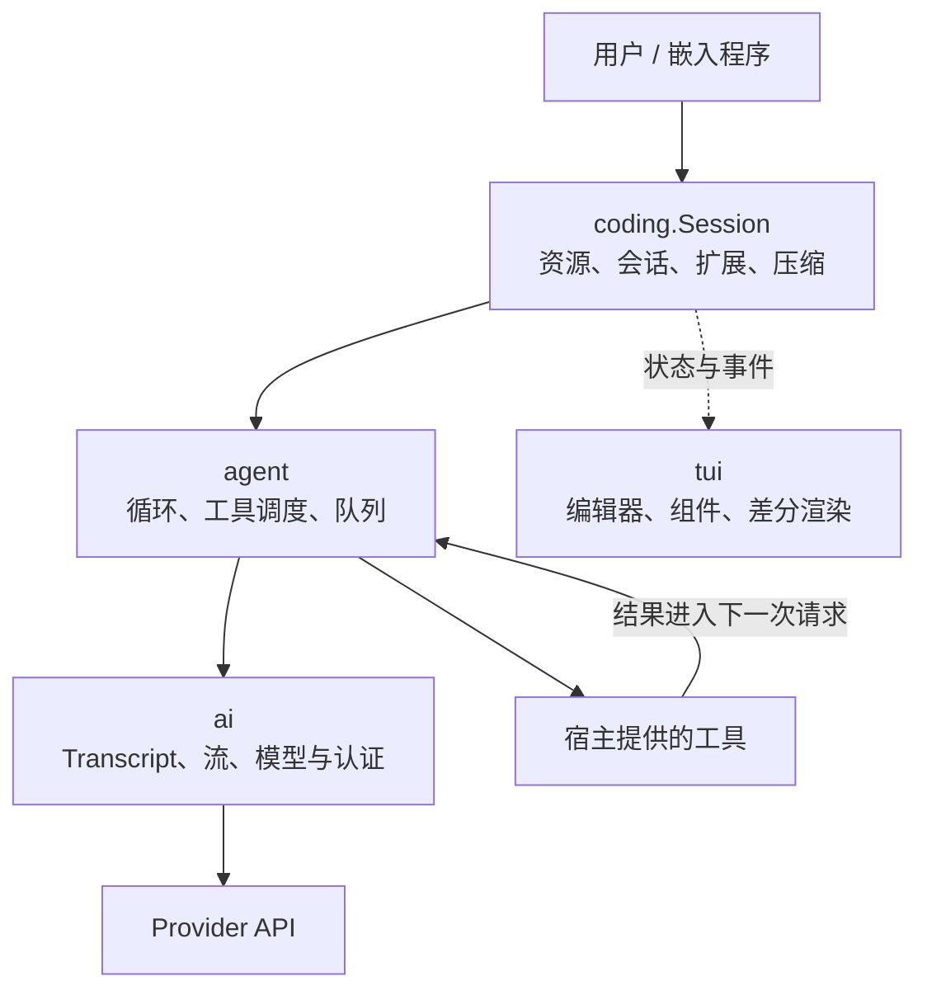

# 第1章：开篇——为什么 PiG 值得你花时间

[学习目录](learning.md) · [下一章：三层架构](learning-ch02-three-layer-arch.md)

结构对应 [参考教程第1章](https://dg-ai-notes.pages.dev/modules/ch01-overview/)。本章从工具、源码和 SDK 三个角度建立 PiG 的整体认识；版本与来源见 [总说明](learning.md)。

## 1. 开场：三个问题，一个答案

你可能想解决三类问题：让编码助手读写项目；弄清模型为什么会连续调用工具；把已有的模型通信、工具执行和会话管理嵌入自己的程序。PiG 同时提供命令行程序和可导入的 Go 包，因而可以沿同一条真实实现路径研究这些问题。

学习时先追踪一个具体任务：“读取一个文件，解释其中的函数”。模型决定要调用 `read`，宿主验证并执行，结果成为下一次请求的输入，最终回复被保存到会话。后续九章分别展开这条路径上的边界。

## 2. PiG 是什么：一张图看懂

### 2.1 一句话定义

PiG 是以 Pi 为行为参考的 Go 编码 Agent：它把模型请求、工具执行、会话状态和终端交互连接起来。模型不直接运行 Go 函数，它只生成工具调用描述，宿主决定如何执行。

### 2.2 关键数字

这套文档分 10 章，核心只涉及 4 个包：`ai`、`agent`、`coding`、`tui`。看懂这四个包各自负责什么、边界在哪，就足以跟完一次完整运行。

上游基线是 Pi `1.4.0+74f46864`；参考教程写的是 `0.80.2`，中间隔了多个版本，所以正文一律以本仓库的 Go 代码为准。

这里不列代码行数、模型数量或“对齐百分比”，因为这类数字很快过期。判断一句话是否可信，只看两样东西：实现它的函数，以及覆盖它的测试或差异记录。

### 2.3 四个核心包，各司其职

| Go 包 | 负责什么 | 暂不负责什么 |
|---|---|---|
| `ai` | 消息、模型、Provider、请求转换、流事件 | 编辑文件、会话树 |
| `agent` | 请求—工具—结果循环，队列，通用事件 | 项目配置和终端展示 |
| `coding` | Session、模型运行时、资源与扩展集成 | 具体 Provider 的线上报文细节 |
| `tui` | 终端组件、布局、输入和渲染 | 决定业务任务何时完成 |

图 1-1 展示职责组合。实线表示请求调用，虚线表示状态与事件交给界面；它不是宣称仓库的 import 图只有这些边。



读图时可以做一个替换实验：把 TUI 换成一个 HTTP 服务，模型与循环仍可复用；把文件工具换成工单查询，循环仍能工作；只有一次模型调用时，则连工具执行与 Session 都可以不用。层与层之间复用的是数据和行为契约，不是某个固定界面。

原参考教程的 Provider 数量、Stars、TUI 行数与基准排名属于 Pi 的特定时间点，本系列不把它们移植为 PiG 的成绩。需要统计当前代码时，可以在本地用 `go list` 检查包，用模型目录查看可选模型；能列出模型也不代表已经验证了认证和请求成功。

## 3. 视角一：作为编码 Agent——一个日常工具

### 3.1 PiG 是什么：可组合的宿主，而非固定工作流

这里有几个容易混的词，先用一句话各自说清楚：

| 词 | 一句话 |
|---|---|
| Stock PiG | 出厂状态：只有宿主机制，没有预设的产品体验 |
| Resource | 可以被加载的东西的统称：扩展、技能、提示模板、主题 |
| Package | 把一组 Resource 打包分发，方便安装与复用 |
| Piglet | 一份“装哪些 Resource、怎么组合”的清单 |

打个比方：Stock PiG 是出厂的车，Package 是零件盒，Piglet 是装配单。PiG Standard 是一份具体的装配单，需要你显式选择；Stock 不会自动照它装配。

所以看到某个界面的默认工具和外观时，先问一句：这是 Stock 自带的能力，还是某个 Piglet 选择后的结果？把两者混为一谈，就会把某个组合的习惯误当成全部 PiG 的固定行为。

### 3.2 五根定制杠杆：在相应边界改变行为

| 定制入口 | 使用时机 | 对应文档 |
|---|---|---|
| Extension | 注册工具、命令、事件处理与 UI 行为 | [扩展](zh-extensions.md) |
| Skill | 按需加载领域流程和资料 | [技能](zh-skills.md) |
| Prompt template | 将重复工作固化为可复用输入 | [提示模板](zh-prompt-templates.md) |
| Theme | 改变展示而不改变执行规则 | [主题](zh-themes.md) |
| Package | 分发上面几类资源 | [包](zh-packages.md) |

它们的生效时机不同：模板展开为输入，技能先提供目录式描述，扩展在宿主事件边界执行。Package 分发资源，Piglet 选择资源，两者也不是同义词。项目 `AGENTS.md` 是另一项持续上下文来源，不应拿它替换参考教程五项中的 Package。

举一个完整的“代码审查”组合：

```text
review-package/
  extensions/    工具或事件策略：限制允许的修改
  skills/        SKILL.md：审查步骤与风险清单
  prompts/       review.md：可重复输入的审查要求
  themes/        审查结果的显示配色

安装 Package → 发现资源 → Piglet 或配置选择 → Session 加载
```

下面是命令形状示例，`./review-package` 必须先是一个有效的本地包。先只验证，再决定是否安装；远程 npm/git 地址应换成你已审查的真实来源。

```bash
pig install ./review-package --validate-only --json
pig install ./review-package
```

扩展可以注册新工具，也可以在 `tool_call` 处阻止操作。技能提供“如何做”的知识，不会仅凭一份 Markdown 就拥有新的系统权限。模板只减少重复输入，不会自动形成强制执行的工作流。主题不应成为执行策略。Package 的作用是复用与分发，不是绕过这些各自的边界。

“让 Agent 修改扩展”也需要完整加载流程：修改文件后执行 `/reload`，宿主重新构建并替换注册。不要把参考教程的热重载描述理解成“每次保存文件都立即运行新代码”；Go 扩展编译、失败回报和旧实例清理都需要时间。

### 3.3 它带来的日常能力：读取、修改与连续工作

核心工具包括 `read`、`bash`、`edit`、`write`，其他工具受选择和配置影响。文件读取可以分页，输出有截断提示，工具失败可返回模型修正，Session 可以恢复与分支。实际能力还取决于所选模型、系统环境和激活的资源。

| 日常操作 | 在内部对应什么 | 使用时的边界 |
|---|---|---|
| 阅读、编辑、执行命令 | 模型提出 tool call，宿主执行 | 修改与 shell 命令是真实副作用 |
| 查看过程和结果 | 消息/工具事件、结构化历史 | 事件日志不等于完整 Provider 请求副本 |
| 会话中切模型 | 更换模型并转换历史重放元数据 | 跨模型思考签名不一定能原样复用 |
| 从旧消息分叉 | 移动 leaf，追加新分支 | 不会自动撤销之前的文件修改 |
| `/compact` | 结构化摘要与上下文投影 | 摘要有损，原始 Entry 仍保留 |
| 调整系统提示 | sections 或完整替换 | 要区分默认规则与显式替代 |

参考教程的基准排名不能证明 PiG 的实测成绩；同样，“能直接执行工具”不是一项安全保证。使用不可信仓库时，应以容器/虚拟机权限建立边界，审批扩展只能提供自己覆盖的策略。

### 3.4 上手一分钟

先按 [快速开始](zh-quickstart.md) 安装，在一个可以丢弃的项目里启动 `pig`。按 [Provider 配置](zh-providers.md) 完成认证，通过 `/model` 选择模型，再输入“只阅读 README，概括项目用途，先不要修改文件”。观察模型选择工具、工具结果和最终回答。

第二步再尝试 `/tree` 查看会话、`/compact` 压缩上下文。源码学习不要求安装所有扩展，也不要求用真实凭据运行仓库测试。

已安装 Node/npm 时可以使用下面的安装入口。它安装的是 PiG，不是参考教程中的 Pi 包；平台条件和其他安装方式见快速开始。

```bash
npm install -g @pi-in-go/pig
pig
```

建议先在 PowerShell 中建立临时学习环境，再启动 PiG。以下变量仅影响当前终端及它启动的子进程；配置隔离不限制工具访问其他磁盘目录。

```powershell
$root = Join-Path $env:TEMP ("pig-learning-" + [guid]::NewGuid())
New-Item -ItemType Directory -Path $root | Out-Null
$env:HOME = Join-Path $root 'home'
$env:PIG_HOME = Join-Path $root 'pig'
$env:PI_HOME = Join-Path $root 'pi'
$env:PIG_CODING_AGENT_DIR = Join-Path $env:PIG_HOME 'agent'
$env:PI_CODING_AGENT_DIR = Join-Path $env:PI_HOME 'agent'
New-Item -ItemType Directory -Force -Path $env:HOME, $env:PIG_CODING_AGENT_DIR, $env:PI_CODING_AGENT_DIR | Out-Null
Set-Location $root
pig
```

第一次使用执行 `/login` 或配置已支持的认证来源，再用 `/model` 选择模型。结束学习后关闭这个终端即可避免继续使用这组临时环境变量。

### 3.5 不只依赖环境变量：用 models.json 定义第三方模型

对于已支持的协议，在 `~/.pig/agent/models.json` 中声明 Provider 的 `baseUrl`、`api`、认证来源和模型列表即可接入兼容端点。设置了 `PIG_CODING_AGENT_DIR` 时，应使用对应的 Agent 目录。具体可复制配置见 [Models](zh-models.md)。

`provider` 是提供方标识，`api` 才是 `openai-completions`、`openai-responses` 等报文协议。缺少协议的自定义模型不会因为“看起来像 OpenAI”就自动可用。真实密钥不要写进学习仓库；可用变量插值或文档规定的认证机制。

下面是与仓库 Models 指南一致的本地 Ollama 示例。前提是本机已经启动 Ollama 并安装了对应模型；`apiKey` 是该本地服务忽略的占位值，不是远程服务可用的认证。

```json
{
  "providers": {
    "ollama": {
      "baseUrl": "http://localhost:11434/v1",
      "api": "openai-completions",
      "apiKey": "ollama",
      "models": [
        { "id": "qwen2.5-coder:7b", "name": "Local Qwen Coder" }
      ]
    }
  }
}
```

| 字段 | 控制什么 | 常见误解 |
|---|---|---|
| Provider 字典键 | 在 PiG 中识别提供方 | 不等于 API 协议 |
| `baseUrl` | 请求发往哪里 | 不能把任意服务当成兼容服务 |
| `api` | 请求与响应如何编码 | `openai-responses` 与聊天补全不是一回事 |
| `apiKey` | 请求认证或认证引用 | 真实密钥不应提交到 Git |
| `models[].id` | 线上接口接收的模型 ID | 不是可以任意改写的显示名 |
| `models[].name` | 面向人的名称 | 不替换线上模型 ID |
| `contextWindow`、`maxTokens` | 输入预算和输出限制 | 要与实际模型一致，而非越大越好 |

设置默认模型的 `settings.json` 示例：

```json
{
  "defaultProvider": "ollama",
  "defaultModel": "qwen2.5-coder:7b"
}
```

这里的 `defaultModel` 不含 Provider 前缀；CLI 或 SDK 显式选模型通常使用 `ollama/qwen2.5-coder:7b`。临时选择可以执行 `pig --model ollama/qwen2.5-coder:7b`，也可以在会话中使用 `/model`。修改已有目录模型的某些属性时用 `modelOverrides`；处理兼容接口的特殊字段时看 `compat`。两者都不应该用来掩盖一个根本不兼容的协议。

## 4. 视角二：作为学习素材——研究 Agent 的设计

### 4.1 为什么是 PiG：核心边界可以单独追踪

当前仓库已经不只是一个小循环，扩展宿主、会话、Provider 和测试占据了大量内容。适合学习的原因是核心职责有明确入口，而不是整个仓库“足够小”。先看 `agent/standalone_loop.go` 和 `agent/agent_loop.go`，遇到请求、工具和持久化边界时再向外展开。

### 4.2 本教程会讲什么

第2章定位分层，第3章跟踪循环，第4—7章分别拆解模型、工具、消息和事件，第8—10章解释上下文、压缩和会话树。每章的顺序和问题对应参考教程，函数名称与行为则采用当前 Go 实现。

### 4.3 PiG 的取舍：学习边界，而非只学功能列表

`ai` 不需要知道编辑器长什么样；普通工具错误可以成为模型输入；磁盘历史不必等于请求上下文；扩展处理函数的结果需要按事件契约解释。这些边界让你能替换一个实现而保留其他职责，也明确了错误应该在哪里处理。

原教程在这里讨论“没有内置的功能如何补齐”。当前版本不能继续说没有 MCP 或子会话，应该按现在的选择边界解释：

| 需求 | 当前 PiG 的落点 | 教学重点 |
|---|---|---|
| MCP 工具 | MCP 配置与扩展/工具加载 | 按需选择能力，而不是复制旧版“无 MCP”断言 |
| 子 Agent / 多 Agent | 子 Session API、显式扩展与编排包 | 生命周期、取消和资源由创建方拥有 |
| 计划和待办 | 文件、提示模板或选择的扩展 | 产品工作流不应硬塞给 Provider |
| 审批与权限 | 工具前置钩子和外部隔离 | 拦截策略与系统权限是两个层面 |
| 长任务、后台过程 | 具体工具、环境与进程生命周期 | 不能用无人管理的 goroutine 模拟所有后台能力 |
| 品牌与默认体验 | 显式 Piglet 组合 | Stock 不自动激活 Standard |

接下来的 SDK 示例让你看到：这些边界不只是架构图，也决定代码里要创建哪个对象、谁关闭资源和谁负责认证。

## 5. 视角三：作为 SDK——构建自己的 Agent

### 5.1 SDK 堆栈：三层架构加一个相对独立的 UI 库

只做一次模型调用可以用 `ai`；需要工具循环可以用 `agent`；需要 PiG 的资源发现、会话恢复和压缩，应从 `coding` 创建 Session。`tui` 是展示层能力，不要求每个嵌入程序都启动终端界面。

产品级典型顺序为 `CreateAgentSessionServices` → `NewRuntime` → `BuildModel` → `Runtime.New` → `Session.Send`。使用结束后释放订阅，并依次关闭 Session、Runtime 和调用方持有的 Services。检查 Go `error` 后，还应检查最终 assistant 的 `StopReason` 和 `ErrorMessage`。

下面给出完整的 SDK 程序。将它保存为仓库下临时示例目录的 `main.go` 后运行；先配置上一节的本地模型，或把显式模型标识换成已认证模型。程序没有打开 TUI，但运行的是 Session 路径。它展示生命周期，不是一次实测模型回答的记录。

```go
package main

import (
    "context"
    "fmt"
    "os"

    "github.com/MichaelKinsy/PiG/agent"
    "github.com/MichaelKinsy/PiG/ai"
    "github.com/MichaelKinsy/PiG/coding"
)

func run() error {
    services, err := coding.CreateAgentSessionServices(coding.CreateAgentSessionServicesOptions{
        CWD: ".", AgentDir: coding.DefaultAgentDir(),
    })
    if err != nil { return err }
    defer services.Close()
    runtime, err := coding.NewRuntime(coding.RuntimeOptions{Services: services})
    if err != nil { return err }
    defer runtime.Close()
    model, err := coding.BuildModel("ollama/qwen2.5-coder:7b", services)
    if err != nil { return err }
    session, err := runtime.New(coding.SessionStartOptions{
        Model: model, SystemPrompt: "Explain the request concisely.",
    })
    if err != nil { return err }
    defer session.Close()
    unsubscribe := session.Subscribe(func(event agent.AgentEvent) {
        if _, ok := event.(agent.TurnEndEvent); ok {
            fmt.Println("Turn ended")
        }
    })
    defer unsubscribe()
    messages, err := session.Send(context.Background(), "Explain what an agent loop does.")
    if err != nil { return err }
    for i := len(messages)-1; i >= 0; i-- {
        if m := messages[i].Assistant; m != nil {
            if m.StopReason == ai.StopReasonError || m.StopReason == ai.StopReasonAborted {
                return fmt.Errorf("assistant %s: %s", m.StopReason, m.ErrorMessage)
            }
            break
        }
    }
    if text := session.LastAssistantText(); text != nil { fmt.Println(*text) }
    return nil
}

func main() {
    if err := run(); err != nil { fmt.Fprintln(os.Stderr, err); os.Exit(1) }
}
```

为什么把清理放在 `run` 而不是在一串 `log.Fatal` 后面？`os.Exit` 不执行当前函数的 defer；先从 `run` 返回，才能可靠关闭已经创建的资源。第4章提供只用 `ai` 的完整调用，第3章提供不联网的独立循环，第2章比较三者的最小依赖。

### 5.2 扩展系统：让 Agent 获得额外能力

扩展注册工具与事件处理函数，宿主保留执行权。PiG 提供多语言桥接（D19）和运行时组合机制；语言不同不意味着各自可以返回不同的宿主状态。普通源码扩展走子进程机制，加载与资源选择决定哪些扩展生效。子进程并不构成文件或网络权限沙箱。

简单说：扩展是给 Agent 加能力的插件，但加什么、何时生效、出错谁负责，仍由宿主决定。所以“装了个扩展”不等于“这套 PiG 从此都带这个能力”，还要看它有没有被选中、有没有加载成功。

### 5.3 四种运行模式

| 模式 | 主要消费者 | 应关注的边界 |
|---|---|---|
| 交互式终端 | 人 | 编辑器、工具卡片和滚动历史 |
| Print | 脚本或一次性命令 | 最终输出、退出状态 |
| JSON | 需要结构化事件的调用方 | 事件顺序、终结事件 |
| RPC | 外部控制程序 | 命令、响应、取消、替换会话 |

模式不同不应各自发明一条模型执行路径；它们使用 Session 所拥有的模型运行时。Go SDK 是另一种嵌入入口，而不是必须额外启动的 CLI 模式。

### 5.4 应用案例：先从仓库内可追踪的例子开始

阅读 `examples/sdk/main.go` 学习创建和关闭会话，再看 [CLI 集成](zh-cli-integration.md) 与 [RPC](zh-rpc.md)，选择进程内 Go 调用还是进程外控制。某项目使用 Pi 并不能证明它使用 PiG，因此这里不沿用原教程的外部采用案例。

## 6. 两种设计方向：固定业务流程与可扩展宿主

同一个任务可以用两种方式实现。以“根据本周提交生成发布说明”为例：

```text
固定流程：
  取 git log → 按模板分类 → 调一次模型润色 → 写文件

可扩展 Agent：
  给模型 read / bash / write 三个工具和一段目标描述
  → 模型自己决定看哪些提交、要不要读 CHANGELOG、写到哪里
```

固定流程每次走同一条路径，容易审计和测试；遇到没预料到的仓库结构就会卡住。Agent 能临场调整；代价是路径不固定，必须靠工具范围、前置钩子和最终检查来兜底。

PiG 提供的是后者的机制，但两者不冲突：你完全可以在 Agent 外面套一层固定流程，只在其中某一步交给模型。用“更自由”取代可靠性设计，不是这套机制的用法。

## 7. 总结

理解 PiG 的第一步是区分模型决策、宿主执行和产品组合。接下来先定位类型与调用关系，再追踪一次真正的运行。

### 7.1 版本说明

本章描述 [学习总说明](learning.md) 中的固定提交。不要将参考教程的旧包名、TypeScript 扩展加载方式或事件数量直接映射为当前 PiG 的接口。

**源码阅读与练习**

- [coding/doc.go](https://github.com/MichaelKinsy/PiG/blob/c64bebd820e20411599a8b1e8e52aa92b4a2ed82/coding/doc.go)：定位公开 SDK 的职责。
- [examples/sdk/main.go](https://github.com/MichaelKinsy/PiG/blob/c64bebd820e20411599a8b1e8e52aa92b4a2ed82/examples/sdk/main.go)：沿创建、发送、关闭的顺序阅读。
- [docs/pig-architecture.md](https://github.com/MichaelKinsy/PiG/blob/c64bebd820e20411599a8b1e8e52aa92b4a2ed82/docs/pig-architecture.md)：区分 Stock 与 Piglet 组合。
- 练习：给“自定义 system prompt”“会话存盘”“显示流式文本”分别指定负责的层，解释为什么不应都放进 Provider。

[学习目录](learning.md) · [下一章：三层架构](learning-ch02-three-layer-arch.md)
