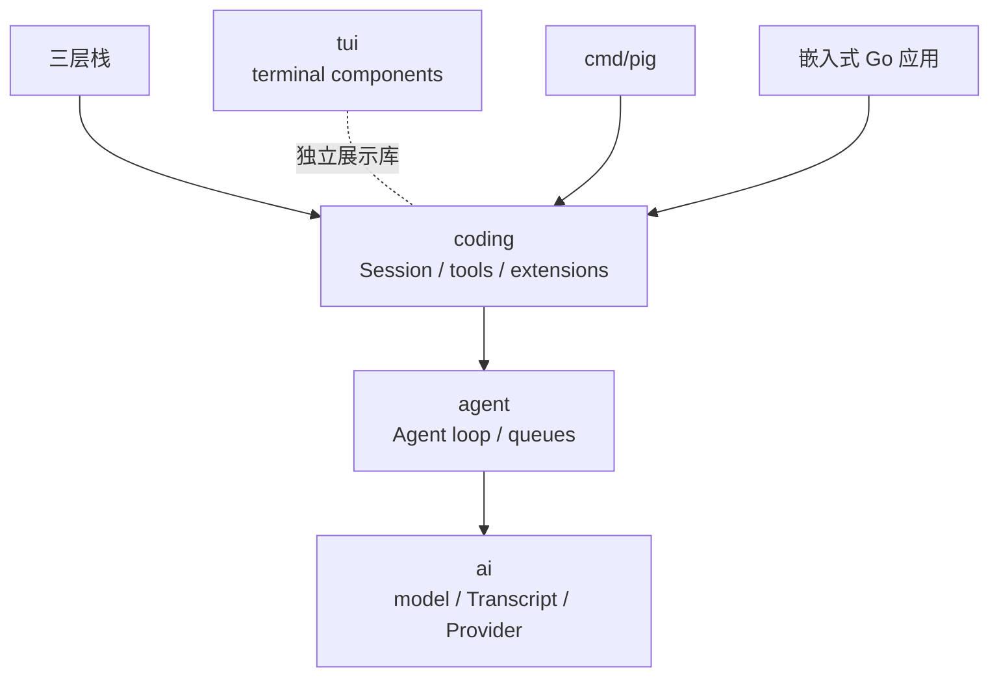
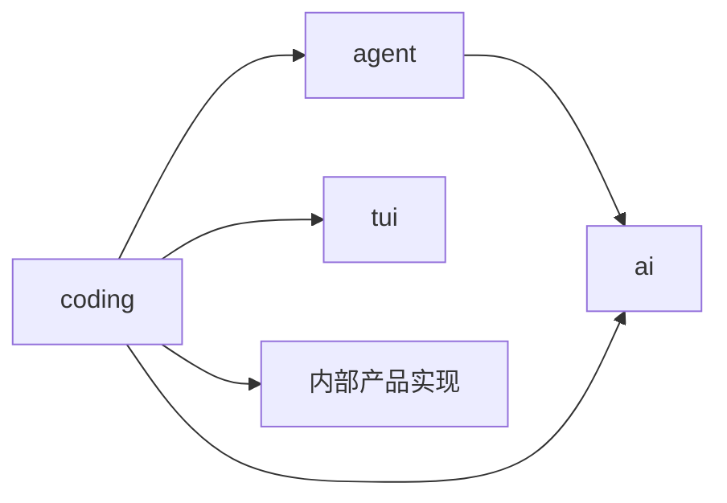
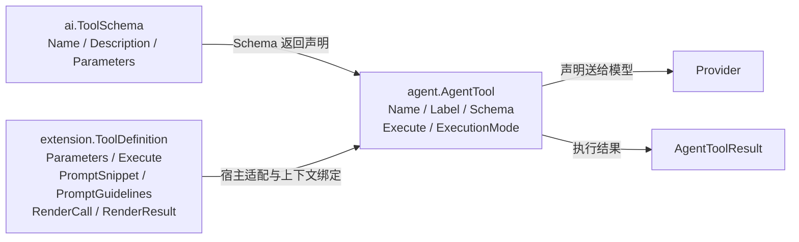

# 第2章：三层架构——PiG 项目的骨骼

[上一章](learning-ch01-overview.md) · [学习目录](learning.md) · [下一章](learning-ch03-agent-loop.md)

结构对应 [参考教程第2章](https://dg-ai-notes.pages.dev/modules/ch02-three-layer-arch/)。重点是职责和类型如何逐层增加，而不是把所有目录强行归入三个框。

## 1. 你打开了一个 Agent 代码库

假设你刚克隆仓库，在根目录敲下 `ls`，会看到 `ai/`、`agent/`、`coding/`、`tui/`、`internal/`、`cmd/`、`extensions/` 这些目录。第一反应通常是：为什么这样分？能不能合成一个包？

先回答四个问题，分工就清楚了：

1. 谁把输入变成模型能懂的请求？——`ai`。
2. 谁执行模型提出的工具调用，并决定要不要再来一轮？——`agent`。
3. 谁负责项目资源、会话文件、压缩和运行模式？——`coding`。
4. 谁把过程画到终端上？——`tui`。

还有一个容易踩的坑：`coding` 的公开 API 和大量实现并不在同一个目录。工具实现、提示词、会话投影在 `internal/codingagent/`，磁盘记录类型在 `internal/sessionentry/`。所以“公开包名”和“代码实际在哪”是两件事，读源码时不要只在一个目录里找。

推荐的阅读顺序是 `go.mod` → `ai/messages.go` → `agent/agent.go` → `agent/standalone_loop.go` → `coding/session.go`，最后再按具体场景进入终端或扩展宿主。

## 2. 五个位置，各管各的

### 2.1 ai：管“调模型”

`ai` 定义模型元数据、消息、工具 Schema、流选项和事件流。Provider 接收规范化的 `TranscriptContext`，把内容转换为自己的 API 格式，再把响应转换回统一消息和事件。这里关心的是协议和生命周期，不是“编辑 README”这个业务目的。

### 2.2 agent：管“跑循环”

`agent` 使用 `AgentTool` 和模型流函数完成“模型响应 → 执行工具 → 追加结果 → 再次请求”。它还负责 steering、follow-up 队列以及 turn 边界。它可以在没有项目配置文件、会话 JSONL 或终端界面的条件下运行。

### 2.3 coding：管“具体业务”

`coding.Session` 把循环接到项目资源、扩展、认证、持久化、压缩和运行模式。`internal/codingagent/` 提供工具、提示词、会话存储与投影等实现。公开 API 的使用方通常从 `coding` 进入，而不是导入 Go `internal` 包。

`cmd/pig/main.go` 的入口把 `os.Args[1:]` 交给 `coding/cli.Main`。沿用户输入追踪启动职责时，可以先看这个简化路径，再进入所选运行模式：

```text
pig "解释 main.go"
  → cmd/pig/main.go：交给 coding/cli.Main
  → CLI：解析参数、解析配置与资源、选择运行模式
  → coding：创建 Services、Runtime、Session
  → Session.Send：准备当前历史、提示词与运行状态
  → agent：运行请求—工具循环
  → ai：转换并发送模型请求
```

这是职责路径，不是六个函数的逐行调用栈。交互式模式还要创建终端组件；print/JSON/RPC 则连接不同的输入输出适配器。它们仍使用 Session 的模型运行时，不能在某个模式里另写一条绕过 Session 的请求路径。

### 2.4 tui：管“显示”

`tui` 负责终端组件、输入、布局和渲染。模型流中的一个文本增量可以驱动界面更新，但界面不应反过来决定 Provider 报文如何编码。独立并不意味着依赖图绝对没有交叉：例如某些渲染数据或工具结果细节可能被上层共同使用。

### 2.5 核心之外：编排与实验能力

原教程在这里介绍实验性 `pi-orchestrator`。当前 PiG 不提供一个可以直接照抄该名字的 Go 核心包。仓库还包含 `chord`、`durable`、`env`、`codemode`、`mcp`、`telemetry`，以及 `internal/experimental/` 下的实验实现。

这些目录扩展协作、执行环境或集成能力，但不改变本教程的主路径。初读时把它们当作边界之外的调用者或能力提供者；不要据旧教程推断它们已默认启用，或把实验入口当作稳定公开 API。

用一棵仓库目录树做实际导航：

```text
PiG/
├── ai/                         模型类型、Transcript、Provider
├── agent/                      Agent 状态、循环、工具接口
├── coding/                     公开 Session / Runtime API
│   └── extension/              扩展定义与宿主
├── tui/                        终端组件与渲染
├── internal/codingagent/       产品工具、提示词、会话投影
├── internal/sessionentry/      磁盘 Entry 联合
├── extensions/sdk/             独立 Go 模块：扩展作者 API
├── cmd/pig/                    CLI 入口
└── examples/sdk/               SDK 程序示例
```

`internal` 是 Go 导入限制：仓库外的调用者不能导入该目录的包。它是封装边界，不表示那里的代码不重要。学习者可以阅读和引用源文件理解实现，但产品代码应从公开 `coding` API 进入。

## 3. 看完这些位置，你大概有了直觉



一句话概括这张图：**底层不知道上层存在**。`ai` 不知道有 Session，`agent` 不知道有终端界面；反过来，上层可以自由组合下层。

`TUI` 与 Agent 栈并列，表示它不是模型循环的必要组成。把界面换成一个 HTTP 服务，循环照样能跑；把文件工具换成数据库查询，循环也照样能跑。能替换，是因为层与层之间传的是数据和接口，不是具体实现。

但不要把这句话读成“依赖图绝对干净”。`coding` 会直接 import `ai`，某些产品数据也会被多处共用。下一节解释这为什么不叫破坏分层。

## 4. 打开 go.mod，事情没那么简单

### 4.1 答案藏在类型系统里

先给出结论：分层的规则不是“只能调用相邻层”，而是“依赖方向必须单向”。TypeScript 教程用 `package.json` 看包依赖；Go 中先看 `go.mod`、`go.work` 和实际 import。一个 Go 模块可以包含很多包，多语言扩展 SDK 还可以有自己的模块。根模块存在并不意味着所有 API 是同一个抽象层。

更可靠的问题是：某个函数参数需要什么？如果它只需要 `ai.Message`，就不应要求整个 Session；如果它需要可执行工具，就应接收行为契约，而不是只接收 JSON Schema。

例如一个产品层函数既使用 `agent.AgentMessage` 又使用 `ai.Model` 是合理的。它没有必要要求 agent 再包装一次 Model 才能访问模型元数据。下面是自写的类型使用片段，不是原文件的逐字摘录：

```go
func describe(model *ai.Model, message agent.AgentMessage) string {
    return model.ID + ":" + message.Role()
}
```

这段使用需要导入 `ai` 与 `agent`。两个 import 都向共同的基础类型靠近，没有让 `ai` 反向读取 Session。Go 不允许包循环引用，但“不循环”只解决语法约束；把大量产品知识放进底层仍然会使职责难以复用。



图中的 `coding → ai` 是本节的关键跨层边。它表示直接使用公共基础类型，不是绕过 Session 生命周期直接发起另一条模型运行路径。

打个比方：财务报销要查财务系统的汇率表，直接调用汇率服务很正常；反过来，汇率服务去读你的工位排班表，才是越界。`coding` 直接 import `ai` 属于前者——它需要 `ai.Model`、`ai.Message` 这类公共类型。真正要避免的是 `ai` 反过来 import `coding`：那会形成循环，也让它无法单独测试。

### 4.2 分层的规则到底是什么

底层提供上层需要的数据和操作，上层组合底层能力。反向通知通过事件和回调完成，而不是把 Session 指针传到所有 Provider 内部。

判断一段代码该放哪一层，可以问三个问题：

- 它需要知道用户的项目、会话文件或界面吗？需要，就不该放 `ai`。
- 它需要执行工具或决定轮次吗？需要，就属于 `agent` 或更上层。
- 换掉另一个方向后，这一层还能单独测试吗？不能，说明依赖放反了。

这是一条职责原则，不是宣称当前仓库是严格无交叉的三层架构。看具体代码时仍要检查实际依赖。

## 5. 类型在层间的流转：从声明到可执行能力

### 5.1 第一层：ai 定义模型协议中的数据

`ai.ToolSchema` 描述工具名称、说明和参数约束。它回答“模型可以怎样请求调用”，不包含调用方项目的执行上下文。`ai.Message` 则描述模型通信中的系统、用户、assistant 和工具结果消息。

### 5.2 第二层：agent 添加执行契约

`agent.AgentTool` 是真正的 Go 行为接口，提供 `Name`、`Label`、`Schema`、`Execute` 和 `ExecutionMode`。`Execute` 接收 `context.Context`、调用 ID、JSON 参数和进度回调，返回 `AgentToolResult` 与 `error`。

因此，同一个 Schema 可以由本地文件工具、远程调用工具或测试假实现提供。循环只需要它满足执行契约。

### 5.3 第三层：coding 添加产品层信息

`extension.ToolDefinition` 是注册工具的数据结构，除了参数和执行函数，还可以含 `PromptSnippet`、`PromptGuidelines`、`RenderCall`、`RenderResult`、曝光方式等字段。产品层需要知道如何向模型介绍它、如何展示它以及何时激活它。

### 5.4 类型扩展的 Before → After 对照

| 层 | 输入给下一层的能力 | 额外职责 |
|---|---|---|
| `ai.ToolSchema` | 可被模型声明和校验的工具 | 协议表示 |
| `agent.AgentTool` | 可以执行并报告结果的工具 | 执行、取消、进度、调度模式 |
| `extension.ToolDefinition` | 可以注册到产品宿主的工具定义 | 提示、渲染、曝光、扩展上下文 |

这是职责递进，不是 Go 结构体继承链。工具定义会通过 `coding/extension_bridge.go` 等适配逻辑进入循环；模型不接收 `Execute` 函数或渲染回调。

图 2-1：同一个工具的三种视图。字段名是当前 PiG 名称，省略非本节字段。



一个可直接使用的声明值如下。注意 `Parameters` 是 JSON Schema 的 Go 表示，而不是 Go 函数形参声明：

```go
schema := ai.ToolSchema{
    Name: "lookup_issue",
    Description: "Look up one issue by its identifier.",
    Parameters: map[string]any{
        "type": "object",
        "properties": map[string]any{
            "id": map[string]any{"type": "string"},
        },
        "required": []string{"id"},
    },
}
```

循环需要的执行契约由 [源码中的 `AgentTool`](https://github.com/MichaelKinsy/PiG/blob/c64bebd820e20411599a8b1e8e52aa92b4a2ed82/agent/agent.go) 明确规定：

```go
type AgentTool interface {
    Name() string
    Label() string
    Schema() ai.ToolSchema
    Execute(ctx context.Context, toolCallID string, params json.RawMessage,
        onUpdate ToolUpdateCallback) (AgentToolResult, error)
    ExecutionMode() ToolExecutionMode
}
```

第三层的定义则是值与回调集合。下面是教学构造片段，不是重新定义完整 API：

```go
definition := extension.ToolDefinition{
    Name: "lookup_issue", Label: "Issue lookup",
    Description: "Read one issue from the configured tracker.",
    Parameters: json.RawMessage(`{"type":"object","properties":{"id":{"type":"string"}},"required":["id"]}`),
    PromptSnippet: "Read an issue before proposing a fix.",
    PromptGuidelines: []string{"Preserve the exact issue identifier."},
}
```

这个片段还没有 Execute，不能作为可运行工具注册。它的用途是展示增量字段；第5章补齐实际执行。Go 编译器只检查 Go 值的类型，仍须由宿主校验工具声明与模型参数。

## 6. 那我写 Agent 真的需要三层吗

### 6.1 场景 A：不分层，所有代码放一个文件

一次性验证可以把输入、模型调用和输出放在一个文件。例如下面的反例把具体 HTTP 协议与业务循环放在一起，暂时省事，后续换协议时就要改循环本身：

```text
while 任务继续:
    构造 OpenAI Chat Completions messages
    POST /chat/completions
    解析 choices[0].message.tool_calls
    执行业务工具
    按 OpenAI 的 role=tool 规则追加结果
```

换成 Anthropic 后，URL、tool_use/tool_result、停止原因和流解析都不同。真正需要分离的是“请求与响应的协议转换”，不是必须创建三个目录。同一个错误若同时涉及工具、重试、存储与界面，再逐步分开这些职责。

### 6.2 场景 B：只分两层，去掉 coding 层

下面的完整辅助函数只依赖 ai 与 agent。调用方提供模型、工具和选项，结果是本次新增消息；不创建 Session 文件，不加载项目扩展：

```go
package demo

import (
    "context"
    "github.com/MichaelKinsy/PiG/agent"
    "github.com/MichaelKinsy/PiG/ai"
)

func RunWithTools(ctx context.Context, model *ai.Model, options ai.StreamOptions,
    tools []agent.AgentTool, prompt string) ([]agent.AgentMessage, error) {
    input := agent.AgentMessage{User: &agent.UserMessage{
        Role: agent.RoleUser, Content: ai.UserText(prompt),
    }}
    return agent.RunAgentLoop(ctx, []agent.AgentMessage{input}, agent.AgentContext{Tools: tools},
        agent.AgentLoopConfig{Model: model, StreamOptions: options},
        func(agent.AgentEvent) error { return nil }, agent.StreamFn(ai.StreamSimple))
}
```

这适合自定义服务或测试宿主，但资源发现、会话树、压缩、扩展生命周期将成为调用方的责任。函数返回 error 为 nil 也不等于 assistant 一定成功，仍需读取最终 StopReason。第3章给出不联网、带断言的双轮实验。

### 6.3 场景 C：只用一层，只用 ai

文档摘要、固定分类或单次问答可以直接使用模型调用 API。下面只处理一次请求的事件与结果；不存在执行工具的循环：

```go
stream, err := ai.StreamSimple(ctx, model, transcript, options)
if err != nil { return err }
for event := range stream.Events(ctx) {
    if delta, ok := event.(ai.TextDeltaEvent); ok { fmt.Print(delta.Delta) }
}
message, err := stream.ResultContext(ctx)
if err != nil { return err }
if message.StopReason == ai.StopReasonError || message.StopReason == ai.StopReasonAborted {
    return fmt.Errorf("%s: %s", message.StopReason, message.ErrorMessage)
}
```

这段是函数内部片段，transcript 为 `ai.TranscriptContext`，不是 Go 的 `context.Context`。后者控制取消，前者保存模型输入。第4章有包含模型配置与 main 的完整程序。

### 6.4 三层不是教条，依赖方向控制才是

| 使用范围 | 获得什么 | 调用方还负责什么 |
|---|---|---|
| ai | 统一消息、Provider、事件流 | 任务控制、工具执行、产品历史 |
| ai + agent | 工具循环、队列与运行事件 | 工具实现、产品资源和存储策略 |
| coding Session | PiG 的运行时、资源和会话集成 | 应用入口、权限边界、输入输出和关闭 |

选择能覆盖需求的最小层。需要产品行为时用 Session；只有模型请求时用 ai；需要自己定义工具控制流时再用 agent。层数不能代替对错误、资源和状态所有权的明确约定。

## 7. 三个可以带走的方法

### 7.1 方法一：让下层接收更少的业务知识

给 Provider 一份规范化 Transcript，而不是整个应用对象。这样请求转换可以独立测试，认证和取消的归属也更清晰。

判断方法很直接：这个函数能不能只靠输入参数跑完，不需要启动终端、读取会话文件或登录模型？能，就说明边界切对了。

### 7.2 方法二：按职责递进类型

先定义交换数据，再定义需要执行的接口，最后补充产品元数据。TypeScript 的 `interface` 不必机械翻译成 Go interface；`ToolDefinition` 这样的数据与回调集合使用 struct 即可。

问自己一句：这一层真的需要“多个实现可互换”吗？需要才用接口，否则具体类型更清楚，也更容易看到数据。

### 7.3 方法三：检查是否真的可独立使用

看 `agent/standalone_loop_test.go` 如何提供假流函数、工具和事件接收器。如果每个循环测试都必须启动真实终端并登录 Provider，边界就难以验证。

独立测试是架构证据，但不能代替完整 Session 路径的集成验证：它能证明“循环本身可以换掉依赖”，不能证明“产品模式的接线正确”。两种测试都要有。

## 8. 下一步：进入 Agent 的循环

下一章从 `RunAgentLoop` 追踪一次多轮工具调用，重点区分“有一次模型回复”和“任务已经结束”。

**源码阅读与练习**

- [ai/messages.go](https://github.com/MichaelKinsy/PiG/blob/c64bebd820e20411599a8b1e8e52aa92b4a2ed82/ai/messages.go)：模型消息边界。
- [agent/agent.go](https://github.com/MichaelKinsy/PiG/blob/c64bebd820e20411599a8b1e8e52aa92b4a2ed82/agent/agent.go)：`AgentTool`、`AgentMessage`、事件与选项。
- [coding/extension/tool.go](https://github.com/MichaelKinsy/PiG/blob/c64bebd820e20411599a8b1e8e52aa92b4a2ed82/coding/extension/tool.go)：产品级工具定义。
- [agent/standalone_loop_test.go](https://github.com/MichaelKinsy/PiG/blob/c64bebd820e20411599a8b1e8e52aa92b4a2ed82/agent/standalone_loop_test.go)：独立循环的依赖替换与失败传播。
- 练习：给一个“查询工单”工具分别列出 Schema、执行函数和 UI 元数据，指出哪些数据会发送给模型。

[上一章](learning-ch01-overview.md) · [学习目录](learning.md) · [下一章](learning-ch03-agent-loop.md)
