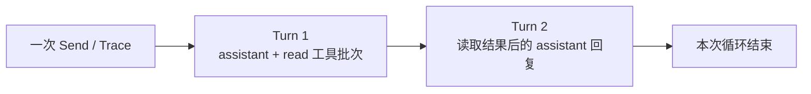
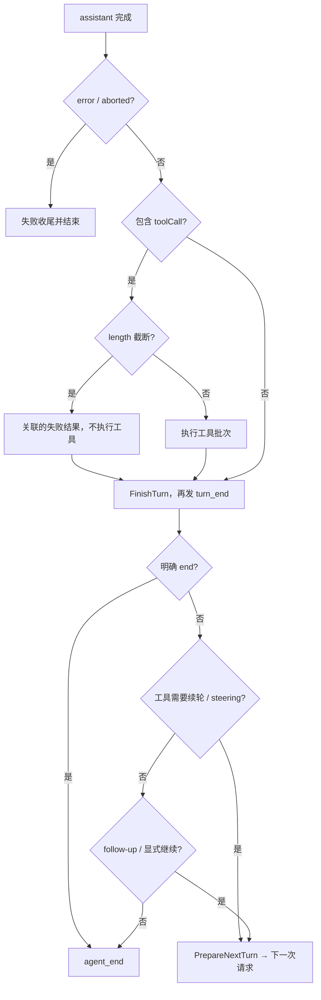
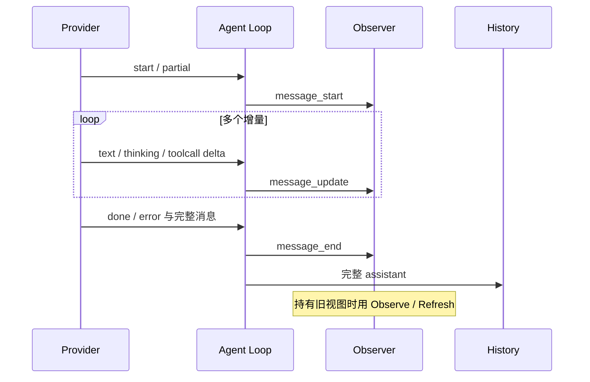
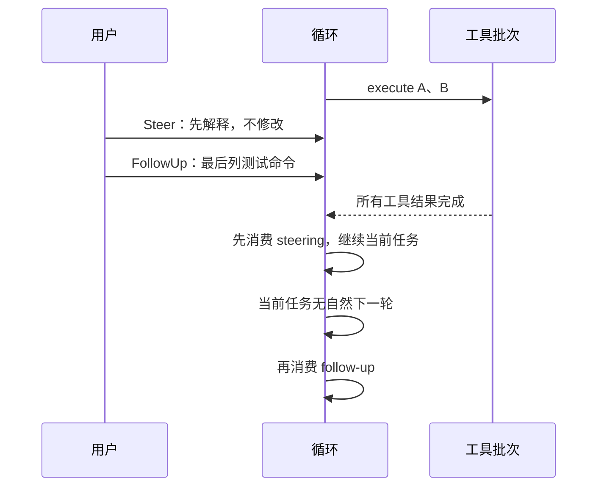
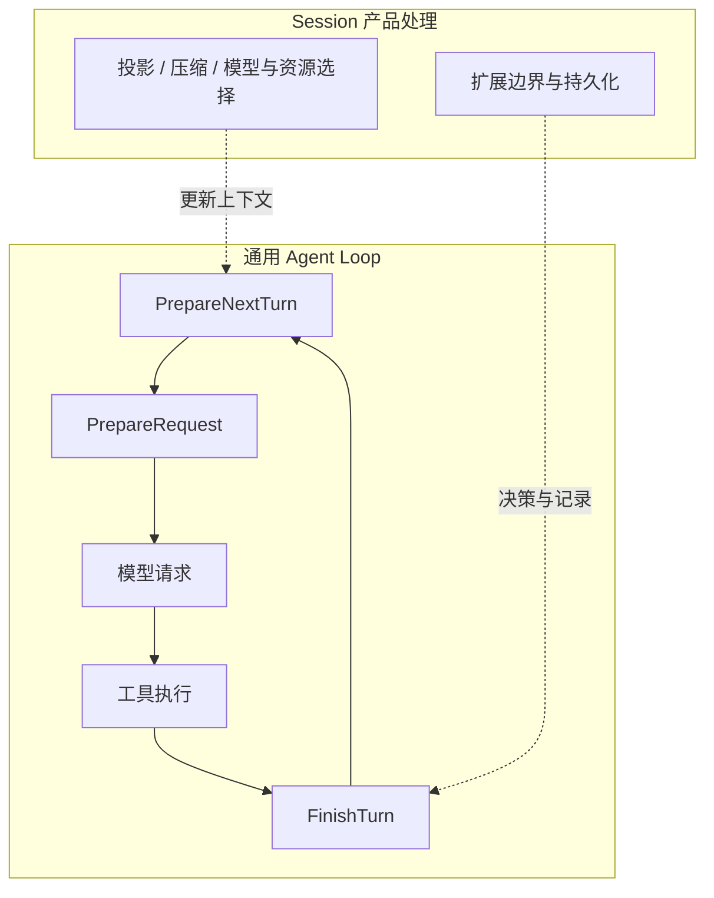

# 第3章：Agent Loop——让模型转动起来的引擎

[上一章](learning-ch02-three-layer-arch.md) · [学习目录](learning.md) · [下一章](learning-ch04-model-call.md)

结构对应 [参考教程第3章](https://dg-ai-notes.pages.dev/modules/ch03-agent-loop/)。本章区分最小循环、当前通用循环和 Session 的产品级处理，避免把旧版本的简图当作全部执行规则。

## 1. 引子：大模型的三种用法

### 1.1 模式一：直接调用

程序发送消息并取得回复，例如一次摘要。模型可以输出文字，但应用没有自动执行其中的工具调用，也没有把执行结果再次交回模型。

调用形式可以很短。以下函数是一个完整 Go 文件中的可编译辅助函数，模型与认证由调用方传入；它不执行模型提出的工具。

```go
package demo

import (
    "context"
    "fmt"
    "github.com/MichaelKinsy/PiG/ai"
)

func Ask(ctx context.Context, model *ai.Model, options ai.StreamOptions, text string) (*ai.AssistantMessage, error) {
    stream, err := ai.StreamSimple(ctx, model, ai.NormalizeContext(ai.Context{
        Messages: []ai.Message{ai.UserMessage{Content: ai.UserText(text)}},
    }), options)
    if err != nil { return nil, err }
    result, err := stream.ResultContext(ctx)
    if err != nil { return nil, err }
    if result.StopReason == ai.StopReasonError || result.StopReason == ai.StopReasonAborted {
        return result, fmt.Errorf("%s: %s", result.StopReason, result.ErrorMessage)
    }
    return result, nil
}
```

`ResultContext` 等待最终结果，事件不需要先被全部读取；它取消等待不等于替调用方接管整个 Provider 的资源生命期，实际请求仍受传给 Stream 的 ctx 约束。

### 1.2 模式二：Workflow

程序规定步骤，例如先分类、再检索、最后生成报告。模型承担其中某一步，下一步由宿主的固定业务规则决定。

### 1.3 模式三：Agent Loop

模型在可用工具集合中提出调用，宿主执行并返回结果，模型继续决定下一步。控制流不是“完全交给模型”：参数校验、允许的工具、取消、队列和轮次结束钩子仍由宿主管理。

## 2. 先搞清楚几个概念：Trace、Turn

### 2.1 Trace：一次完整运行

本教程把一次提示触发、经过若干模型请求和工具执行的过程称为 Trace。这是阅读用语，不要求源码存在一个同名结构。Session 可以在一次底层循环结束后进行重试或其他产品处理，因此 Session 完全稳定不能只靠一次 `agent_end` 判断。

### 2.2 Turn：一个轮次

一个 Turn 包含一次 assistant 响应，以及该响应触发的工具批次和轮次收尾。一次 assistant 消息可以同时带文本、thinking 和多个工具调用；不是每个工具单独算一轮。

### 2.3 Trace 与 Turn 的关系

例如用户要求解释文件：第一个 Turn 请求 `read` 并得到结果，第二个 Turn 输出解释。一条用户消息触发了两次模型请求。用户在执行期间排队的消息也可能让同一次运行继续。



这里的 Turn 不等于单个 HTTP chunk，也不等于一次工具执行。provider 会在同一 assistant 消息里流式送多个 event；所有这些 event 仍可能只组成一个 Turn。

## 3. 全景：一条消息的旅程，以及循环怎么转

### 3.1 流程全景

先用一个具体场景走一遍。你在项目里输入“帮我看看 main.go 里的 server 函数做了什么”，然后按下回车：

```text
① 输入变成一条 user 消息
② 循环开始（agent_start），准备第一次请求
③ 请求携带系统提示、工具声明和这条 user 消息
④ 模型调用 read(path="main.go")，并附一句“我先读文件”
⑤ 宿主校验参数、执行工具，把文件内容变成 toolResult
⑥ 带上 toolResult 再请求一次，模型这次输出解释
⑦ 没有新工具调用，也没有排队消息 → 循环结束（agent_end）
```

两次模型请求、两个 Turn、一次工具批次。把上面七步压缩成结构，就是下面的流程。它省略了失败传播和 Session 集成，重点看“结果怎么回到模型”和“什么时候停”。

```text
提示消息 / 待处理输入
  → 追加上下文与系统工具状态
  → 准备请求
  → 流式 assistant 响应
  → 判断错误、截断和工具调用
  → 工具准备、执行、结果追加
  → FinishTurn → turn_end
  → steering / follow-up / 显式继续
  → 下一轮或结束
```

参考教程用 `stopReason` 讲这条路径；本章沿用这个切入点，但会先说明为什么不能只看这一个字段。

### 3.2 循环怎么转：stopReason 是输入之一

先破除一个直觉：模型并不知道自己“做完了”。它只是一个接一个预测 token 的模型。所谓“结束”，是写宿主代码的人定的规矩：这一轮回复里没有工具调用，就当作这次任务告一段落。

所以循环真正看的是两样东西的组合：回复内容里有没有待执行的工具调用，以及宿主自己的状态（队列里有没有新消息、轮次钩子要不要继续）。`stopReason` 是这两样之外的输入，用来区分正常结束、输出被截断、请求失败和中止。

具体对应到当前实现：`error` 和 `aborted` 是硬退出；`length` 表示输出截断；工具调用则要从 assistant 的内容块里收集。因此实现并非只判断 `stopReason == toolUse`。此外，`FinishTurn` 可以要求结束或继续，队列也可能产生下一次请求。

### 3.3 一条基本规则：工具结果通常需要后续回答

有正常工具调用，就执行并把结果加入上下文，供下一轮模型读取。若整个非空工具批次的每个结果都标记 `Terminate`，或者 `FinishTurn` 明确结束，运行可以合法停在工具结果上。只有其中一个工具要求终止，不足以终止一个混合批次。

简单说：工具结果不是终点，而是下一轮对话的材料。除非所有工具都说“到此为止”，否则模型应该有机会看到结果并继续。

### 3.4 循环的退出路径

| 条件 | 当前行为 |
|---|---|
| 没有工具、steering、follow-up 或显式继续 | 正常结束 |
| assistant 为 `error` 或 `aborted` | 完成失败轮次的收尾后硬退出 |
| 调用方取消 | 取消传播并记录 aborted；`RunAgentLoop` 对已记录的取消可返回消息和 nil，调用方还须检查 assistant 状态 |
| `FinishTurn` 选择 end | 不再轮询后续队列和准备下一轮 |
| 全部工具结果要求终止 | 工具批次可结束运行；仍需结合轮次决策与队列理解 |
| 请求准备、事件接收器等失败 | 按调用入口的错误契约返回或进入失败生命周期 |

`RunAgentLoop` 的流式封装与直接返回入口要分开分析。已经被记录为 aborted 的取消在 `RunAgentLoop` 中可由 `standaloneRunError` 归一为 nil；`Agent.Send` 对调用方 context 取消仍有自己的错误返回规则。需要显式处理运行错误时使用直接返回入口，同时检查最终 assistant，不能只看流结束。



两个容易误判的测试输入：

```json
{"stopReason":"stop","content":[{"type":"toolCall","id":"t1","name":"read","arguments":{"path":"README.md"}}]}
{"stopReason":"length","content":[{"type":"toolCall","id":"t2","name":"edit","arguments":{"path":"README.md"}}]}
```

这是省略其他字段的响应片段。第一条仍有待处理的工具调用，不能只因 stop 就忽略；第二条即使已经有一个看似可读的 toolCall，也不能执行截断参数。真正控制流要把停止状态和内容一起看。

## 4. 源码详解：基础 Loop 与 coding 的叠加设计

### 最简 Loop：所有 Agent 的共同部分

最小概念模型是“请求模型；若有工具则执行、追加结果并继续，否则结束”。先写成算法，明确模型只生成调用描述，真正执行在宿主：

```text
messages = 历史 + 用户输入
repeat:
    assistant = 请求模型(messages, tools)
    messages.append(assistant)
    calls = assistant 中完整的 toolCall 内容块
    if calls 为空: return messages
    for call in calls:
        result = 宿主查找并执行工具(call)
        messages.append(与 call.id 关联的 result)
```

这段教学算法不是可用于生产的循环：它没有保护失败或 length 截断，也没有校验、取消、队列与持久化。下面将这些规则补齐；完整离线程序则直接复用真实循环，而不复制一个缩水实现。

### PiG 的 coding 层在此基础上叠加了什么

Session 提供资源和扩展、历史投影、模型选择、自动压缩与重试，并把消息写入会话。通用循环通过 `PrepareRequest`、`PrepareNextTurn`、`FinishTurn` 等钩子与其连接，而不是直接依赖会话文件或 UI。

### 4.1 入口：RunAgentLoop 收到了什么

`agent/standalone_loop.go` 的 `RunAgentLoop` 接收 `context.Context`、本次 prompts、`AgentContext`、`AgentLoopConfig`、`AgentEventSink` 和流函数。`AgentContext` 带历史消息和可执行工具；系统提示与工具声明会以系统状态进入 Transcript，不能照旧示例假定这里总有独立的 `systemPrompt` 参数。

`AgentLoopConfig` 包含模型、流选项、转换函数、队列读取器与轮次钩子。`AgentEventSink` 是返回 `error` 的同步回调，每次投递都等待它完成；失败可以使直接调用返回错误。

这是调用入口的最小 Go 示例。它省略 tools，只说明一次用户输入如何经过通用 Agent Loop；模型对象必须由调用者从自己的服务配置中获得，StreamSimple 的认证选项也需由调用者提供。

```go
package demo

import (
    "context"
    "fmt"
    "time"

    "github.com/MichaelKinsy/PiG/agent"
    "github.com/MichaelKinsy/PiG/ai"
)

func Run(ctx context.Context, model *ai.Model, options ai.StreamOptions) error {
    prompt := agent.AgentMessage{User: &agent.UserMessage{
        Role: agent.RoleUser, Content: ai.UserText("Explain the main package."),
        Timestamp: time.Now().UnixMilli(),
    }}
    sink := func(event agent.AgentEvent) error {
        fmt.Printf("%T\n", event)
        return nil
    }
    _, err := agent.RunAgentLoop(ctx, []agent.AgentMessage{prompt}, agent.AgentContext{},
        agent.AgentLoopConfig{Model: model, StreamOptions: options}, sink,
        agent.StreamFn(ai.StreamSimple))
    return err
}
```

若传入带 tools 的 `AgentContext`，相同循环会查找、验证和执行工具。此示例没有构造认证，也不会绕过 Session 产品层自动压缩、持久化或扩展加载。

**离线实验：两次模型响应、一次真实 Go 工具执行。** 下面的完整程序用受控流函数代替网络模型，第一次请求返回 echo 调用，第二次读取实际 toolResult 再回复。只有模型响应是预设的；参数验证、工具调度、结果追加和轮次处理仍由真实 `RunAgentLoop` 完成。

```go
package main

import (
    "context"
    "encoding/json"
    "fmt"
    "github.com/MichaelKinsy/PiG/agent"
    "github.com/MichaelKinsy/PiG/ai"
)

type Echo struct { calls *int }
func (Echo) Name() string { return "echo" }
func (Echo) Label() string { return "Echo" }
func (Echo) ExecutionMode() agent.ToolExecutionMode { return agent.ToolModeParallel }
func (Echo) Schema() ai.ToolSchema {
    return ai.ToolSchema{Name: "echo", Description: "Repeat the text.", Parameters: map[string]any{
        "type": "object", "properties": map[string]any{"text": map[string]any{"type":"string"}},
        "required": []string{"text"},
    }}
}
func (e Echo) Execute(ctx context.Context, id string, raw json.RawMessage, update agent.ToolUpdateCallback) (agent.AgentToolResult, error) {
    if err := ctx.Err(); err != nil { return agent.AgentToolResult{}, err }
    var args struct { Text string `json:"text"` }
    if err := json.Unmarshal(raw, &args); err != nil { return agent.AgentToolResult{}, err }
    (*e.calls)++
    return agent.AgentToolResult{Content: []ai.ToolResultMessageContent{ai.TextContent{Text: args.Text}}}, nil
}

func main() {
    requests, executions := 0, 0
    model := &ai.Model{ID: "fixture", ProviderMeta: ai.ProviderMetadata{
        ProviderID: "learning", API: ai.APIOpenAICompletions,
    }}
    streamFn := func(ctx context.Context, m *ai.Model, transcript ai.TranscriptContext, _ ai.StreamOptions) (*ai.AssistantMessageEventStream, error) {
        requests++
        reply := &ai.AssistantMessage{API:m.ProviderMeta.API, Provider:m.ProviderMeta.ProviderID, Model:m.ID}
        if requests == 1 {
            reply.StopReason = ai.StopReasonToolUse
            reply.Content = []ai.AssistantContentBlock{
                ai.ToolCall{ID:"echo-1", Name:"echo", Arguments:ai.JsonObject{"text":"hello"}},
            }
        } else {
            last, ok := transcript.At(transcript.Len()-1).(ai.ToolResultMessage)
            if !ok || last.ToolCallID != "echo-1" || last.IsError {
                return nil, fmt.Errorf("expected the successful echo result")
            }
            text, ok := last.Content[0].(ai.TextContent)
            if !ok || text.Text != "hello" { return nil, fmt.Errorf("unexpected echo text") }
            reply.StopReason = ai.StopReasonStop
            reply.Content = []ai.AssistantContentBlock{ai.TextContent{Text:"Echo returned hello."}}
        }
        stream := ai.NewAssistantMessageEventStream()
        if err := stream.Push(ai.DoneEvent{Reason:reply.StopReason, Message:reply}); err != nil { return nil, err }
        return stream, nil
    }
    prompt := agent.AgentMessage{User:&agent.UserMessage{Role:agent.RoleUser, Content:ai.UserText("Echo hello")}}
    messages, err := agent.RunAgentLoop(context.Background(), []agent.AgentMessage{prompt},
        agent.AgentContext{Tools:[]agent.AgentTool{Echo{calls:&executions}}},
        agent.AgentLoopConfig{Model:model}, func(event agent.AgentEvent) error { return nil }, streamFn)
    if err != nil { panic(err) }
    if requests != 2 || executions != 1 { panic("unexpected loop behavior") }
    fmt.Printf("requests=%d executions=%d\n", requests, executions)
    for _, message := range messages { fmt.Println(message.Role()) }
}
```

预期第一行 `requests=2 executions=1`，后面包括用户、assistant、toolResult、assistant，以及工具声明需要的 system 消息。可将工具参数改为缺少 text，观察验证失败时 Execute 是否没有调用；将第一条响应改为 length，观察截断调用是否被阻止。这样比只读伪代码更能理解真实控制流。

### 4.2 loop 的骨架：内层与外层

#### 内核：内层循环

内层处理一次模型响应、该响应的工具批次以及轮次收尾。只保留职责可以写成：

```text
请求模型 → 检查失败/截断 → 执行工具 → FinishTurn → turn_end
    ↑                         │
    └──── 工具要求继续 ────────┘
```

#### 叠加：steering 与外层 follow-up

`loopRun.loop` 的内层处理工具调用和 steering；内层准备结束时，外层读取 follow-up。若没有自然产生的下一轮，但 `FinishTurn` 要求继续，就执行一次只使用当前上下文的请求。自然下一轮已经满足继续要求时，不额外再调用一次模型。

先把读取源码时的骨架压缩成下面的算法示意。符号是教学名称，不是另一套可调用 Go API；真实实现还负责异常、时序统计、系统工具状态和事件。

```text
pending = 读取 steering
反复执行：                          外层：追加任务与显式继续
    hasMoreTools = true
    当 hasMoreTools 或 pending 非空： 内层：当前任务
        若已有上一轮：
            PrepareNextTurn
            若 pending 为空，再次读取 steering
            turn_start
        追加 prepared messages 与 pending，声明工具变化
        PrepareRequest
        assistant = streamAssistantResponse
        若 error / aborted：完成失败轮次并退出
        若有 tool calls：
            length → 为全部调用生成失败结果
            否则 → executeToolCalls
            hasMoreTools = 批次不是全部 terminate
        否则 hasMoreTools = false
        decision = FinishTurn
        turn_end
        若 decision=end：退出，不消耗队列
        pending = 读取 steering
        记录尚未满足的显式 continue 请求
    若 follow-up 非空：令 pending=follow-up，继续外层
    若显式 continue 尚未满足：继续外层，发一个 context-only 请求
    否则结束
agent_end
```

入口另外保存两份不同职责的数据：`context` 包含本次请求能用的历史，`newMessages` 只收集本次运行新产生的记录。`RunAgentLoop` 不把调用者传入的旧 slice 原地扩成完整历史；返回值也不是所有旧消息的副本。

```text
之前 context    = [oldUser, oldAssistant]
本次 prompts    = [newUser]
运行中的 context = [oldUser, oldAssistant, newUser, newAssistant, ...]
返回 newMessages = [newUser, newAssistant, ...]
```

初始工具声明还可能产生 system 消息，所以有工具的运行不能仅凭“用户和回答”推断精确返回条数。

### 4.3 叠加一：steering 消息注入

steering 表示“在当前运行的合适边界改变方向”。它不是直接打断正在执行的网络包或文件写入。循环在开始和轮次边界读取队列；当前工具批次完成后，输入才按既定顺序加入后续上下文。

准备下一轮可能耗时，例如进行压缩。如果此前没有取出 steering，准备完成后会再次检查，以接住准备期间到来的输入，同时保持 one-at-a-time 模式的语义。

### 4.4 内核：streamAssistantResponse 调用模型

顺序可概括为 `TransformContext` → `ConvertToLlm` → `TransformLLMMessages` → 请求级图片限制 → 系统覆盖 → `ai.NormalizeContext` → 凭据解析 → 流函数。D137 的图片数量限制只改变本次请求，不删除持久化的图片。

#### 阶段 A：上下文预处理（可选）

`TransformContext` 仍然接收 AgentMessage，可以看到 Bash、摘要和应用角色，而不仅是模型协议角色。钩子返回本次选择的上下文；它不是删除磁盘历史的 API。下面是省略入口差异处理的教学片段，cfg、ctx、history 由调用方提供：

```go
messages := history
if cfg.TransformContext != nil {
    transformed, err := cfg.TransformContext(ctx, messages)
    if err != nil { return err }
    messages = transformed
}
```

Session 的历史投影与压缩还有请求准备钩子参与，不能只见到这个名称就把所有上下文工程归到它一个函数里。

#### 阶段 B：AgentMessage → ai.Message 转换

标准转换明确认识产品消息，不是只保留 user/assistant/toolResult 的简单过滤器。当前还有 system 消息；Bash、分支摘要、压缩摘要会按规则变成 user，未知角色才需要应用提供自己的转换。

```go
var llmMessages []ai.Message
if cfg.ConvertToLlm != nil {
    converted, err := cfg.ConvertToLlm(messages)
    if err != nil { return err }
    llmMessages = converted
} else {
    llmMessages = agent.ConvertToLLM(messages)
}
```

```text
Agent 层：[system, user, bashExecution, compactionSummary, unknownRole]
标准转换：[system, user, user(Bash 内容), user(摘要说明)]
```

这是角色转换示意，不建议把示意顺序直接当作有效压缩后的对话。真实投影先安排摘要、保留区和系统状态；第6章展开每一种消息规则。

#### 阶段 C：构建 Transcript 并调用模型

转换后还要应用 `TransformLLMMessages`、请求级图片限制和系统覆盖，再构造规范化 Transcript。认证可以每次请求动态解析，以处理长运行期间凭据过期。上面的两个教学片段不能替代完整过程：

| 步骤 | 输入 | 作用 | 失败或副作用边界 |
|---|---|---|---|
| `TransformContext` | `[]AgentMessage` | 调整 Agent 可见历史 | 可返回错误，不直接删除历史 |
| `ConvertToLlm` | Agent 消息 | 变成封闭的 `ai.Message` 联合 | 已知角色按规则映射，未知角色不自动发送 |
| `TransformLLMMessages` | `[]ai.Message` | 对 Provider 标准消息再次转换 | 不改变磁盘 Entry |
| 图片限制、系统覆盖 | 规范化前 Context | 只构造本次请求视图 | 不回写原始会话图片 |
| `NormalizeContext` | `ai.Context` | 校验并形成 Transcript | 不合法消息在发送前失败 |
| 凭据解析、StreamFn | Model + Transcript | 选取认证并启动 Provider 流 | 设置错误可在流创建前返回 |

```text
AgentMessage[]
   │ TransformContext
   ▼
AgentMessage[]
   │ ConvertToLlm
   ▼
ai.Message[]
   │ TransformLLMMessages / 图片限制 / system override
   ▼
ai.Context ── NormalizeContext ──> TranscriptContext
                                      │
                             凭据 + StreamFn
                                      ▼
                                Provider 请求
```

`NormalizeContext` 返回 Transcript 值，并非 `(Transcript, error)`；校验失败状态由后续发送边界检查。新建包装值也不等于每次把全部历史深复制一次，借用与复制的差别见第6章。

#### 阶段 D：流式处理响应与最终消息

assistant 的开始、增量和结束通过消息事件发布。流结束后得到完整 assistant，再决定工具和收尾。Provider 实际发送前还会做协议相关的消息转换；不要把另一个工具函数 `agent.NormalizeMessages` 误写成这里直接调用的步骤。

一次请求里的部分消息按事件逐步出现：

```text
Provider event                 Agent event / transcript
start(partial assistant)       message_start
text_start / text_delta        message_update × N
text_end                       message_update / finalized block
thinking_start / delta / end   message_update ...
toolcall_start / delta / end   message_update ...
done(message)                  message_end
```

事件边界和“是否把每一个增量都复制进 UI”不是同一件事。当前 PiG 可依据是否有观察者跳过无用的 message update，同时保留最终消息；Session 生命周期里对应消息仍以完成态写入。持有流式部分快照的消费者需使用 Observe/RefreshEvent 读当前观测，而不能假定先前拷出的普通 Go 值会自动改变。

带工具调用时，assistant 一条消息可以混合文字和结构化调用：

```json
{
  "role": "assistant",
  "content": [
    {"type": "text", "text": "先查看入口文件。"},
    {"type": "toolCall", "id": "t1", "name": "read", "arguments": {"path": "main.go"}}
  ],
  "stopReason": "toolUse"
}
```

这是结构说明，省略了模型元数据、usage 与时间戳；真实消息应由 Provider 构造。`toolcall_delta` 阶段的 JSON 还可能只有 `{"pa` 这样的前缀，界面可以显示进度，但执行器必须等完整 assistant 完成再处理。

图 3-3 对应参考教程的流式更新图。PiG 的源码并不是让所有读者共享一个任意可写的对象，因此图中明确区分观察值与最终入历史：



稳定的前缀也影响 Provider 缓存。以下只表示可复用前缀的逻辑，不保证实际命中：

```text
请求1：system + tools + user1
请求2：system + tools + user1 + assistant1 + toolResult1
请求3：同一旧前缀 + assistant2 + user2
```

系统工具集合、模型身份或最早保留图片改变时，都可能改变缓存边界。缓存配置与事件协议在第4章继续展开。

### 4.5 内核：检查 stopReason

对 `error`、`aborted`，即使 `FinishTurn` 请求继续也不覆盖硬退出。对于 `length` 且含工具调用的消息，当前实现不执行可能被截断的参数，而是为这些调用生成失败结果，让后续模型有机会恢复。

这两个规则分别防止“失败后继续误执行”和“把不完整参数当成完整指令”。对照测试应包含相同工具内容配上不同 stop reason 的情况。

### 4.6 内核：executeToolCalls 执行工具

循环收集工具调用，选择串行或并行策略，逐个完成参数准备、Schema 验证和前置钩子，再执行。并行时工具结束事件按完成顺序出现，但进入历史的结果保持模型调用顺序。

打个比方：一批工具像同时出发的快递员，谁先送到谁先按门铃（结束事件），但签收单最后要按你下单的顺序整理（历史里的结果顺序）。细节见第5章。

### 4.7 内核与叠加：轮次钩子、turn_end 与再次检查 steering

`FinishTurn` 是“这一轮结束前，产品层还有没有话要说”的钩子。它看到本轮的完整上下文和结果，可以返回结束、要求继续，或者不干预。

循环在拿到决定后才发布 `turn_end`，再按决定处理队列。顺序是“先追加结果、再问钩子、最后发事件”，不是先发事件让监听器去改已经完成的轮次。产品扩展里的轮次边界逻辑通过 Session 接到这个位置，不等同于普通的只读订阅回调。

### 4.8 回到循环顶部

下一轮开始前先调用 `PrepareNextTurn`，允许更新模型、工具或上下文。可以把它想成每次重新进站前的检查点：Session 在这里刷新会话投影，也可以在同一次运行中提前压缩。随后注入待处理消息、声明工具变化、调用 `PrepareRequest`，再发出下一次请求。

这也是“同一次 Send 里可能出现提前压缩”的位置。压缩不必等到整个运行结束，只要下一次请求眼看要超预算，就可以在这里先处理。

### 4.9 叠加二：外层 follow-up 的继续机制

follow-up 表示“当前工作结束后，再做这件事”。只有内层没有自然的工具或 steering 继续需求时才读取它。它与 steering 不应混用，否则用户希望稍后处理的任务可能提前影响当前工作。

### 4.10 steering 与 follow-up 对照

| 比较项 | steering | follow-up |
|---|---|---|
| 意图 | 修正正在进行的任务 | 当前任务之后的新输入 |
| 读取位置 | 运行开始与轮次边界 | 内层将结束时 |
| 对正在执行的工具 | 按边界排队，不等于取消工具 | 等待当前工作 |
| 优先关系 | 优先于 follow-up | 没有 steering 继续需求后读取 |

队列模式控制一次取一条还是多条。取消是独立控制，不应拿排队消息模拟取消语义。



若 `FinishTurn` 明确 end，队列保持未消费，而不是随循环结束全部丢弃。若 `PrepareNextTurn` 的耗时区间里来了 steering，第二次检查会把它纳入即将进行的请求；这说明检查位置本身就是契约。

```go
// 用户正在查看结果时，Steer 进入正在运行的任务边界。
agentInstance.Steer(agent.AgentMessage{User: &agent.UserMessage{
    Role: agent.RoleUser, Content: ai.UserText("先不要改文件，先解释风险。"),
}})

// FollowUp 表示当前工作结束后再处理的输入。
agentInstance.FollowUp(agent.AgentMessage{User: &agent.UserMessage{
    Role: agent.RoleUser, Content: ai.UserText("完成后再给出测试命令。"),
}})
```

此处 `agentInstance` 是已经创建的 `*agent.Agent`。两条队列不会中止正在运行的工具；若要中止，应使用该次运行所拥有的取消上下文或 Agent abort API。

## 5. 总结：三条设计，一条底线

### 5.1 请求、行动、观察的循环

模型提出行动，宿主执行，结果重新成为模型输入。控制权通过消息反复交接，但执行边界始终在宿主手里。这就是 ReAct 模式在工程上的样子：思考、行动、观察，一轮接一轮。

### 5.2 显式状态共同驱动继续与结束

stop reason、工具内容、批次终止、轮次决策和队列共同参与判断。把其中任一字段提升为唯一依据，都会遗漏实际分支。

### 5.3 内核与产品行为分离

通用循环只提供机制：转换、请求、执行、轮次钩子。Session 决定业务：选哪个模型、要不要压缩、消息怎么存。

三条设计让循环转起来；另有一条底线让它可预测——**顺序和生命周期必须显式**：事件按顺序等待，工具批次执行完才续轮，取消和错误沿所有权传播，会话关闭后不能还有后台工作偷偷写文件。



对照这些边界阅读源码，比一次背下所有配置项更有效：先证实一个简单成功路径，再为 length、失败、取消、混合 Terminate、队列输入逐个画出不同分支。

## 6. 下一站

下一章研究 `ai` 如何把规范化 Transcript 交给不同 Provider，并在统一事件流上结束一次请求。

**源码阅读与练习**

- [agent/standalone_loop.go](https://github.com/MichaelKinsy/PiG/blob/c64bebd820e20411599a8b1e8e52aa92b4a2ed82/agent/standalone_loop.go)：公开入口和错误契约。
- [agent/agent_loop.go](https://github.com/MichaelKinsy/PiG/blob/c64bebd820e20411599a8b1e8e52aa92b4a2ed82/agent/agent_loop.go)：`loopRun.loop`、`runTurn` 与请求转换。
- [agent/agent_loop_upstream_test.go](https://github.com/MichaelKinsy/PiG/blob/c64bebd820e20411599a8b1e8e52aa92b4a2ed82/agent/agent_loop_upstream_test.go)：重点看 `DoesNotExecuteToolCallsFromLengthTruncatedMessage`、`StopsAfterBatchWhenEveryToolResultTerminates` 和 `PicksUpSteeringQueuedDuringPrepareNextTurn`。
- [coding/session_transcript.go](https://github.com/MichaelKinsy/PiG/blob/c64bebd820e20411599a8b1e8e52aa92b4a2ed82/coding/session_transcript.go)：Session 如何准备下一轮。
- 练习：画出“两项工具，一项 Terminate，另一项成功，同时有 steering”的时间线，说明为什么不能看到第一个 Terminate 就退出。

[上一章](learning-ch02-three-layer-arch.md) · [学习目录](learning.md) · [下一章](learning-ch04-model-call.md)
