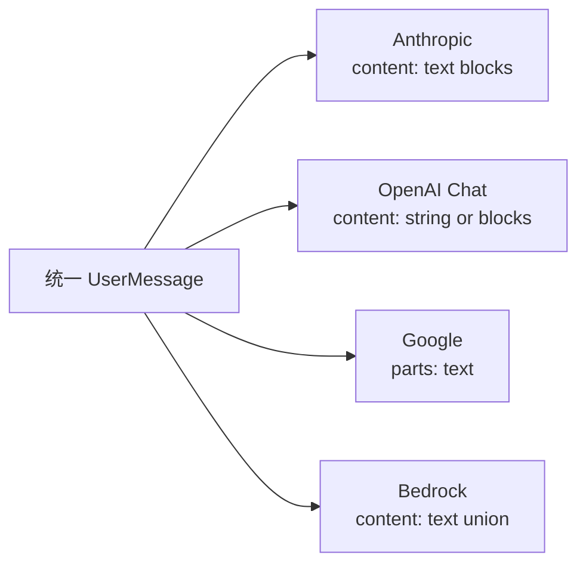
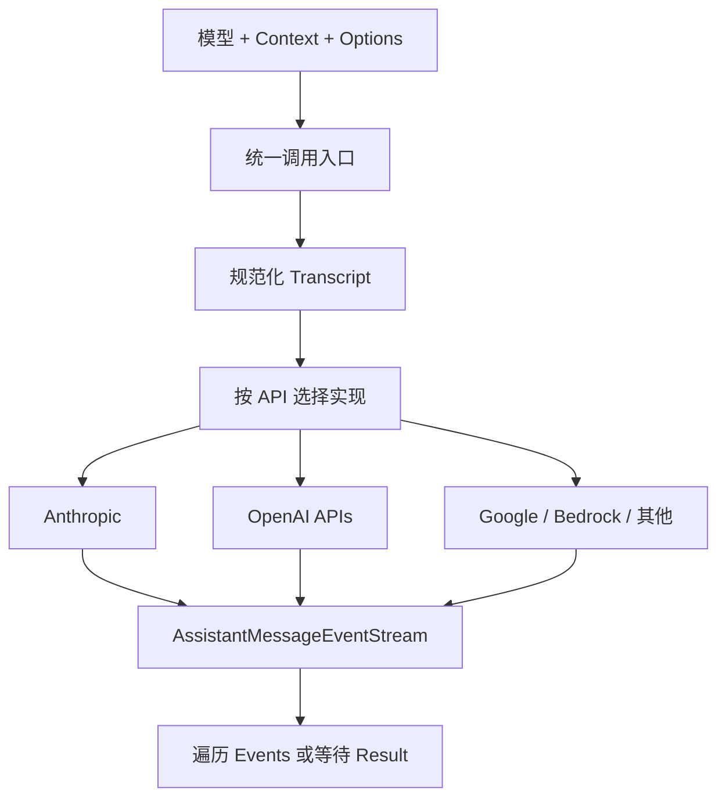
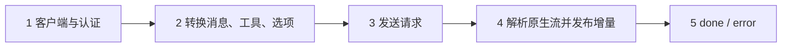
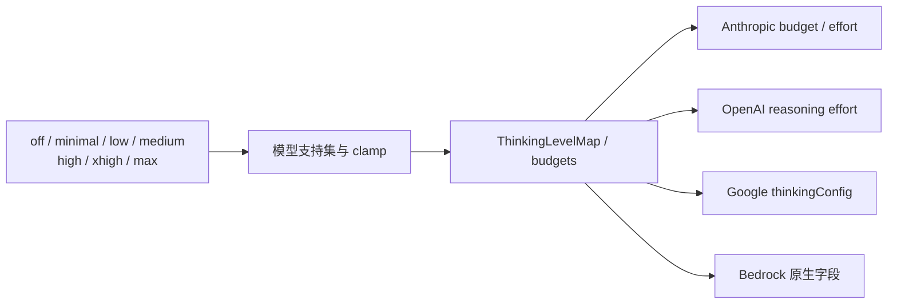

# 第4章：模型调用——统一入口与多种模型协议

[上一章](learning-ch03-agent-loop.md) · [学习目录](learning.md) · [下一章：工具系统](learning-ch05-tools.md)

结构对应 [参考教程第4章](https://dg-ai-notes.pages.dev/modules/ch04-model-call/)。本章追踪 `ai` 包的 API、事件流和 Provider；示例中的 Go 类型以当前源码为准。

## 1. 问题：同一段对话，不同模型要翻译成不同格式

### 1.1 不只是消息格式：四个维度全都不一样

同一句“解释 main.go”，发给不同厂商的模型，HTTP 报文长得完全不一样。可以把它想成一家翻译公司：客户只写中文工单，公司按不同客户的要求，分别译成英文、日文、法文再发出去；回信也要译回统一的中文格式。

这家公司要处理的差异不止一种：角色和内容怎么表示、工具调用结构怎么摆、认证和请求头怎么填、流事件和终止原因怎么命名。思考模式、缓存字段、图片和签名内容也都受具体 API 限制。所以统一接口的目标是收敛宿主这边的调用方式，而不是假装所有报文完全一样。

还要区分 Provider 品牌和 API 类型。Provider 标识决定模型归属与认证；API 标识则说明报文长什么样，例如 `anthropic-messages`、`openai-completions` 或 `openai-responses`。同一个品牌可以用不同 API，同一套 API 也能服务多个兼容端点——这就是为什么配置里必须分开写这两项。

先比较同一条用户文本的消息片段，而不是完整 HTTP 请求：

```json
{"role":"user","content":[{"type":"text","text":"解释 main.go"}]}
```

上面是 Anthropic 风格。OpenAI Chat Completions 的纯文本消息可以是：

```json
{"role":"user","content":"解释 main.go"}
```

Google 使用 parts：

```json
{"role":"user","parts":[{"text":"解释 main.go"}]}
```

Bedrock Converse 使用无 `type` 字段的 text 联合成员：

```json
{"role":"user","content":[{"text":"解释 main.go"}]}
```

图 4-1 把共同输入和四种协议放在一起。再加入工具结果后，差异更大：OpenAI Chat 使用 tool 角色，Anthropic 把 tool_result 放进 user 内容，Google 使用 functionResponse，Bedrock 使用 toolResult。不能用字符串替换字段名实现通用转换。



| 维度 | 需要统一什么 | 仍要由 Provider 处理什么 |
|---|---|---|
| 消息 | 角色、内容顺序、工具关联 | system 位置、角色合并、签名回放 |
| 工具 | 名称、参数与 Schema | input_schema / parameters / toolSpec 等包装 |
| 生成设置 | 输出预算、thinking、缓存意图 | 原生参数、模型支持集和兼容行为 |
| 流响应 | text/thinking/toolcall 与终结 | 原生事件名、JSON 分片、usage、停止原因映射 |

跨模型重放时要按模型身份处理思考签名和调用 ID。把另一个模型的签名块原样复制，可能使后续请求直接被 API 拒绝。

## 2. 解法：统一数据契约与具体 API 实现

### 2.1 第一层：统一入口

三个入口名字相近，区别在“接收什么、怎么构造选项”：

| 入口 | 接收 | 实际做什么 |
|---|---|---|
| `ai.Stream` | `ai.Context` + 可选选项 | 先规范化，再调用该 API 注册的 `Stream`，按传入选项构造请求（补上环境中的凭据） |
| `ai.StreamSimpleContext` | `ai.Context` + 可选选项 | 先规范化，再调用注册的 `StreamSimple`，由模型和简单选项推导协议参数 |
| `ai.StreamSimple` | 已规范化的 `TranscriptContext` | 跳过注册表查找，直接按模型的 API 构造简单选项并发请求 |

“简单”指的是选项简单，不是请求简单：它只保留模型能力、thinking 级别、预算这类通用意图，会丢掉协议专有字段。例如 Bedrock 的 region、profile、bearer token 在简单路径上不会被读取。需要这些能力时用 `Stream`，别指望简单入口替你传进去。

三个入口最终都落到“按 API 找实现”。不要把入口与 Session 的运行时混为一谈：Session 负责选模型和运行生命周期，Provider 只负责这一次 API 请求。

### 2.2 第二层：事件协议

流式请求报告 start、text/thinking/tool call 增量、对应内容结束以及最终 assistant 消息。消费者可以观察事件，也可以读取结果。调用 `Result()` 不应取决于另一个 goroutine 有没有完全遍历事件，但应用仍须负责关闭自己拥有的流或取消上下文。

保留事件顺序和一个明确的终结结果，是事件流契约的一部分。持有部分 assistant 快照并希望在后续增量后读取时，要使用对应的 Observe/Refresh API，不要假定先前读到的对象会自动变化。

当前标准 assistant 事件有以下十二种；这与第7章更丰富的 Agent/Session 事件联合不是同一个类型：

```text
start
  text_start → text_delta × N → text_end
  thinking_start → thinking_delta × N → thinking_end
  toolcall_start → toolcall_delta × N → toolcall_end
done 或 error
```

不同内容块可以交错，靠 `ContentIndex` 区分。`text_delta` 的 `Delta` 是本次新增文本；`Partial` 是响应状态，不应每次把完整 Partial.Text 再追加一遍，否则界面会重复文字。`done` 除 stop/length/toolUse 还支持 deferred；deferred 是服务端延后生成的结果契约，不是已经获得最终回答。



结果等待不依赖事件 drain，代价是未消费队列仍可能保留数据。长期只读 Result 的调用方也需要理解内存和对象生命周期，而不是据此宣称内存恒定。

### 2.3 第三层：API Provider

`ai/` 下按协议实现具体请求构建、SSE 或 JSON 响应解析、认证和 API 特例。OpenAI 兼容并不是一个协议就能覆盖所有 API；`openai-completions` 与 `openai-responses` 使用不同请求转换。添加模型目录记录与添加 API 实现也是两件事。

真实 API 的内部工作可按五步读：



| 阶段 | 阅读对象 | 要追踪的输入输出 |
|---|---|---|
| 客户端与认证 | Provider 构造和请求选项 | API key/OAuth、base URL、headers、ctx |
| 请求转换 | API-specific builder | Transcript → message/tool/system 字段 |
| 发送 | HTTP 或原生客户端 | 编码、响应状态、取消、重试边界 |
| 增量译码 | 原生事件分支 | 文本、thinking、工具 JSON 前缀、usage |
| 终结 | done/error 分支 | 完整 AssistantMessage、StopReason、错误信息 |

例如 Anthropic text block start 对应 text_start，text delta 对应 text_delta，tool_use block 的 JSON 片段对应 toolcall_delta。原生 stop reason 需要归一化到 `ai.StopReason`，同时按模型需要保留原始原因。

### 2.4 StreamFunction 的入职要求

`agent` 所需的是一个接收模型与规范化上下文、返回 assistant 事件流的函数，而非固定 Provider 实例。这样循环测试可以注入受控流，产品层也可以在每次请求前选取模型和凭据。

Go 的错误有两种时机：设置阶段可以在事件流创建之前就返回 `error`；流创建后，网络或 Provider 错误以终结 assistant 错误状态报告。不要把所有失败都假定成“已有一个流，只看最后一条事件”。

循环注入点的函数形状如下。它依赖统一 Transcript 和选项，而不依赖 CLI、工具实现或 Session 文件：

```go
func streamFn(ctx context.Context, model *ai.Model, transcript ai.TranscriptContext,
    options ai.StreamOptions) (*ai.AssistantMessageEventStream, error)
```

这是签名说明而非可单独调用的实现。持有资源的 Provider 则通过 `ID()`、`Stream(ctx, transcript, opts)` 与 `Close()` 表达身份、单次请求和生命周期；API 注册表中的 `APIProvider` 保存 Stream/StreamSimple 函数。这两个类型名称相近，职责不同。

| 输入 | 必须保持的契约 |
|---|---|
| Model | Provider 身份与 API 协议分开，按真实能力构造选项 |
| TranscriptContext | 已规范化，只读借用；不能改写共享历史 |
| StreamOptions | 只使用当前请求的认证、预算、thinking、缓存与钩子 |
| context.Context | 取消请求及其拥有的工作，不留下无人接收的 goroutine |
| 返回流 | 保序发布内容事件，只产生一个终结结果 |

如需保存或修改消息，调用复制访问器 `Messages()`；直接借用 `At` 返回的内容时保持只读。这样 Provider 无需每次复制并不发送的工具 details，也不会把自身格式修复写回 Session 历史。

## 3. 怎么用：从调用到接入新模型

### 3.1 场景一：调用模型

独立文本分析只需一次模型流调用。下面是完整程序，直接使用本地兼容服务，不通过 coding.Session，不读取真实认证文件。它会联网到本机 Ollama；先确保对应模型已安装。

```go
package main

import (
    "context"
    "fmt"
    "os"
    "time"
    "github.com/MichaelKinsy/PiG/ai"
)

func run() error {
    ctx, cancel := context.WithTimeout(context.Background(), 2*time.Minute)
    defer cancel()
    model := &ai.Model{
        ID: "qwen2.5-coder:7b", DisplayName: "Local Qwen Coder",
        ProviderMeta: ai.ProviderMetadata{
            ProviderID: "ollama", API: ai.APIOpenAICompletions,
            BaseURL: "http://localhost:11434/v1",
        },
        Capabilities: ai.ModelCapabilities{
            ContextWindow: 32768, MaxOutputTokens: 1024,
        },
    }
    transcript := ai.NormalizeContext(ai.Context{
        SystemPrompt: "Answer concisely.",
        Messages: []ai.Message{ai.UserMessage{
            Content: ai.UserText("Explain a tool call in one sentence."),
            Timestamp: time.Now().UnixMilli(),
        }},
    })
    stream, err := ai.StreamSimple(ctx, model, transcript, ai.StreamOptions{
        APIKey: "ollama", MaxTokens: 256,
    })
    if err != nil { return fmt.Errorf("setup: %w", err) }
    for event := range stream.Events(ctx) {
        switch event := event.(type) {
        case ai.TextDeltaEvent:
            fmt.Print(event.Delta)
        case ai.ThinkingDeltaEvent:
            fmt.Fprintf(os.Stderr, "thinking delta: %d bytes\n", len(event.Delta))
        case ai.ToolCallEndEvent:
            fmt.Fprintf(os.Stderr, "tool requested: %s\n", event.ToolCall.Name)
        }
    }
    result, err := stream.ResultContext(ctx)
    if err != nil { return err }
    if result.StopReason == ai.StopReasonError || result.StopReason == ai.StopReasonAborted {
        return fmt.Errorf("%s: %s", result.StopReason, result.ErrorMessage)
    }
    fmt.Printf("\nstop=%s input=%d output=%d\n", result.StopReason, result.Usage.Input, result.Usage.Output)
    return nil
}

func main() {
    if err := run(); err != nil { fmt.Fprintln(os.Stderr, err); os.Exit(1) }
}
```

窗口与输出值是示例预算，不替代实际部署模型的能力声明。这个程序只报告 tool call，不执行它；要循环执行工具，使用第3章的 Agent 路径。若需要资源发现、压缩和恢复，则使用第1章的 Session 程序。

### 3.2 场景二：接入一个新模型

先判断 API 是否已支持。若已支持，优先在 provider/model 配置目录中定义端点和模型元数据；若协议不兼容，需实现 Provider、模型映射、认证与测试，并遵循 `ai/AGENTS.md` 中的契约。新实现应验证线上请求结构，而不仅是模型能出现在选择列表中。

注册到模型目录、在 `models.json` 中加入兼容 endpoint、实现新的 API Provider，分别处于不同边界。不要为已有协议的一个新地址复制 Provider 实现。

下面用一个不联网的自定义 API 演示注册契约。返回确定文本只是教学假实现，不能替代真实 Provider，也没有伪造任何线上模型的回答。函数先取得统一 Transcript，再以标准 terminal event 交付结果；它刻意不生成增量，用于检查“只有终结事件”这条受支持路径。

```go
package main

import (
    "context"
    "fmt"
    "time"
    "github.com/MichaelKinsy/PiG/ai"
)

func fixtureStream(ctx context.Context, model *ai.Model, transcript ai.TranscriptContext, _ ai.StreamOptions) (*ai.AssistantMessageEventStream, error) {
    if err := ctx.Err(); err != nil { return nil, err }
    text := fmt.Sprintf("Received %d transcript messages.", transcript.Len())
    reply := &ai.AssistantMessage{
        API: model.ProviderMeta.API, Provider: model.ProviderMeta.ProviderID,
        Model: model.ID, StopReason: ai.StopReasonStop,
        Content: []ai.AssistantContentBlock{ai.TextContent{Text: text}},
        Timestamp: time.Now().UnixMilli(),
    }
    stream := ai.NewAssistantMessageEventStream()
    if err := stream.Push(ai.DoneEvent{Reason: ai.StopReasonStop, Message: reply}); err != nil {
        return nil, err
    }
    return stream, nil
}

func main() {
    api := ai.API("learning-fixture")
    ai.RegisterAPIProvider(ai.APIProvider{API: api, Stream: fixtureStream, StreamSimple: fixtureStream})
    model := &ai.Model{ID: "fixture", ProviderMeta: ai.ProviderMetadata{
        ProviderID: "learning", API: api,
    }}
    stream, err := ai.Stream(context.Background(), model, ai.Context{
        Messages: []ai.Message{ai.UserMessage{Content: ai.UserText("hello")}},
    })
    if err != nil { panic(err) }
    for event := range stream.Events(context.Background()) { fmt.Println(event.EventType()) }
    fmt.Println(stream.Result().Content[0].(ai.TextContent).Text)
}
```

预期输出是 `done` 和 `Received 1 transcript messages.`。这证明注册、路由与结果交付，不证明 SSE、认证、取消竞争或真实 Provider 正确。

## 4. 进阶：翻译器内部、SSE 与思考模式

### 4.1 流式传输：SSE 解析由协议实现负责

Server-Sent Events（SSE）是逐条传送的文本事件格式。PiG 在 `ai/sse.go` 集中处理文本帧，各 Provider 再解释其中的原生事件和 JSON 载荷。传输层收到一个 TCP/HTTP 数据块，并不意味着已经收到完整 SSE 事件，更不意味着收到完整工具参数。

Anthropic 的两个简化帧：

```text
event: content_block_start
data: {"type":"content_block_start","index":0,"content_block":{"type":"text","text":""}}

event: content_block_delta
data: {"type":"content_block_delta","index":0,"delta":{"type":"text_delta","text":"Hello"}}

```

OpenAI Chat Completions 常见的是没有 event 字段的 data 帧：

```text
data: {"choices":[{"index":0,"delta":{"content":"Hello"},"finish_reason":null}]}

data: {"choices":[{"index":0,"delta":{},"finish_reason":"stop"}]}

data: [DONE]

```

这两组只是协议片段，省略请求 ID、usage 和完整起止序列。它们说明为何“每个 data 都读 `.delta.text`”不可行；`[DONE]` 也不是 SSE 标准规定的 JSON，而是具体 API 的约定。

共享解析器遵循以下步骤：

```text
字节流 → 识别 LF / CRLF / CR 行结束
    : comment          → 不作为载荷解释
    event: name        → 保存事件类型
    data: first        → 累积 data 行
    data: second       → 累积 data 行
    空行               → 派发一个事件，Data = "first\nsecond"
```

跨两次读取拆开的 CRLF 不能误当两个空行；同一事件的多条 data 要用换行连接，而不是丢弃前面的行。源码在流结束时还尝试 flush 剩余事件，Provider 仍负责判定自己的响应是否正常终结。D134 对超长单行设置与 V8 字符串上限对应的限制，避免未换行输入无限占用内存；这不等于使用一个任意小的 64 KiB 协议上限。

再看分片工具参数：

```text
toolcall_start：id=t1，name=read
toolcall_delta：{"pa
toolcall_delta：th":"main.go"}
toolcall_end：arguments={"path":"main.go"}
assistant done：stopReason=toolUse
```

UI 可以展示不完整前缀，执行器必须等待完整 assistant。即使结束时的尽力解析得到合法 JSON，length 状态仍可能表示内容不完整，第3章的截断保护会阻止执行。

阅读时把三层缓冲分开：传输帧、Provider 的内容块累积、事件流队列。断网、JSON 错误和 ctx 取消必须落入正确的终结路径；不能从某个错误字符串猜测自己已经收齐结果。

### 4.2 思考模式：协议方言如何表达

PiG 暴露模型能力声明和可选的 thinking levels：`off`、`minimal`、`low`、`medium`、`high`、`xhigh`、`max`。模型只应使用它支持的级别。各 API 把级别翻译成自身参数；同一 UI 级别不保证每个 Provider 的 wire 参数相同。

这些级别是“档位”，不是精确的 token 数。你选 `high`，Anthropic 可能翻译成一个思考预算，OpenAI 兼容族可能翻译成 reasoning effort 字符串，Google 可能写进 thinkingConfig。同一档在不同模型上的实际思考量可以差很多，所以调参时要按模型分别观察，不要拿一个模型的 `high` 当另一个模型的等价物。

`off` 只存在于模型能力声明里；请求侧的 `ThinkingLevel` 用空字符串表示“不请求 reasoning”。两个类型不要当成同一个。

### 4.3 PiG 如何统一：模型支持的思考级别

图 4-4：先选公共级别，再按模型支持集映射。`ModelThinkingLevel` 包含 off；请求的 `ThinkingLevel` 通过空值表达不请求 reasoning，不能把两个类型当作完全相同。



| 协议族 | 典型表达 | 阅读注意 |
|---|---|---|
| Anthropic | enabled budget 或 adaptive effort | 不同模型的模式不同，不统一硬写 16384 |
| OpenAI 兼容族 | reasoning effort 或声明的 thinking budget 字段 | Completions 与 Responses 的包装也不同 |
| Google | thinkingConfig 与 thoughts 输出选项 | 支持集与预算规则由模型决定 |
| Bedrock | Converse 请求中的模型特定配置 | 认证和请求结构不是普通 OpenAI endpoint |

统一入口负责共同生命周期，API 模块保留协议特有数据。模型目录中可能同时记录 input 能力、context window、最大输出、价格与 reasoning。请求归一化和响应解析都应保留调用者仍需的原始元数据。

## 5. 进阶：缓存控制与错误处理

### 5.1 缓存控制：请求可重用内容

Prompt caching 由模型与 API 能力共同决定。调用方和 Session 维护稳定上下文、缓存提示或预热策略，Provider 按 API 写出缓存相关字段。缓存结果需要结合 token usage 和模型价格判断，不能只凭“发送了相同 prompt”推断已命中。

公共选项的表达很简单：

```go
options := ai.StreamOptions{
    CacheRetention: ai.CacheRetentionShort,
    MaxTokens: 1024,
}
```

`none`、`short`、`long` 表示保留意图，不是要求所有 Provider 使用同一 wire 字段。以当前 Anthropic 实现为例：

| 位置 | 当前缓存标记方式 |
|---|---|
| system blocks | 按构建路径附上 cache_control |
| tools | 支持工具缓存时，在最后一个声明上设置边界 |
| conversation | 若最后一条转换消息是 user，把边界放到其最后一个内容块；尾部是 assistant 时不向前任意找旧 user |
| long 保留 | 只有模型/配置支持时写对应 TTL |
| none | 不添加该缓存控制标记 |

典型字段片段：

```json
{"type":"ephemeral","ttl":"1h"}
```

这个 JSON 是支持 long 保留时的 cache_control 值，不是完整请求。缓存取决于前缀内容、模型、服务端规则及有效期；每次重新创建一个 Go Context 值本身不会使缓存失效。相反，在最早的 system 内容里每次插入时间戳，可能使后面的相同对话也无法复用那个前缀。

```text
请求 A：稳定 system + 稳定 tools + user1
请求 B：同一前缀 + assistant1 + toolResult1
请求 C：改写了最前面的 system + 其他相同历史
```

B 有复用 A 前缀的可能，C 改变了更早的缓存边界。观察 Usage 中的 CacheRead、CacheWrite，结合提供方计费与缓存文档确认效果；不能把“设置了 short”当成性能测试结果。

### 5.2 错误处理：区分 setup 与流中失败

| 阶段 | 典型失败 | 表达方式 |
|---|---|---|
| 创建流之前 | 未知 API、无凭据、非法选项 | 函数直接返回 `error`，不存在可消费事件 |
| 流已经建立 | HTTP、解码、Provider 执行错误 | 终结 assistant 状态携带错误信息与 stop reason |
| 用户或 Session 生命周期 | context 取消、Agent abort | 按取消契约终结，不伪装为成功文本 |
| 调用方事件处理 | sink 返回 error | Agent 直接循环可以把它作为运行失败返回 |

上层可对暂时性失败重试，但必须保留已执行的工具副作用和失败轮次状态。不能对任意 Provider 错误无限重试。

## 6. 回到那一行代码

一行统一流调用隐藏了模型解析、认证、Transcript 转换和终结规则。

### 6.1 设计精华

回头看那一行 `ai.StreamSimple`，它替你做了四件事：挑出对应协议的实现、把统一消息翻译成该协议的报文、把流式响应翻译回统一事件、把失败收束成一个明确的终态。你看到一行，背后是一条五步流水线。

读 Provider 源码时按这个顺序走，不容易迷路：先看它接收什么类型，再看请求怎么拼，然后看网络调用与取消，接着看流事件怎么译码，最后看测试怎么断言线上报文。只读最后一步不够——一个 Provider 能出现在模型列表里，离“请求正确、取消干净、错误有终态”还很远。

## 7. 下一站

下一章回到模型发出的 tool call，追踪参数如何从 JSON 变成真实执行。

**源码阅读与练习**

- [ai/types.go](https://github.com/MichaelKinsy/PiG/blob/c64bebd820e20411599a8b1e8e52aa92b4a2ed82/ai/types.go)：`Provider` 和 `StreamOptions` 的协议边界。
- [ai/direct_simple.go](https://github.com/MichaelKinsy/PiG/blob/c64bebd820e20411599a8b1e8e52aa92b4a2ed82/ai/direct_simple.go)：直接 API 与 setup 错误。
- [ai/compat.go](https://github.com/MichaelKinsy/PiG/blob/c64bebd820e20411599a8b1e8e52aa92b4a2ed82/ai/compat.go)：兼容注册层。
- [ai/AGENTS.md](https://github.com/MichaelKinsy/PiG/blob/c64bebd820e20411599a8b1e8e52aa92b4a2ed82/ai/AGENTS.md)：Provider 和事件流可靠性契约。
- 练习：选一个 OpenAI API 和一个非 OpenAI API，对照它们在 tool call 输入、finish reason 和错误终结上的差异。

[上一章](learning-ch03-agent-loop.md) · [学习目录](learning.md) · [下一章](learning-ch05-tools.md)
