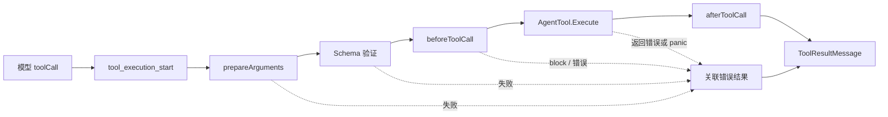
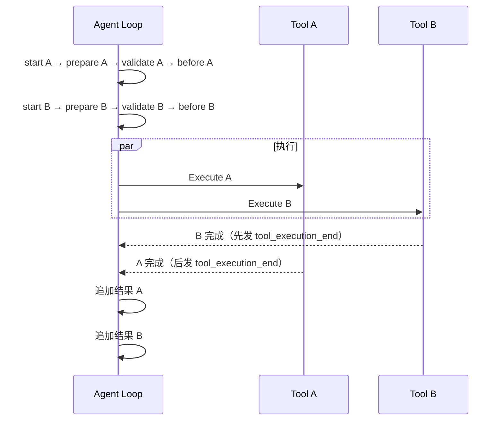

# 第5章：工具系统——工具如何被校验、调度与执行

[上一章](learning-ch04-model-call.md) · [学习目录](learning.md) · [下一章](learning-ch06-messages.md)

结构对应 [参考教程第5章](https://dg-ai-notes.pages.dev/modules/ch05-tools/)。贯穿案例：模型要求读取文件，然后修改其中一段文本。模型输出的是调用描述，工具宿主才真正操作文件。

## 1. 三层类型：为什么一个工具要分三层定义

### 1.1 第一层：ToolSchema，模型可见的声明

`ai.ToolSchema` 包含名称、说明、参数 Schema 等字段。模型依此生成工具名和参数。Schema 是输入契约，不是权限控制，也不包含 Go 执行函数。

先把它想成一张名片：上面写着“我叫什么、能干什么、需要你提供哪些信息”。名片能让别人知道怎么找你，但它本身不会干活。模型看到的只有名片，真正干活的是宿主里的执行函数。

一个完整的 JSON Schema 片段：

```go
schema := ai.ToolSchema{
    Name: "lookup_issue",
    Description: "Look up one issue by its identifier.",
    Parameters: map[string]any{
        "type": "object",
        "properties": map[string]any{
            "id": map[string]any{"type": "string", "description": "Issue key"},
        },
        "required": []string{"id"},
        "additionalProperties": false,
    },
}
```

Provider 会把这份 schema 转换成自己的 tool declaration。模型返回的是 toolCall，不会执行声明中的代码。即使 schema 要求 `id` 是字符串，宿主仍须在信任边界验证 JSON，因为模型输出不等于可信的 Go 值。

### 1.2 第二层：AgentTool，加上执行能力

`agent.AgentTool` 提供 `Schema()`、`Execute(...)` 和 `ExecutionMode()` 等方法。执行函数接收调用 ID、原始 JSON、取消上下文和进度回调，返回内容、细节等结果以及 `error`。调用 ID 用来把结果关联回 assistant 的工具调用块。

下面是一个完整的接口实现示例。它演示如何解码参数、返回模型可读内容和声明并行模式；真实工单系统及认证不在这个演示中。

```go
package demo

import (
    "context"
    "encoding/json"
    "fmt"
    "github.com/MichaelKinsy/PiG/agent"
    "github.com/MichaelKinsy/PiG/ai"
)

type LookupIssueTool struct{}

func (LookupIssueTool) Name() string  { return "lookup_issue" }
func (LookupIssueTool) Label() string { return "Issue lookup" }
func (LookupIssueTool) Schema() ai.ToolSchema {
    return ai.ToolSchema{
        Name: "lookup_issue", Description: "Look up an issue by key.",
        Parameters: map[string]any{
            "type": "object",
            "properties": map[string]any{"id": map[string]any{"type": "string"}},
            "required": []string{"id"},
        },
    }
}
func (LookupIssueTool) ExecutionMode() agent.ToolExecutionMode { return agent.ToolModeParallel }
func (LookupIssueTool) Execute(ctx context.Context, callID string, raw json.RawMessage,
    update agent.ToolUpdateCallback) (agent.AgentToolResult, error) {
    if err := ctx.Err(); err != nil { return agent.AgentToolResult{}, err }
    var args struct { ID string `json:"id"` }
    if err := json.Unmarshal(raw, &args); err != nil { return agent.AgentToolResult{}, err }
    if args.ID == "" { return agent.AgentToolResult{}, fmt.Errorf("issue id is required") }
    if update != nil {
        update(agent.AgentToolResult{Content: []ai.ToolResultMessageContent{
            ai.TextContent{Text: "Checking " + args.ID},
        }})
    }
    return agent.AgentToolResult{
        Content: []ai.ToolResultMessageContent{ai.TextContent{Text: "No issue data in this demo."}},
        Details: map[string]any{"id": args.ID, "callId": callID},
    }, nil
}

var _ agent.AgentTool = LookupIssueTool{}
```

`var _` 让编译器验证接口满足关系。这个示例只操作输入和局部值，因此允许并行；真实查询需把 ctx 传给网络请求，而不是在入口检查一次后完全忽略取消。

### 1.3 第三层：ToolDefinition，产品层再加信息

`extension.ToolDefinition` 还携带提示词片段、渲染函数、默认激活策略、曝光方式和扩展回调。它回答“宿主如何注册、介绍、展示和调用这个工具”。这些字段不应未经筛选地全部发送给 Provider。

### 1.4 桥接两层：工具定义如何进入循环

参考教程叫 `wrapToolDefinition` 的职责，在 PiG 中由 `coding.WrapRegisteredTool` 和内部 `bridgeTool` 承担。注册值先解析 Parameters，然后将 Definition 保存到适配器；`Schema()` 返回模型声明，`Execute` 在必要时用 `runner.ToolCallContext` 补充扩展上下文，再调用定义的执行函数。

核心转发关系可以用下列算法表达，省略调用顺序预约、运行时检查与错误处理，不是另一套公开 API：

```text
WrapRegisteredTool(registered, runner)
    → newBridgeTool：解析声明、保持 Schema 顺序
    → 保存 runner

bridge.Schema()
    → declaration + name + description + guidelines + constrainedSampling
bridge.PrepareArguments(raw)
    → definition.PrepareArguments（不存在则保留 raw）
bridge.Execute(ctx, id, params, update)
    → 检查 Execute 是否存在
    → 绑定调用顺序与 runner.ToolCallContext
    → definition.Execute(ctx, id, params, update)
```

实际工厂调用形状：

```go
wrapped, err := coding.WrapRegisteredTool(registered, runner)
if err != nil { return err }
tools := []agent.AgentTool{wrapped}
```

`registered` 是 `extension.RegisteredTool`，`runner` 是当前宿主 Runner。Go 的产品执行签名没有在末尾额外加一个裸 `ExtensionContext` 参数，而是通过 `context.Context` 和宿主访问函数提供；直接照抄 TypeScript 的第五个参数会得到错误 API。

### 1.5 为什么要分层

Provider 只需要声明，循环需要执行，产品需要注册和展示。把这些职责拆开后，模型 API 不依赖终端组件，普通循环测试也不必启动扩展进程。

## 2. 五步管道：工具调用不是调个函数就完了

### 2.1 为什么不能直接调用

模型可能拼错工具名、缺少必需参数，或者输出已截断的 JSON。即使参数合法，前置策略也可能阻止执行。宿主还需要保持取消、进度、错误和消息关联，因此必须有明确的调用管道。

这和机场安检类似：不是“看到登机牌就放行”，而是逐道检查——证件对不对（工具存在吗）、行李合不合规（参数合法吗）、有没有禁带品（策略允许吗），最后才登机（执行）。任何一道没过，都会留下一条记录，不会让人凭空消失。

### 2.2 PiG 的答案：五步管道

核心顺序是参数准备 → Schema 验证 → before 钩子 → 执行 → after 钩子，最后生成工具结果消息。普通成功路径之外，每一步都有自己的失败规则。`tool_execution_start` 是生命周期通知，当前实现会在参数准备与前置检查前发出，不代表文件操作已经发生。

下面用模型返回的调用作为入口。参数是结构化 JSON；`id` 是关联 ID，不是工具名，也不由工具自行重建。

```json
{"type":"toolCall","id":"call_abc123","name":"lookup_issue","arguments":{"id":"BUG-42"}}
```

图 5-1：成功路径与错误返回汇合。横向顺序不可随意调换；失败路径产生对应结果，而不是跳过历史关联。



示例流程：模型要求读取 `BUG-42` → start 事件 → 参数解码及验证 → 权限钩子放行 → 查询工具执行 → 结果钩子增加展示 details → 结果消息带回 `toolCallId=call_abc123`。

### 2.3 第一步：prepareArguments，准备参数

可选的 `ArgumentPreparer` 允许工具在验证前修整已知的参数表达形式。例如 edit 的兼容输入整理属于工具自己的规则。准备后的值进入验证和后续钩子；这不是任意吞掉错误、自动猜测用户意图的入口。

edit 的两类输入说明了为什么准备要在验证之前：

```json
{"path":"app.go","oldText":"old","newText":"new"}
```

可整理为当前 edits 数组形式：

```json
{"path":"app.go","edits":[{"oldText":"old","newText":"new"}]}
```

某些模型还会把 edits 数组编码成字符串，preparer 可解析这一已知形式；无效 JSON 仍须失败，不能把残缺调用当成合法空数组。可读 `internal/codingagent/tools/edit_diff_test.go` 的 PrepareArguments 用例。

### 2.4 第二步：validateToolArguments，Schema 验证

验证名称对应的工具以及参数形状，阻止不符合声明的输入直接进入实现。Go JSON 表示还需注意成员顺序、缺失值与显式 `null`。验证结果和错误描述是可观察行为，不能简单替换成一个含糊的“invalid arguments”。

下面直接调用当前校验函数，观察一个明确的失败：必填的 id 缺失。该程序只验证 JSON，不调用模型或外部服务。

```go
package main

import (
    "encoding/json"
    "fmt"
    "github.com/MichaelKinsy/PiG/ai"
)

func main() {
    schema := map[string]any{
        "type": "object",
        "properties": map[string]any{"id": map[string]any{"type": "string"}},
        "required": []string{"id"},
    }
    for _, raw := range []string{`{"id":"BUG-42"}`, `{}`} {
        validated, err := ai.ValidateToolArgumentsSchema("lookup_issue", schema, json.RawMessage(raw))
        fmt.Printf("input=%s valid=%v\n", raw, err == nil)
        if err == nil { fmt.Println(string(validated)) } else { fmt.Println(err) }
    }
}
```

第一项有效，第二项在调用工具之前失败。校验器还存在与 TypeBox 对齐的值转换规则，所以不能把参考教程的“数字字段一定因类型错误失败”直接当作 PiG 的测试预期。应检查返回的 validated 参数，而不是验证后又把原始参数送进 Execute。若工具实现 `ArgumentSchema` 或 refinement 能力，准备过程使用对应的校验入口，不能用上述基础函数代表全部扩展校验。

### 2.5 第三步：beforeToolCall，前置钩子

前置钩子可阻止执行或按契约修改输入。当前流程在 before 钩子之前验证参数，钩子修改后的输入不会自动再做同一轮 Schema 验证；因此扩展作者必须对修改结果负责。被阻止的调用仍需要关联的结果，不能只删除调用而留下不完整历史。

| 返回 `ToolCallHookResult` | 效果 |
|---|---|
| 零值 | 不干预，继续 |
| `Block: true, Reason: ...` | 不执行，生成说明阻止原因的关联结果 |
| 非 nil `Args` | 后续钩子与 Execute 使用替代参数 |
| 非 nil `Err` | 不执行，将钩子错误变为工具失败结果 |
| 阻止时 `Terminate: true` | 该结果要求批次后停止，仍按整批规则判断 |

这是可编译的前置钩子工厂，供 `AgentLoopConfig.BeforeToolCallHooks` 使用；它只限制工单查询的 id，不声称提供全局权限沙箱。

```go
package demo

import (
    "context"
    "encoding/json"
    "github.com/MichaelKinsy/PiG/agent"
)

func OnlyIssue(allowed string) agent.BeforeToolCallHook {
    return func(ctx context.Context, id, name string, args json.RawMessage) agent.ToolCallHookResult {
        if name != "lookup_issue" { return agent.ToolCallHookResult{} }
        var input struct { ID string `json:"id"` }
        if err := json.Unmarshal(args, &input); err != nil {
            return agent.ToolCallHookResult{Err: err}
        }
        if input.ID != allowed {
            return agent.ToolCallHookResult{Block: true, Reason: "This issue is outside the selected scope."}
        }
        return agent.ToolCallHookResult{}
    }
}
```

修改参数的钩子要自行构造满足工具契约的新 JSON。阻止策略不能只是往日志写一行：必须返回宿主会读取的 Block 字段。

### 2.6 第四步：tool.Execute，实际执行

工具在收到的 `context.Context` 生命周期内完成工作，进度经 `onUpdate` 发布。进度不是最终结果；执行已结束后到来的更新不能继续污染当前工具状态。对文件修改还要保留调用顺序和同一文件的互斥规则。

`ToolUpdateCallback` 的输入是**截至当前的完整结果快照**，不是文本 delta。例如两批输出应这样表达：

```go
if update != nil {
    update(agent.AgentToolResult{Content: []ai.ToolResultMessageContent{
        ai.TextContent{Text: "Checking BUG-42\n"},
    }})
    update(agent.AgentToolResult{Content: []ai.ToolResultMessageContent{
        ai.TextContent{Text: "Checking BUG-42\nFound one issue\n"},
    }})
}
```

UI 用第二份快照替换第一份。若把第二次输入误写成只有 `Found one issue`，需要累计显示的消费者就会丢掉之前内容；若消费者把完整快照再追加一次，又会重复显示。这个契约与第4章的 TextDeltaEvent 不同。

包装层用接受标志和在途更新计数管理结束边界：Execute 完成后关闭接收，等待已经接受的更新完成，再发布结束结果。晚到更新被忽略不意味着工具可以留下无人管理的后台任务；工具仍必须取消并等待自己创建的工作退出。

### 2.7 第五步：afterToolCall，后置钩子

后置钩子可以按契约替换 content、details、isError 等结果信息。替换文本内容时，还要注意原有 structured content 是否仍然描述同一个结果。不同表示应同步更新或按实现规则失效，避免 UI 与模型看到互相矛盾的数据。

以下完整辅助函数替换指定查询工具的结果文本。它只演示结果改写，不能消除工具已经造成的副作用，也不能当作全渠道脱敏方案：

```go
package demo

import (
    "context"
    "encoding/json"
    "github.com/MichaelKinsy/PiG/agent"
    "github.com/MichaelKinsy/PiG/ai"
)

func HideIssueBody() agent.AfterToolCallHook {
    return func(ctx context.Context, id, name string, args json.RawMessage,
        result agent.AgentToolResult) agent.AfterToolCallResult {
        if name != "lookup_issue" || result.IsError { return agent.AfterToolCallResult{} }
        return agent.AfterToolCallResult{
            Content: []ai.ToolResultMessageContent{ai.TextContent{Text: "Issue fetched; body hidden by policy."}},
            Details: map[string]any{"redacted": true},
        }
    }
}
```

覆盖是逐字段替换，不是深度合并：

| 覆盖字段 | 未提供 | 提供后的行为 |
|---|---|---|
| Content | nil 保留 | 非 nil 空切片也会替换为零个内容块 |
| Details | nil 保留 | 替换整个 details，不合并字典成员 |
| IsError、Terminate | nil 保留 | `*bool` 可显式覆盖为 false |
| StructuredContent | 结合 Content 判断 | 改 Content 而未给对应结构时，丢弃旧结构以避免不一致 |

比如想清除错误标记，必须提供指向 false 的指针，而非把字段留为 nil。after hook 自身 panic 也会被收尾层转换为工具错误结果；这与进度 sink 拒绝造成的外层 Go error 是不同路径。

### 2.8 管道终点：ToolResultMessage

进入历史的结果带 `toolCallId`、`toolName`、内容、错误标记和时间等数据。模型主要依赖内容理解结果；宿主还可能利用 details 渲染。工具事件中的完整结果对象与持久化消息的字段并不必然完全相同。

```json
{
  "role": "toolResult",
  "toolCallId": "call_abc123",
  "toolName": "lookup_issue",
  "content": [{"type":"text","text":"No issue data in this demo."}],
  "details": {"id":"BUG-42","callId":"call_abc123"},
  "isError": false,
  "timestamp": 1700000000000
}
```

这份示例使用虚构 ID 和时间，只说明字段；真实结果由宿主生成并关联。与第1节工具返回的 `AgentToolResult` 相比，宿主加上了调用身份、role 和 timestamp。structured content 等字段可能用于调用结果事件，并非都写入同一条模型消息。

## 3. 并行与串行：一个批次不是一起启动就结束了

### 3.1 模型经常一次调用多个工具

“读取两个文件”可以出现在同一 assistant 消息中。这时需要决定并发方式，也需要确定事件顺序和历史顺序。它们是三个问题，不是同一个问题。

### 3.2 并行不是简单启动若干 goroutine

Go 调度不保证 goroutine 按创建顺序开始。若调用顺序影响文件写入、扩展同步前缀或外部服务，必须在启动并发任务前完成顺序预约，并在所有任务结束后合并结果。

### 3.3 调度策略：串行要求影响整个批次

当全局配置选择串行，或者批次中任一工具要求串行时，该批次走串行路径。全部工具允许并行才采用并行路径；实现仍拥有并发任务和等待过程，不是无人负责的后台执行。

### 3.4 并行执行的三阶段

| 阶段 | 主要工作 | 顺序 |
|---|---|---|
| 准备 | start 事件、参数准备、验证、前置钩子、必要的顺序预约 | 模型调用顺序 |
| 执行与结束通知 | 并发执行，结果钩子，end 事件 | 按实际完成处理 |
| 追加结果消息 | 将批次结果放入上下文 | 模型调用顺序 |

例如模型先调用 A 再调用 B，B 更快完成：UI 可以先看到 B 的结束事件，但历史仍保存 A 的结果再保存 B 的结果。当前批次全部处理完后，才进入下一轮与队列注入。

图 5-2：并行批次的三种顺序。`prepare` 按输入顺序；执行时间并发；end 按完成顺序；结果消息恢复输入顺序。



| 排序对象 | 发生顺序 | 为什么要区分 |
|---|---|---|
| 调用准备和 before 钩子 | A → B | 前置处理可能改变输入或外部状态 |
| 执行完成事件 | B → A（本例） | 应反映真实结束时刻 |
| 历史 ToolResult | A → B | 与原 assistant toolCall 次序匹配 |
| 下一轮模型请求 | A、B 全完成以后 | 不能在部分结果尚未归并时拼一份不完整批次 |

如果任一工具要求 sequential，整个批次串行；而即使声明 parallel，同一文件修改也会使用宿主维护的 mutation queue 等机制保序，不能将“可并行”理解成“任意副作用都可同时写”。

## 4. 工具出错也是一条消息，但基础设施错误另有边界

### 4.1 六类常见失败，汇入关联结果

工具不存在、参数准备失败、Schema 验证失败、策略阻止、执行返回错误、执行 panic，都需要可解释的结果或明确的失败路径。阻止执行可以是策略决定，不一定等于系统异常；具体 `IsError`、`Terminate` 按结果契约保留。

| 失败来源 | 工具是否运行 | 返回模型的内容 | 运行是否必然中止 |
|---|---:|---|---:|
| 工具名未注册 | 否 | “tool not found” 类关联错误结果 | 否 |
| `PrepareArguments` 失败 | 否 | 准备函数返回的可读错误 | 否 |
| JSON 或 Schema 无效 | 否 | 校验器产生的错误文本 | 否 |
| before hook 阻止 | 否 | `Reason` 或阻止信息 | 看 `Terminate` 和批次 |
| Execute 返回 Go error | 已开始或中途失败 | 对应调用 ID 的错误结果 | 通常可以让模型恢复 |
| Execute panic | 执行异常 | panic 消息被保护层转换 | 通常可恢复；外层仍有独立错误 |

注意：`AgentTool.Execute` 返回 `AgentToolResult{IsError: true}` 表示工具选择正常返回了“业务错误结果”；Go `error` 表示执行失败。它们不是同一表达，后者会被 Agent 包装成错误内容。


### 4.2 执行边界的防护

工具执行包装层把普通执行错误和受保护边界内的 panic 转成结果，让模型有机会纠错。进度投递失败则可能使运行返回错误。外层还有事件接收器、持久化和上下文准备等失败，不能从“工具错误变消息”推导出“整个调用永远不返回 error”。

沿 `executePreparedToolCall` 读以下顺序，尤其注意“等待更新”和“转换工具错误”之间的先后：

```text
accepting = true
收到 update 时：
    若已关闭 accepting，忽略
    否则计入 inflight，调用 sink，记录首个拒绝，再完成计数

调用 executeTool（在受保护边界把 panic 转成 error）
关闭 accepting
等待所有已接受的 inflight 更新
若存在进度投递拒绝：返回 Go error，不调用 after hooks
否则：
    Execute 的 error → 可恢复工具错误结果
    Execute 正常返回 → 保留结果及其 IsError
    调用 after hooks → 发布 end → 追加历史消息
```

`ToolExecutionEndEvent.IsError` 和 `event.Result.IsError` 也不能互换：前者是整个调用的最终错误状态，后者是工具结果对象自身的标记。Execute 返回 Go error 时，框架生成的 Result 可以没有自己的 IsError，但外层调用错误状态仍为 true。消费者应使用事件或 Outcome 的最终标记判断调用成功与否。

接收标志解决“已结束调用又被晚到更新改写”，等待计数解决“先发 end 再看到先前进度”，外层 error 解决“事件发送失败却宣称完整交付”。这是三个不同的问题。

### 4.3 错误到消息：前后对比

直接返回“文件不存在”给终端，模型无法知道为何没有结果。把它保存成带原调用 ID 的错误 ToolResult，下一轮模型就能选择修正路径或询问用户。这里保留的是事实和关联，不是把失败伪装成成功。

```text
Execute 返回：error("file not found: src/config.go")
       ↓ 绑定原调用 read-1
ToolResultMessage：
    toolCallId = read-1
    toolName = read
    content = [{type:text, text:"file not found: src/config.go"}]
    isError = true
       ↓ 下一次模型请求
模型可以选择：检查目录、修正路径，或询问用户
```

| 模型收到的失败 | 可以考虑的下一步 | 宿主仍要约束什么 |
|---|---|---|
| 路径不存在 | ls/find 定位正确路径 | 路径访问权限 |
| edit 匹配失败 | 重新 read，再生成准确编辑 | 避免覆盖外部改动 |
| 测试命令非零退出 | 阅读诊断后修复 | 不自动安装未批准的软件 |
| before hook 阻止 | 解释限制，改用允许的操作 | 不能通过另一工具绕过同一策略 |

模型有机会纠错，不代表它必定选择正确的恢复操作。错误记录还要经过同样的工具权限与取消边界。

### 4.4 为什么使用消息表达可恢复错误

循环能沿正常历史格式继续，恢复决策留在模型和宿主策略层；审计与重放仍能看到原始调用和失败。

反过来看：如果工具失败一路抛到最外层，会发生什么？程序可能直接退出，历史里只留下一个没有结果的 toolCall，下一次恢复时连“当时想做什么”都不知道。把失败变成一条带调用 ID 的消息，等于给它留了档案。

这条规则有边界：若错误涉及宿主无法可靠持久化或发送事件，就应按外层错误契约终止，不能继续假装历史完整。

### 4.5 描述越具体，纠错依据越明确

“文件不存在：src/config.go”比“tool failed”更有帮助；edit 未匹配时应说明匹配问题，而不是声称文件已修改。错误内容同时要避免泄漏凭据、完整认证头或无关私有数据。

写错误信息时，可以把它当成写给模型看的说明书：它在哪、想做什么、为什么没成、下一步可以试什么。少写一句“失败了”不会更安全，只会让模型多猜一轮。

### 4.6 两层错误处理，分层负责

具体工具解释领域失败，例如路径、文本匹配、进程退出；框架负责调用关联、生命周期和错误结果封装。框架不应凭字符串猜测某个文件工具是否实际执行成功。

| 工具 | 领域错误应保留的信息 | 为什么不能只说 failed |
|---|---|---|
| read | 请求的 offset、文件总行数、路径 | 模型据此改为有效分页 |
| edit | 文件路径、匹配失败或多重匹配原因 | 模型应重读原文而不是盲改 |
| bash | 已产生的输出、退出码、超时或取消状态 | 错误之前的输出往往包含诊断 |

```text
模糊：Read failed
具体：Offset 200 is beyond end of file (100 lines total)

模糊：Command failed
具体：[保留的命令输出] + Command exited with code 1
```

这些是错误说明的示例，不是跨平台固定逐字输出断言。工具内部识别已知失败并提供领域上下文；框架兜底保留工具给出的描述。未识别错误仍应传播到拥有它的保护边界，不能忽略后返回空成功结果。

### 4.7 自定义工具的实践建议

明确输入 Schema，尊重取消，给结果提供可用文本，把渲染数据放入相应细节，限制输出大小，并为错误与晚到进度写测试。`ExecutionMode` 应反映真实并发安全性，不能为了更快而声明错误模式。

按优先级排，最容易出事的是三条：

1. **取消**：每个可能阻塞的调用都传下去，不要只在入口查一次 `ctx.Err()`。
2. **输出大小**：任何可能返回整文件或整段日志的工具，都要有截断与继续读取提示。
3. **并发声明**：只有真的不共享可变状态时才标并行；同一文件的写操作交给宿主的变更队列。

再加一条常被忽略的：进度回调是完整快照，不是增量。写错这一点，界面要么重复文字，要么只显示最后一小段。

### 4.8 一句话总结

让模型看到可恢复的工具失败，让调用者看到不可恢复的运行失败，并保留两者之间的关联与顺序。

## 5. 进阶：Operations 抽象，工具执行不等于系统调用

### 5.1 问题：工具代码直接绑定本地系统

若 `read` 的所有语义都写死在 `os.ReadFile` 周围，远程环境和内存测试就不得不复制截断、图片检测等行为。需要替换的是文件操作，不是整个工具协议。

```go
content, err := os.ReadFile(path)
```

上面只有本地文件系统调用，不能在不改工具语义的情况下接入 SSH 或内存数据。Operations 把“去哪里拿数据”作为依赖，而把“结果如何适配模型”留在工具里。

### 5.2 解法：把操作作为依赖注入

`ReadTool.Operations` 可指定 `ReadOperations`；为空时使用本地行为。工具保留路径处理、输出组织和限制规则，底层读取可以替换。相同思路用于 edit、write、grep 等工具。

下面是仓库内可编译的测试型构造片段。它使用 `internal` 包，所以只能放在 PiG 模块目录内学习，外部应用应走公开工具工厂或扩展 API。

```go
package demo

import (
    "context"
    "encoding/json"
    "fmt"
    "github.com/MichaelKinsy/PiG/internal/codingagent/tools"
)

func ReadMemory() error {
    tool := &tools.ReadTool{CWD: ".", Operations: &tools.ReadOperations{
        ReadFile: func(string) ([]byte, error) { return []byte("alpha\nbeta\n"), nil },
        Access: func(string) error { return nil },
    }}
    result, err := tool.Execute(context.Background(), "read-demo",
        json.RawMessage(`{"path":"fixture.txt"}`), nil)
    if err != nil { return err }
    fmt.Printf("%v\n", result.Content)
    return nil
}
```

即使底层没有真的打开文件，ReadTool 仍会走自己的参数、内容格式和截断路径。远程版本可以把 `ReadFile` 换成一个拥有取消和连接生命周期的远程适配；并不代表任意 Operations 都自动获得网络取消支持。

### 5.3 每个工具只声明自己的最小需求

当前 `ReadOperations` 是包含 `ReadFile`、`Access`、`DetectImageMimeType` 函数字段的 struct，并非一律使用 Go interface。Operations 是职责抽象，不是要求每个 TypeScript interface 在 Go 中保留同一种语法。

```text
read：访问检查、读取字节、识别图片类型
write：准备父目录、写入内容
edit：读取当前内容、验证匹配、按顺序写回
bash：启动命令、收集输出、取消并等待退出
```

上面是依赖职责清单，不是四种 Operations 的精确字段定义。设计远程适配时，要逐项阅读具体结构：仅替换 ReadFile，而 Access 仍检查本机，就会把两种文件系统混在同一次调用中。远程路径、错误格式、取消和连接释放都属于适配器的责任。

测试也因此分两层：用内存 Operations 检查参数、截断与结果格式；再通过真实执行边界检查文件权限、网络断开或子进程取消。第一层通过不等于远程能力已经验证。

## 6. 方法论提炼

先把声明、执行和展示分开；再定义参数到结果的固定管道；最后分别验证执行顺序、事件顺序与历史顺序。安全和正确性来自具体边界，不来自“这是一个工具接口”这个名称。

落到自己的项目上，可以按三个问题检查：

1. **声明够不够清楚？** 模型只看得到名称、描述和 Schema。它不知道你的内部约定，字段说明含糊就会传错参数。
2. **每一步失败有归宿吗？** 找不到工具、参数不合法、策略阻止、执行出错，都应该变成一条能关联回原调用的结果，而不是消失。
3. **顺序有人负责吗？** 并行的结束顺序和历史顺序不是一回事；文件写入的互斥也不能靠“应该不会同时发生”来保证。

这三条比记住五步管道的名字更有用。名字会变，问题不会。

## 7. 收尾

下一章解释这些结果进入什么消息类型，以及为什么 Session 保存的数据不完全等于模型输入。

**源码阅读与练习**

- [agent/tool_execution.go](https://github.com/MichaelKinsy/PiG/blob/c64bebd820e20411599a8b1e8e52aa92b4a2ed82/agent/tool_execution.go)：调用管道和批次调度。
- [coding/extension_bridge.go](https://github.com/MichaelKinsy/PiG/blob/c64bebd820e20411599a8b1e8e52aa92b4a2ed82/coding/extension_bridge.go)：产品工具到循环工具的适配。
- [internal/codingagent/tools/read.go](https://github.com/MichaelKinsy/PiG/blob/c64bebd820e20411599a8b1e8e52aa92b4a2ed82/internal/codingagent/tools/read.go)：`ReadOperations` 和实际输出规则。
- [agent/tool_batch_order_test.go](https://github.com/MichaelKinsy/PiG/blob/c64bebd820e20411599a8b1e8e52aa92b4a2ed82/agent/tool_batch_order_test.go)、[agent/tool_settle_test.go](https://github.com/MichaelKinsy/PiG/blob/c64bebd820e20411599a8b1e8e52aa92b4a2ed82/agent/tool_settle_test.go)：开始、结束和钩子顺序。
- 练习：让两个测试工具用可控屏障逆序完成，分别列出预期事件和历史；不要用 sleep 假定调度顺序。

[上一章](learning-ch04-model-call.md) · [学习目录](learning.md) · [下一章](learning-ch06-messages.md)
