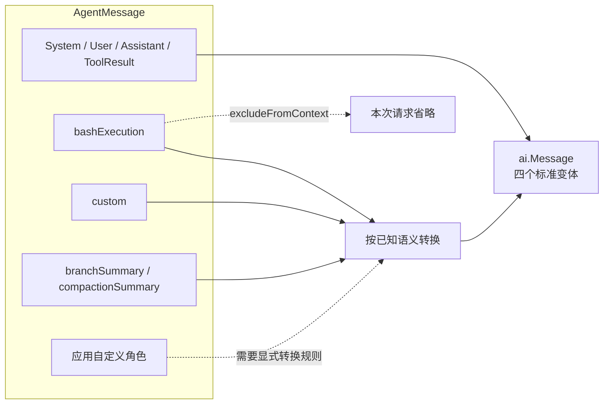

# 第6章：消息系统——Agent 的记忆如何组织与传递

[上一章](learning-ch05-tools.md) · [学习目录](learning.md) · [下一章](learning-ch07-event-driven.md)

结构对应 [参考教程第6章](https://dg-ai-notes.pages.dev/modules/ch06-messages/)。本章的两个关键修正是：当前模型消息包含 `system`，Go 的扩展表示也不使用 TypeScript 声明合并。

## 1. 开场：一条 Bash 命令的消息之旅

用户直接执行 `!pwd` 与模型调用 `bash` 是两种来源。模型调用表现为 assistant 中的 tool call，随后有对应 `toolResult`；用户直接执行命令则可以保存为 `bashExecution` 自定义消息，带命令、输出、退出状态等信息。

两者都能帮助模型理解环境，但不能伪造同一条调用链。没有模型 tool call 的用户 Bash 输出，不应该凭空变成一个没有来源的 tool result。

## 2. 第一层：模型协议中的四类消息

### 2.1 每种消息的数据结构

模型 API 能说的话其实只有四类：系统设定、用户输入、助手输出、工具结果。字段名各家不同，但这四类语义是共同的最小集合。`ai.Message` 就按这个最小集合设计。

| `ai.Message` 变体 | 主要内容 | 阅读时注意 |
|---|---|---|
| `SystemMessage` | 系统文本、顺序化 sections、工具新增与移除 | 系统状态在 Transcript 中随位置变化 |
| `UserMessage` | 文本或含图片的内容块 | 不能把有序块任意合并或丢弃 |
| `AssistantMessage` | 文本、thinking、tool call、Usage、模型与停止信息 | 错误也是明确的最终状态 |
| `ToolResultMessage` | 调用 ID、工具名、内容、details、错误与用量 | 关联到此前的工具调用 |

`ai.Message` 是封闭接口：想新增一种，必须改 `ai` 包，不能在别处声明一个同名类型就自动生效。这样 Provider 收到的消息集合是可穷举的，转换逻辑才不会漏分支。thinking 签名、工具调用签名、缺失字段与显式空值都可能影响重放，不只是展示细节。

先亲自构造标准消息。以下片段使用真实公共类型；`ai` 层的 Role 由变体序列化，不像 `agent.UserMessage` 那样需要填写 Role 字段。

```go
system := ai.SystemMessage{Content: ai.SystemText("Read before editing."), Timestamp: 1}
user := ai.UserMessage{Content: ai.UserText("Explain auth.go"), Timestamp: 2}
assistant := ai.AssistantMessage{
    API: ai.APIOpenAICompletions, Provider: "learning", Model: "fixture",
    Content: []ai.AssistantContentBlock{
        ai.TextContent{Text: "I will inspect the file."},
        ai.ToolCall{ID: "read-1", Name: "read", Arguments: ai.JsonObject{"path": "auth.go"}},
    },
    StopReason: ai.StopReasonToolUse, Timestamp: 3,
}
result := ai.ToolResultMessage{
    ToolCallID: "read-1", ToolName: "read",
    Content: []ai.ToolResultMessageContent{ai.TextContent{Text: "package auth"}},
    IsError: false, Timestamp: 4,
}
messages := []ai.Message{system, user, assistant, result}
```

这里只演示本地构造，不为虚构模型建立线上请求。三种内容容器各有约束：

```text
UserContent = UserText 或 UserContentBlocks
  blocks: TextContent / ImageContent
Assistant.Content
  TextContent / ThinkingContent / ToolCall
ToolResult.Content
  TextContent / ImageContent
```

文本与图片交替时，顺序仍有意义。“这张图”“下一张图”的指代依赖前后位置。thinking 内容还可能带签名或 redacted 状态，跨模型转换时不能当作普通文字直接拼到 user 文本里。

工具结果的 details 通常供宿主和 UI 使用，不保证直接进入线上请求。`Details=nil` 与显式 `details:null` 由 `DetailsNull` 等状态区分；不能把所有空值都理解成“这个字段不存在”。

### 2.2 一个完整对话示例

```text
system：提示词与 read 工具声明
user：解释 config.go 的用途
assistant：文本 + toolCall(id=t1, name=read, arguments=...)
toolResult：toolCallId=t1，文件内容
assistant：最终解释
```

这是一份解释性的记录，不是可直接发送的 JSON。真实请求还要经过规范化和 Provider 转换；system 不一定最终以同名 wire 角色发送，工具结果结构也因 API 而异。

## 3. 矛盾：Agent 里的消息更多

可是只有这四类，产品需求马上会撞墙。举几个具体例子：

- 用户直接在终端敲 `!pwd`，这条命令不是模型要求的，不能伪造一个 toolResult 塞回去。
- 会话太长，系统生成了一段压缩摘要，它不是用户说的话。
- 用户从旧分支跳回来，需要告诉模型“之前试过另一条路”。
- 扩展想记录一条“构建通过”的提示，有自己的类型和显示方式。

这些都得存下来，也大多需要让模型看到。于是磁盘上出现了更多种类：模型切换、标签、上下文编辑、用量统计。它们有的影响对话，有的只影响恢复和显示。

所以必须区分四层东西：Session Entry（磁盘记录）、`agent.AgentMessage`（宿主内部消息）、`ai.Message`（模型协议消息）、Provider 报文（某个 API 的 JSON）。它们是逐层转换的关系，不是可以互换的同一对象。

## 4. 第二层：AgentMessage，内部丰富、外部受约束

### 4.1 AgentMessage 的联合表示

`agent.AgentMessage` 是带标签的 Go struct，持有 System、User、Assistant、ToolResult 指针中的一个，或者 Custom 映射。标准变体以类型表达数据，Custom 承担应用级消息。构造时应保持变体互斥，不能填多个指针再期待序列化器猜测意图。

图 6-1：产品消息比 Provider 消息丰富；箭头是转换，不是 Go 类型继承。



下面是对应 Go 表示的构造示例，只有 Custom 被设置：

```go
message := agent.AgentMessage{Custom: map[string]any{
    "role": agent.RoleBashExecution,
    "command": "pwd", "output": "/workspace/demo\n",
    "exitCode": float64(0), "cancelled": false, "truncated": false,
    "timestamp": int64(1700000000000),
}}
```

这里用 float64 表示 JSON 解码后常见的数值形状；如果手工构造映射，应检查消费方接受的数值类型，不要把 TypeScript 的 number 与 Go 的 int 混为一谈。

### 4.2 自定义消息的扩展位置

已知自定义角色包括 `bashExecution`、`custom`、`branchSummary`、`compactionSummary`。它们的字段服务于产品层，例如 Bash 需要退出码，分支摘要需要说明来源。扩展自己的记录是否进模型，取决于投影和转换规则。

下面是三种 Agent 层消息的 JSON 形状，省略与主题无关的可选字段；它们不是磁盘 Entry，所以没有外层 `type/id/parentId`：

```json
{"role":"custom","customType":"build-note","content":"Tests passed locally; remote checks are pending.","display":true,"timestamp":1}
{"role":"branchSummary","summary":"Approach A was explored but not applied.","fromId":"old-leaf","timestamp":2}
{"role":"compactionSummary","summary":"The goal is to fix validation without changing the API.","tokensBefore":185000,"timestamp":3}
```

| 消息 | 产品读者需要什么 | 模型读者需要什么 |
|---|---|---|
| custom | customType、display、details 与专用渲染 | content 中要传达的文本/图片 |
| branchSummary | 来源分支及导航信息 | 探索结果及“来自另一分支”的说明 |
| compactionSummary | 压缩前状态、摘要位置 | 旧任务背景与待继续事项 |

给自定义消息加 role 并不自动产生发送规则；未知角色要在自己的 ConvertToLlm 中显式映射。把 JSON 存进会话也不意味着 Provider 接受同名 role。

### 4.3 Go 如何替代声明合并

TypeScript 教程通过扩展接口和 declaration merging 增加联合成员。Go 不提供这种机制；PiG 使用显式结构、Custom 表示和转换函数。不能在另一包声明一个同名接口就自动扩展 `ai.Message`，也不应把任意 map 当成已验证的 Provider 输入。

例如应用希望增加 `buildReport` 消息，可以在自己的 ConvertToLlm 中明确映射。以下函数不改变原消息，先把该角色转成已知 custom 消息，再交给标准转换，避免破坏标准转换的工具流边界处理：

```go
package demo

import (
    "github.com/MichaelKinsy/PiG/agent"
    "github.com/MichaelKinsy/PiG/ai"
)

func ConvertBuildReports(messages []agent.AgentMessage) ([]ai.Message, error) {
    mapped := make([]agent.AgentMessage, len(messages))
    for i, message := range messages {
        mapped[i] = message
        if message.Role() != "buildReport" { continue }
        text, _ := message.Custom["summary"].(string)
        mapped[i] = agent.AgentMessage{Custom: map[string]any{
            "role": agent.RoleCustom, "customType": "build-report",
            "content": "Build report: " + text, "display": false,
            "timestamp": message.Custom["timestamp"],
        }}
    }
    return agent.ConvertToLLM(mapped), nil
}
```

将函数赋给 `AgentLoopConfig.ConvertToLlm` 即定义了转换契约。未设置这个函数的其他应用仍不知道 buildReport，正是显式边界要保证的事情。若报告的 summary 缺失在业务上是错误，应在输入边界返回错误，而非像教学片段一样允许空文本。

## 5. 转换边界：ConvertToLLM

### 5.1 翻译发生在什么时候

转换位于每次模型请求的准备阶段，而不是消息刚产生时就永久丢弃产品字段。Session 保存的原始信息还能服务 UI 和恢复；请求准备从当前投影中选择要发送的消息。

图 6-2：同一条消息有存储视图、Agent 视图和模型请求视图。


比如用户 Bash 记录依旧可以带命令、退出码和完整输出路径；模型请求只需要一段能解释执行结果的文本。这个转换不是不可逆序列化，不应拿模型收到的文本覆盖产品 Entry。

### 5.2 转换规则：标准消息保留，已知自定义消息按规则处理

| 输入 | 转换结果 |
|---|---|
| 标准 system/user/assistant/toolResult | 转成对应 `ai.Message`，保留所需元数据 |
| `bashExecution` | 命令、输出和状态描述组成 user 内容；排除标记为真时省略 |
| `custom` | 按定义转成 user 文本或内容块 |
| `branchSummary` | 带来源提示的 user 摘要 |
| `compactionSummary` | 带压缩上下文说明的 user 摘要 |
| 未知自定义角色 | 不自动传给模型，需明确转换规则 |

所以“所有自定义消息都变 User”不够准确。已知角色的处理规则和未知角色的省略必须分开理解；转换还要保持工具调用与结果之间的合法顺序。

### 5.3 具体例子：BashExecution 的转换

产品记录可以同时携带 command、output、exitCode、cancelled、truncated、fullOutputPath。模型看到的是可读文本，说明运行了什么、输出是什么、是否取消或失败、完整输出在哪里。字段仍然保留在产品记录里，方便 UI 显示专门的命令组件。

转换前的消息示例：

```json
{
  "role": "bashExecution", "command": "pwd",
  "output": "/workspace/demo\n", "exitCode": 0,
  "cancelled": false, "truncated": false, "timestamp": 1700000000000
}
```

模型层的表达示意：

```json
{
  "role": "user",
  "content": [{"type":"text","text":"Ran `pwd`\n```\n/workspace/demo\n\n```"}],
  "timestamp": 1700000000000
}
```

具体换行和附加状态以 `bashExecutionToText` 的实现为准。退出非零时追加退出状态，取消时追加取消信息，截断时提示完整输出路径；无输出时显式说明 `(no output)`。不要把“没有输出”和“没有运行”混淆。

下面可以在仓库内运行，观察真实转换和排除结果，不需要 Provider：

```go
package main

import (
    "encoding/json"
    "fmt"
    "github.com/MichaelKinsy/PiG/agent"
)

func main() {
    visible := agent.AgentMessage{Custom: map[string]any{
        "role": agent.RoleBashExecution, "command": "pwd",
        "output": "/workspace/demo", "exitCode": float64(0),
        "cancelled": false, "truncated": false, "timestamp": int64(1),
    }}
    hidden := agent.AgentMessage{Custom: map[string]any{
        "role": agent.RoleBashExecution, "command": "pwd",
        "output": "local diagnostic", "excludeFromContext": true, "timestamp": int64(2),
    }}
    output := agent.ConvertToLLM([]agent.AgentMessage{visible, hidden})
    data, err := json.MarshalIndent(output, "", "  ")
    if err != nil { panic(err) }
    fmt.Println(string(data))
}
```

预期只有一条模型消息，排除的 Bash 仍在输入的 AgentMessage 集合中。转换函数没有撤销命令，也没有删除磁盘记录。

## 6. 两阶段管道：为什么 transform 与 convert 分开

`TransformContext` 面向丰富的 Agent 消息，适合做上下文选择和扩展处理；`ConvertToLlm` 把所选消息变成模型层类型。当前流程还有 `TransformLLMMessages`，可在标准模型消息层进行后续处理。

为什么分两次而不是一次做完？因为两个阶段手里的东西不一样：

- `TransformContext` 看到的是产品消息：Bash、摘要、扩展记录都在。它能决定“这次请求要带哪些”。
- `ConvertToLlm` 负责翻译：把选中的产品消息变成模型认识的四种类型。
- `TransformLLMMessages` 只看到模型消息，适合做协议层的最后调整，例如修整某些 API 不接受的内容。

顺序反了会出问题：先翻译再筛选，就丢了产品字段，无法判断某条 Bash 该不该排除；只筛选不翻译，模型又看不懂自定义角色。

随后 `ai.NormalizeContext` 把简写系统提示和工具声明纳入系统消息，验证并构造 `TranscriptContext`。Provider 再处理具体协议和重放限制，包括已记录的工具流修复差异 D48。把所有步骤写成“过滤一个数组”会遗漏状态回放、顺序和协议转换。

`TranscriptContext.Messages()` 是给保留或修改内容的调用者使用的复制访问器；`At` 等借用访问需遵守只读约定。D104 记录了 Go 观察与所有权边界的相关机制。修改借用数据可能污染后续请求，不能为少一次复制而破坏契约。

## 7. 过滤机制：有些消息模型不该看

### 7.1 excludeFromContext 的语义

用户 `!!` 命令对应的 Bash 记录可以带 `excludeFromContext`。它仍可用于历史和显示，但转换时不送入模型。排除上下文不是删除文件、撤销命令或擦除日志。

### 7.2 三种常见可见性组合

| 场景 | 历史或 UI | 模型上下文 |
|---|---|---|
| 普通用户消息、正常 Bash | 可保存并显示 | 根据转换规则发送 |
| 排除上下文的 Bash | 可保存并显示 | 省略 |
| `custom` 的 `display:false` | 按渲染规则隐藏展示 | 仍可能发送给模型 |

因此 `display:false` 不是保密标志，未知角色也不等于获得了可靠的权限隔离。敏感信息应在进入记录和请求的边界明确处理。

## 8. 完整数据流：从用户操作到模型看到的消息

```text
用户输入 / 工具结果 / 扩展记录
  → Session Entry 与当前分支
  → 会话投影（压缩、context_edit、系统状态）
  → AgentMessage
  → TransformContext
  → ConvertToLlm
  → TransformLLMMessages 与请求级处理
  → NormalizeContext → TranscriptContext
  → Provider 报文
```

UI 同时可以读取产品消息和事件，不必从 Provider 报文反推显示数据。模型每轮接收的是当前投影，不是整个 JSONL 文件。

## 9. 总结

### 9.1 一条主线：数据结构同时照顾两个读者

产品需要可恢复、可显示、带来源的记录；模型需要协议合法、相关且有序的消息。通过明确转换连接二者，避免用一种数据结构承担所有职责。

### 9.2 把这条主线用到自己的项目

先规定原始记录和发送记录的差异，再为过滤、转换、未知角色和工具关联写测试。尤其要覆盖模型切换、错误 assistant、孤立工具结果和 `null` 字段，而不是只测试纯文本问答。

## 10. 下一站

下一章跟踪同一批消息怎样触发观察事件和可干预的扩展钩子。

**源码阅读与练习**

- [ai/messages.go](https://github.com/MichaelKinsy/PiG/blob/c64bebd820e20411599a8b1e8e52aa92b4a2ed82/ai/messages.go)、[ai/transcript.go](https://github.com/MichaelKinsy/PiG/blob/c64bebd820e20411599a8b1e8e52aa92b4a2ed82/ai/transcript.go)：模型类型与规范化边界。
- [agent/messages.go](https://github.com/MichaelKinsy/PiG/blob/c64bebd820e20411599a8b1e8e52aa92b4a2ed82/agent/messages.go)、[agent/transform.go](https://github.com/MichaelKinsy/PiG/blob/c64bebd820e20411599a8b1e8e52aa92b4a2ed82/agent/transform.go)：产品消息和转换规则。
- [agent/transform_custom_user_boundary_test.go](https://github.com/MichaelKinsy/PiG/blob/c64bebd820e20411599a8b1e8e52aa92b4a2ed82/agent/transform_custom_user_boundary_test.go)：自定义消息与工具流边界。
- 练习：分别为普通 Bash、`excludeFromContext` Bash、`display:false` custom 和未知 role 写出“存储、展示、发送”的三列预期。

[上一章](learning-ch05-tools.md) · [学习目录](learning.md) · [下一章](learning-ch07-event-driven.md)
