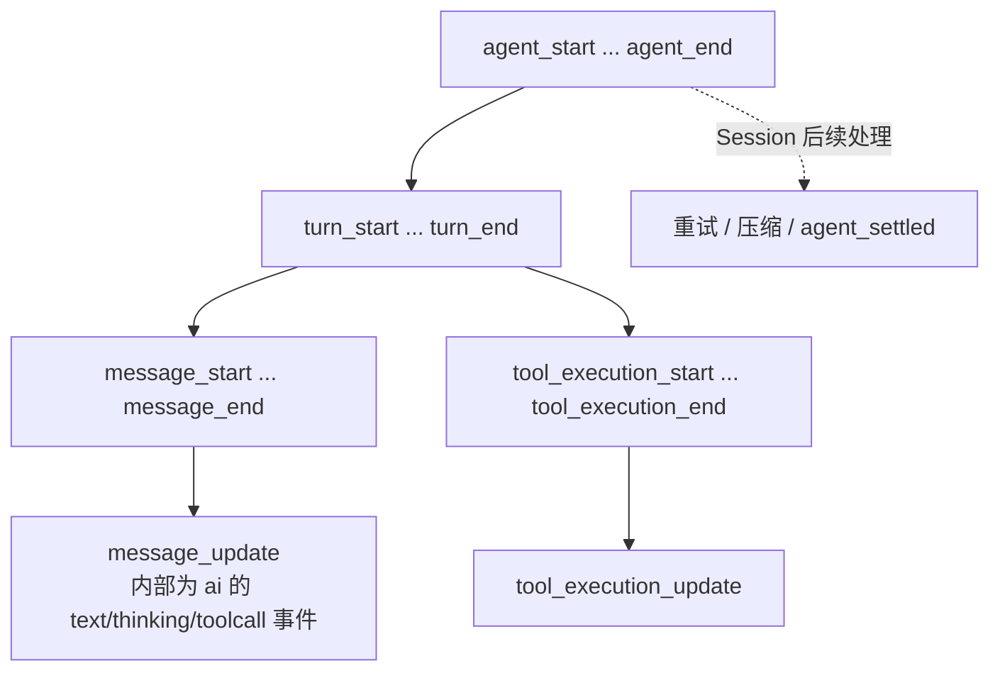
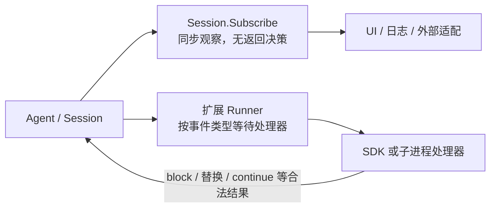
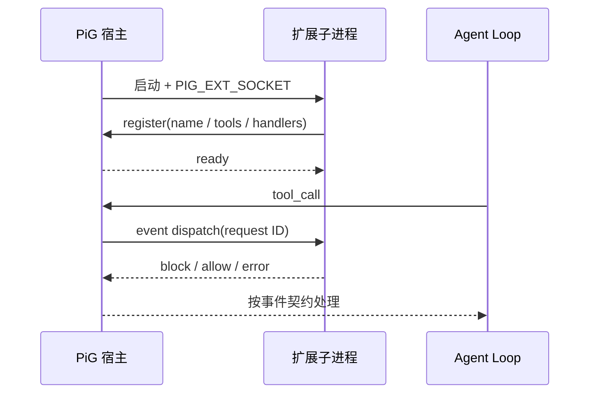

# 第7章：事件驱动——观察运行与干预行为

[上一章](learning-ch06-messages.md) · [学习目录](learning.md) · [下一章](learning-ch08-context-engineering.md)

结构对应 [参考教程第7章](https://dg-ai-notes.pages.dev/modules/ch07-event-driven/)。当前事件类型不断演进；下文重点讲语义和等待关系，不承诺一个过期的固定事件数量。

## 1. 为什么需要事件系统

### 1.1 一个直觉：状态跟踪

模型的一次流包含开始、增量、工具执行、结果和结束。事件给 UI、日志、JSON 模式与宿主观察者提供增量，不必等 Session 最后再比较整份历史。

这就像查快递：你不需要等包裹送到才知道进度，物流系统会在揽收、运输、派送各个节点推送状态。事件就是 Agent 的运行状态推送。

### 1.2 不用事件会怎样

把所有工作集中到一次同步函数调用，会隐藏流式状态和工具进度，并让不同运行模式复制执行路径。事件把观察点暴露出来，但也带来顺序、错误和回调耗时责任。

### 1.3 发布—订阅与直接调用

事件订阅通常用于观察已经发生的状态；前置钩子可以根据返回值阻止或修改操作。两者不能仅因都叫“回调”就互换。

## 2. 两条管道的全貌：事件源与两类监听器

### 2.1 事件源：AgentEvent 是开放演进的产品契约

`agent.AgentEvent` 是联合类型，除了 `agent_start`、`turn_start`、`message_start`、`message_update`、`message_end`、`tool_execution_start/update/end`、`turn_end`、`agent_end` 外，还包含队列、Session 信息、压缩和 `agent_settled` 等事件。应从定义与当前生产调用点读取完整列表，不使用参考教程中的“十种”当成固定枚举。

`agent_end` 表示本次 Agent 运行生命周期；Session 还可能做重试或其他后续工作。想知道整体 Session 当前是否安定，应查看相应 Session/settled 语义，而不是只监听 `agent_end`。

图 7-1 对应原教程的四层事件嵌套，展示通用循环的主要事件，额外 Session 事件在外侧处理。



两轮工具任务的示意序列：

```text
agent_start
  turn_start
    message_start / message_end          用户输入或系统状态
    message_start                       assistant
      message_update × N
    message_end
    tool_execution_start
      tool_execution_update × N
    tool_execution_end
    message_start / message_end          toolResult
  turn_end
  turn_start
    message_start / updates / message_end
  turn_end
agent_end
Session 完成其他工作后：agent_settled
```

工具进度不是一条新的持久化对话消息；最终工具结果才进入历史。并行工具的开始与结束可以交错，消息序列仍按批次规则组织。

| 事件组 | 应读取的数据 | 不应推断的事实 |
|---|---|---|
| 消息 update | assistant 内部增量类型、内容索引 | 每个 update 都是文本 token |
| 工具 start | 工具名、ID、参数 | 工具已通过前置权限检查 |
| 工具 end | 调用结果与错误标记 | 后续模型已经回答 |
| turn end | 本轮 assistant 与工具结果 | 整个 Session 已空闲 |
| agent settled | Session 运行的最终稳定状态 | 下次新输入也不会启动工作 |

### 2.2 两类管道：Agent/Session 订阅与扩展钩子

`Agent.Subscribe` 和 `coding.Session.Subscribe` 是观察事件接口。扩展宿主事件通过 `coding/extension/host/inproc.Runner.Emit` 等入口派发；具体扩展 API 的处理、改写和阻止能力由事件类型规定。

这不是“一条订阅总线 + 一个 JS Map”的旧版实现。PiG 的产品扩展使用 Go 宿主、多语言 SDK 和子进程协议；只有业务确实需要时，才沿扩展架构追踪这一部分。

图 7-2：观察路径与可干预路径按职责区分，两个路径都可能等待同步工作完成。



工具的真实时序要结合第5章：`tool_execution_start` 在参数准备前发出；随后 `tool_call` 钩子可能阻止执行；被阻止时仍有结果和结束状态。不能从 start 事件推出“阻止已经来不及”，也不能从观察事件返回一个 map 就让宿主执行阻止。

## 3. 管道 A：Session.Subscribe

### 3.1 怎么用：注册、签名、注销

Go SDK 中典型形式是：

```go
unsubscribe := session.Subscribe(func(event agent.AgentEvent) {
    log.Printf("event: %T", event)
})
defer unsubscribe()
```

回调接收 `AgentEvent`，没有返回值。调用返回注销函数，可限定订阅生命周期。真实应用可以按事件类型提取文本、工具状态和结束原因。

### 3.2 Session 订阅会等待回调

`coding.Session.Subscribe` 在发布路径中按注册顺序同步调用 listener。慢回调会阻塞事件发布，并可能拖慢运行。因此该 API 虽然用于只读观察，也不等于异步、不阻塞。订阅者应快速复制所需状态，另行交给有界工作队列；不得把 Session 的借用状态保留到调用之后修改。

`Agent.Subscribe` 的函数签名与 Session 订阅不同，具有上下文及错误返回。需要理解哪一层接收者时，要查看准确类型，不能统称一个接口。

当前 `Session.notifyListeners` 的另一个源码细节是每一步重新读取 listener 列表，而不是在发布开始时冻结一份快照：

```text
index = 0
repeat:
    current = 当前 listener 列表
    若 index 越界则返回
    同步调用 current[index]
    index++
```

因此，回调中新增订阅可以参与同一次派发；回调中移除自己或更早的位置可能使后面的元素前移，从而跳过一个位置。这个规则与某些扩展分发器的快照语义不同。通常把注册与注销放在运行边界，就不必依赖这些容易误判的动态行为。

把同步观察接到异步输出端，需要明确队列容量、取消、结果保留与关闭责任。下面是设计示意而非完整程序：

```text
同步 Subscribe 回调
  → 复制需要发送的增量或序列化为不可变字节
  → 有界队列（满时：阻塞、取消，或只合并允许丢弃的临时进度）
  → 由请求拥有的发送任务
  → 请求结束：取消 → 注销 → 等待任务退出
```

审计、错误和最终结果不能按“UI 临时进度”策略丢弃。把原始事件中的借用对象直接传到另一 goroutine，也可能越过观察所有权边界。若只是学习 SSE，第5节采用直接写入的简单示例，明确让网络写入产生背压，生产服务再使用受控队列。

### 3.3 管道 A 能收到哪些事件

收到的是 Agent 运行期间生产的事件；Session 可能还在事件外维护持久化和投影。事件类型包含多轮消息、工具批次与更高层生命周期事件。新增状态可以扩大事件联合类型，因此处理未知类型时要避免把日志解码崩溃当作兼容策略。

### 3.4 什么时候用管道 A

只需观察流式文本、记录工具开始和结束、构建一个嵌入 Go 程序的进度视图时使用 Session 订阅。回调内不应执行网络请求或大范围读取 Session 历史，否则就把同步发布路径变成新的慢任务。

## 4. 管道 B：扩展事件宿主

### 4.1 怎么用：定义扩展并注册处理器

扩展使用对应语言的 SDK 注册事件处理器，PiG 负责发现、加载和调度。一般事件遵循 SDK wire contract；本地 Go 集成也有强类型结构。子进程扩展需要处理宿主协议与进程生命周期，而不只是实现一个 JavaScript 对象。

下面是当前 Go Extension SDK 的最小工厂示例。它注册一个工具、一个命令和一个会话开始处理器；工具执行失败时返回 `error`，宿主负责把它变成工具结果。

```go
package review

import sdk "github.com/MichaelKinsy/PiG/extensions/sdk"

func Extension() *sdk.Extension {
    e := sdk.New("review")
    e.Tool("review_ping", "Return a short health response.",
        sdk.Schema{"type": "object", "properties": map[string]any{}},
        func(ctx sdk.Context, params map[string]any) (any, error) {
            return "pong", nil
        })
    e.Command("review", "Show the extension status.", func(ctx sdk.Context, args string) error {
        ctx.Notify("review is loaded", "info")
        return nil
    })
    e.OnSessionStart(func(ctx sdk.Context, data map[string]any) (any, error) {
        ctx.SetStatus("review", "loaded")
        return nil, nil
    })
    return e
}
```

把它保存到由 `pig extension init ./review --lang go` 生成的扩展模块中，再用 `pig install ./review --validate-only --json` 验证。这里的 `sdk.Extension` 是扩展作者 API，不等于内置工具的 `extension.ToolDefinition`；前者通过宿主协议注册，后者在 PiG 产品层装配。

不同扩展 SDK 都实现共同 API，但其创建方式不同。下面以一个隔离的 Go 工厂实例为例，经注册握手提供自身的工具和 handler。packed/fused 是其他实现方式，不能从此图推断每种扩展都占一个独立 OS 进程。这里的工厂也不同于主程序源码按值提供的内置 `ExtensionFactory`。

实际使用的命令流：

```text
pig extension init ./review --lang go
        ↓ 生成 go.mod + extension.go
实现 Extension() *sdk.Extension
        ↓
pig install ./review --validate-only --json
        ↓
pig -e ./review
        ↓ 在 Session 中编辑代码并 /reload
```

Go SDK 面向 PiG 的子进程宿主；调用 `Extension.Run()` 需要宿主注入 `PIG_EXT_SOCKET`。单独运行一个没有宿主的 Go main 不等同于加载扩展。



### 4.2 注册与事件表

扩展加载时，处理器按扩展身份注册到宿主。`Runner.Emit` 根据事件 Type 找到已注册处理器，并按扩展加载顺序依次调用。部分 typed dispatcher 对 handler 返回值作专门累计或短路；不要只由通用 `Emit` 推断所有事件的结果策略。

把源码中的身份、注册和派发拆开看：

```text
加载扩展 → Extension 的身份与来源
注册 handler(eventType, callback) → 该扩展拥有的事件处理集合
派发事件 → 读取该 eventType 的处理器 → 按分发规则等待与合并结果
reload / shutdown → 移除旧身份拥有的注册与工作
```

宿主 `extension.Extension` 还记录 Tools、Commands、Flags、Shortcuts、MessageRenderers 等注册。运行时注册使用同步机制，不能把早期构造用的 Handlers map 当作任意时刻可并发改写的公开总线。

| 事件 | 典型发生位置 | handler 可以做什么 |
|---|---|---|
| session_start | Session 建立或加载后的扩展边界 | 初始化扩展状态与展示 |
| input | 输入转换边界 | 按契约处理或替换输入 |
| before_agent_start | 开始一次运行前 | 提供附加消息或系统提示调整 |
| context | 模型请求准备时 | 替换本次请求的消息集合 |
| tool_call | 验证后、Execute 前 | 允许或阻止调用 |
| tool_result | 执行后的结果处理 | 覆盖指定结果字段 |
| session_before_compact | 默认摘要生成之前 | 取消或提供自定义压缩结果 |
| session_before_tree | 导航生效之前 | 按导航契约取消或提供摘要处理 |

这不是完整事件枚举。每一项都应继续定位自己的 typed dispatcher；“名字有 before”不足以推断它允许返回哪些字段。

### 4.3 派发路径与错误处理

`Runner.Emit` 等待 handler。调用出错时，通用派发会记录并继续其他处理器；`tool_call` 这类有专用分发契约的事件可以在错误时停止。SessionBefore 事件的 Cancel 结果会短路。不同路径不能统一解释成“所有监听器都调用完且错误被吞掉”。

`tool_call` 的 typed result 形状如下：

```go
type ToolCallEventResult struct {
    Block     bool
    Reason    string
    Terminate bool
}
```

它只在扩展处理 `tool_call` 时有意义。`Block` 阻止工具执行，`Reason` 进入结果说明，`Terminate` 参与当前批次结束判断；不是任意 `session.subscribe` 回调都可以返回它。当前 PiG 的批次只有在每个最终结果都要求终止时才整体终止。

通用 `Emit` 还会处理 panic 隔离和 handler 错误记录；专用 `EmitToolCall` 会在 handler error 时返回错误。读扩展时要先找事件的 typed dispatcher，再决定“出错后继续还是停止”。

多语言子进程还需考虑消息帧背压、context 取消、异常隔离和 shutdown。并发任务由宿主拥有并等待；测试不应靠 sleep 来假设事件顺序。

### 4.4 扩展上下文

SDK 上下文向扩展提供与其生命周期相关的能力，例如当前 Session 状态、工具注册、模型信息或 UI 命令。能读取什么和能修改什么由权限、运行位置与具体 API 决定，不应仅根据事件可观察性推出任意 Session 操作能力。

### 4.5 扩展独占事件的触发位置

查看事件的生产调用点，确认它在持久化之前还是之后、能否取消、是否接收旧状态或最新状态、handler 返回是否影响后续步骤。前置、结果和边界类事件的返回语义尤其重要。

### 4.6 什么时候用管道 B

需要扩展产品行为、注册工具或改变定义好的事件结果时使用扩展机制。仅为了观察进度而启动外部进程、增加 SDK 协议和生命周期，会增加不必要复杂度；嵌入 Go 程序通常先评估 Session.Subscribe。

## 5. 实战：四类场景，选择正确边界

### 5.1 只读观察：Session.Subscribe

#### 场景1：实时观察 Agent 在做什么

将少量不可变进度信息传递给本地 UI 或日志。记住回调是同步的，并在程序结束时注销。

```go
unsubscribe := session.Subscribe(func(event agent.AgentEvent) {
    switch event := event.(type) {
    case agent.ToolExecutionStartEvent:
        fmt.Printf("start %s\n", event.ToolName)
    case agent.ToolExecutionEndEvent:
        fmt.Printf("end %s error=%v\n", event.ToolName, event.IsError)
    case agent.AgentSettledEvent:
        fmt.Printf("settled aborted=%v\n", event.Aborted)
    }
})
defer unsubscribe()
```

如果要观察流式文本，处理 `agent.MessageUpdateEvent` 的 `AssistantMessageEvent`；它可能是 `ai.TextDeltaEvent`、`ThinkingDeltaEvent` 或 tool-call 事件。`Agent.RefreshEvent` 用于在 retained event 经历等待后刷新部分状态，不要只监听“看起来像文本”的事件。

如果要把增量发送给浏览器，优先在订阅回调中写入由 HTTP 请求拥有的流，并让写入错误触发请求取消；不要在回调中启动无主 goroutine。

#### 场景2：流式转发到 Web 前端（SSE）

以下完整函数由 HTTP handler 调用，调用方为每个请求独占一个 Session，设置服务器写超时并负责关闭 Session。它只传文本增量和最终状态，不把工具参数、thinking 或整个会话泄漏给浏览器。

```go
package demo

import (
    "context"
    "encoding/json"
    "errors"
    "fmt"
    "net/http"
    "sync"

    "github.com/MichaelKinsy/PiG/agent"
    "github.com/MichaelKinsy/PiG/ai"
    "github.com/MichaelKinsy/PiG/coding"
)

func StreamReply(w http.ResponseWriter, r *http.Request, session *coding.Session, prompt string) error {
    if _, ok := w.(http.Flusher); !ok { return errors.New("streaming unsupported") }
    ctx, cancel := context.WithCancel(r.Context())
    defer cancel()
    w.Header().Set("Content-Type", "text/event-stream")
    controller := http.NewResponseController(w)
    var mu sync.Mutex
    var writeErr error
    send := func(value any) {
        mu.Lock()
        defer mu.Unlock()
        if writeErr != nil { return }
        data, err := json.Marshal(value)
        if err == nil { _, err = fmt.Fprintf(w, "data: %s\n\n", data) }
        if err == nil { err = controller.Flush() }
        if err != nil { writeErr = err; cancel() }
    }
    unsubscribe := session.Subscribe(func(event agent.AgentEvent) {
        if update, ok := event.(agent.MessageUpdateEvent); ok {
            if delta, ok := update.AssistantMessageEvent.(ai.TextDeltaEvent); ok {
                send(map[string]any{"type": "delta", "text": delta.Delta})
            }
        }
    })
    defer unsubscribe()
    messages, err := session.Send(ctx, prompt)
    if err == nil {
        for i := len(messages)-1; i >= 0; i-- {
            if m := messages[i].Assistant; m != nil {
                if m.StopReason == ai.StopReasonError || m.StopReason == ai.StopReasonAborted {
                    err = fmt.Errorf("assistant %s", m.StopReason)
                }
                break
            }
        }
    }
    send(map[string]any{"type": "complete", "ok": err == nil})
    mu.Lock()
    defer mu.Unlock()
    return errors.Join(err, writeErr)
}
```

这个简单版本的网络写入会阻塞订阅回调，这是明确选择的背压，而不是“Agent 不等”。高并发服务应采用前述受控队列，并保留取消、写失败、最终结果与等待退出的语义。

### 5.2 管道 B 实战组：工具拦截与上下文注入

#### 场景3：工具调用拦截

这是可由 `pig -e` 加载的 Go 工厂，阻止名为 `delete_table` 的自定义工具。它不是覆盖 bash、SQL 或其他工具的完整安全策略。

```go
package guard

import sdk "github.com/MichaelKinsy/PiG/extensions/sdk"

func Extension() *sdk.Extension {
    e := sdk.New("learning-guard")
    e.OnEvent("tool_call", func(ctx sdk.Context, data map[string]any) (any, error) {
        if data["toolName"] == "delete_table" {
            return map[string]any{"block": true, "reason": "Deleting tables is disabled."}, nil
        }
        return nil, nil
    })
    return e
}
```

#### 场景4：上下文预处理

以下工厂在每次模型请求前加入时间提示，不修改 Session 历史。它保留事件中已有的消息顺序，在开头加入普通 user 文本；涉及工具流的业务插入应先验证 Provider 的合法消息边界，必要时使用系统 section 更新代替任意插入。

```go
package timehint

import (
    "fmt"
    "time"
    sdk "github.com/MichaelKinsy/PiG/extensions/sdk"
)

func Extension() *sdk.Extension {
    e := sdk.New("learning-time")
    e.OnEvent("context", func(ctx sdk.Context, data map[string]any) (any, error) {
        messages, ok := data["messages"].([]any)
        if !ok { return nil, fmt.Errorf("context messages must be an array") }
        now := time.Now()
        hint := map[string]any{
            "role": "user", "content": "Current time: " + now.Format(time.RFC3339),
            "timestamp": now.UnixMilli(),
        }
        updated := make([]any, 0, len(messages)+1)
        updated = append(updated, hint)
        updated = append(updated, messages...)
        return map[string]any{"messages": updated}, nil
    })
    return e
}
```

若同时加载多个 context handler，后者接收前者已替换的消息。不要为了保持“原始输入”又从旧快照重建并覆盖前面的变化。

### 5.3 怎么选管道：先问是否需要返回决策

问题是“我想知道发生了什么”，先找观察接口；问题是“我需要改变即将发生的操作”，找有明确阻止或替换结果语义的钩子；问题是“必须扩展产品能力”，选择 Extension API。

### 5.4 小结

| 场景 | API | 影响 |
|---|---|---|
| 工具日志 | Session.Subscribe | 观察结果，不改变工具决策 |
| SSE 文本 | Session.Subscribe + HTTP | 对外转发；显式处理背压与取消 |
| 工具拦截 | `tool_call` 扩展 handler | 宿主读取 block / reason |
| 上下文注入 | `context` 扩展 handler | 改变本次模型输入，不直接重写磁盘历史 |

## 6. 总结：理解两类调用路径

第一类提供状态观察，回调耗时仍影响发布者；第二类通过事件契约提供可执行的扩展行为，并按具体分发函数解释等待、错误和返回值。事件数量、调用是否异步、失败是否继续都必须查当前实现。

如果只记一句话：**订阅是“看着”，钩子是“插手”**。看着的时候不要做慢事，插手的时候要读清该事件允许返回什么。两者的共同点是都同步，都占着运行的时间，没有一个能假装自己不在场。

## 7. 下一站

下一章从消息与事件延伸到上下文边界：对话为什么越长越贵，以及宿主如何限制模型实际收到的内容。

**源码阅读与练习**

- [coding/session.go](https://github.com/MichaelKinsy/PiG/blob/c64bebd820e20411599a8b1e8e52aa92b4a2ed82/coding/session.go)：搜索 `Subscribe` 并查看发布路径。
- [agent/agent.go](https://github.com/MichaelKinsy/PiG/blob/c64bebd820e20411599a8b1e8e52aa92b4a2ed82/agent/agent.go)：当前 AgentEvent 联合。
- [coding/extension/host/inproc/runner.go](https://github.com/MichaelKinsy/PiG/blob/c64bebd820e20411599a8b1e8e52aa92b4a2ed82/coding/extension/host/inproc/runner.go)：`Emit`、`EmitToolCall` 和专用 typed dispatch。
- [coding/extension/AGENTS.md](https://github.com/MichaelKinsy/PiG/blob/c64bebd820e20411599a8b1e8e52aa92b4a2ed82/coding/extension/AGENTS.md)：SDK 与扩展生命周期契约。
- 练习：在 Session 订阅器里放一个阻塞屏障，观察发布端什么时候继续；改为快速投递到有界 channel，再比较生命周期。

[上一章](learning-ch06-messages.md) · [学习目录](learning.md) · [下一章](learning-ch08-context-engineering.md)
