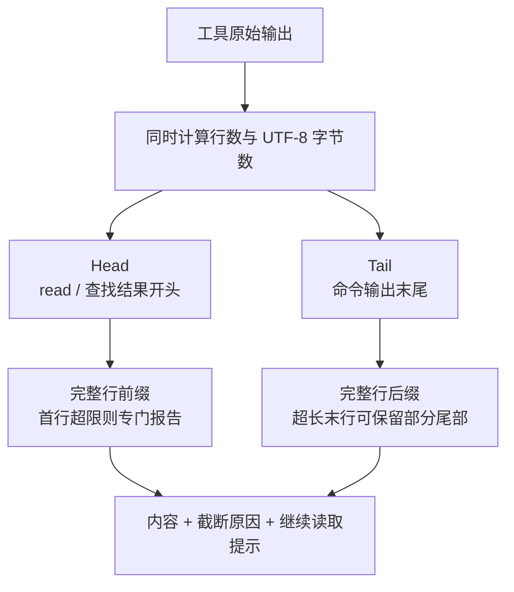
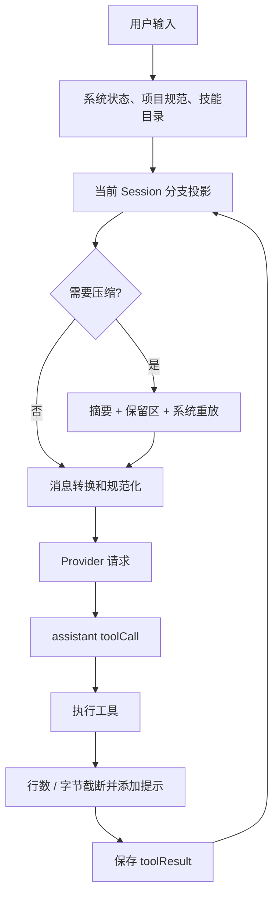

# 第8章：上下文工程——在有限窗口中管理长对话

[上一章](learning-ch07-event-driven.md) · [学习目录](learning.md) · [下一章](learning-ch09-compaction.md)

结构对应 [参考教程第8章](https://dg-ai-notes.pages.dev/modules/ch08-context-engineering/)。有限模型窗口不能容纳无限原文；PiG 通过限制输入、组织提示词和摘要历史，让长会话继续工作，同时保留可恢复的原始记录。

## 1. 问题：窗口是固定的，对话是增长的

模型每次请求都受上下文窗口约束。新消息、工具输出、图片、工具声明和系统提示都会占用预算。一条很长的命令输出就可能超过数十轮普通对话，因此只按“消息条数”裁剪不够。

上下文工程同时处理相关性、体积与协议合法性。省略工具调用却留下它的结果，或者从另一条分支随意拼入一段历史，都可能生成 API 拒绝的请求。

## 2. 地图：两层防护

输入侧限制单次工具输出并动态组装系统提示；历史侧通过 Compaction 和 Branch Summary 控制长会话与分支迁移。Compaction 是旧上下文压缩，Branch Summary 是离开某条分支时对探索内容的摘要，两者服务不同问题。

打个比方，这像一座有进水口和蓄水池的水厂：

- **进水口限流**：单次工具输出太大，先截断再给模型，别让它一次灌满。
- **蓄水池定期清淤**：历史越积越多，把旧的部分压成摘要，保留最近的原文。
- **旁路记录**：离开一条探索分支时，把那条路的结论记成摘要带走，而不是把整条管道搬过来。

```text
新信息 → 工具截断 / 按需读文件 / 系统提示组织
                           ↓
历史记录 → 活动分支投影 → 压缩与摘要 → 本次模型请求
```

## 3. 输入侧一：工具输出截断

### 3.1 问题：一条命令就能占满窗口

例如递归打印仓库或输出完整日志，模型很难从中定位结论，还会消耗预算。工具应返回有边界的内容和下一步读取方式，而不是让所有数据无限进入消息历史。

### 3.2 双重限制：行数与字节，先触者生效

`internal/codingagent/tools/truncate.go` 的默认限制是 2000 行和 `50 * 1024` 字节。字节限制不是 token 限制，中文和图片编码不能按一个字符一个字节估算。显式的零限制与未提供限制也不相同，选项用指针区分。

### 3.3 两种策略：TruncateHead 与 TruncateTail

Head 保留开头，适合读文件和查找结果；Tail 保留结尾，适合命令最终状态与末尾错误。用 shell 的话说，Head 像 `head -n`，Tail 像 `tail -n`。具体工具决定使用哪种策略和提示格式。当前还有 middle 截断能力，但不能因此把所有内置工具都解释成保留中间或两端。

图 8-1：同一份数据，不同任务需要保留不同位置。



用小预算观察真实函数，比直接看 2000 行例子更清晰。下面是可运行的仓库内程序，导入 SDK 公共截断辅助函数；不需要模型、终端 UI 或真实文件。

```go
package main

import (
    "fmt"
    sdk "github.com/MichaelKinsy/PiG/extensions/sdk"
)

func main() {
    lines, bytes := 2, 100
    opts := sdk.TruncationOptions{MaxLines: &lines, MaxBytes: &bytes}
    source := "one\ntwo\nthree"
    head := sdk.TruncateHead(source, opts)
    tail := sdk.TruncateTail(source, opts)
    fmt.Printf("head=%q\ntail=%q\n", head.Content, tail.Content)
    fmt.Printf("head: truncated=%v by=%s\n", head.Truncated, head.TruncatedBy)
}
```

预期 Head 是 `one\ntwo`，Tail 是 `two\nthree`。如果总字节在达到行数之前已超限，结果则按字节边界停止。算法的基本步骤是沿选定方向累加每行长度与换行分隔符，达到任一上限即停；还要另外处理末行片段和字符边界，不能用 `strings.Split(... )[:limit]` 代替全部逻辑。

### 3.4 边界安全：UTF-8 多字节字符

按字节截断仍需避开字符内部，保证结果可解码。切字节、切 UTF-16 单元、切终端显示列是不同操作：一个 emoji 就能使这几个长度不同。

```text
文本：A中🙂B
UTF-8 字节：1 + 3 + 4 + 1 = 9
Unicode 码点：4
JavaScript UTF-16 单元：1 + 1 + 2 + 1 = 5
终端列：还取决于字符宽度与终端规则
```

以 Tail 的 5 字节预算为例，完整尾部可以是 `🙂B`；不能简单保留任意五个字节而把四字节 emoji 切成非法序列。Head 还受“保留完整行”的另一条约束，因此同一个单行输入不一定返回前面的五个合法字节。

### 3.5 单行就超限：Head 与 Tail 不同

Head 不返回半行；第一行单独超过字节限制时，内容可为空并设置 `FirstLineExceedsLimit`。Tail 在最后一行独自超限时可以保留其尾部，并设置 `LastLinePartial`。不要给两种函数写同一个“总会保留一段文本”的解释。

可把前一个程序的输入换成下面的边界表。行预算都设为 2，结果由独立的字节与行规则推导：

| 输入 | 字节预算 | Head | Tail | 检查重点 |
|---|---:|---|---|---|
| 空串 | 100 | 空 | 空 | 空内容不需要伪造正文 |
| `one\ntwo\nthree` | 100 | `one\ntwo` | `two\nthree` | 行数先达到限制 |
| `abcdef` | 3 | 空 | `def` | 首行超限与尾行部分保留不同 |
| `A中🙂B` | 5 | 空 | `🙂B` | 尾部保留合法 UTF-8 |

自动断言示例见下文。显式零限制还需单独测试；不能用 `if limit == 0 { useDefault }` 擅自抹掉调用方提供的零值。

### 3.6 单行限长：grep 的 500 单元规则

`TruncateLine` 默认按 500 个 JavaScript UTF-16 代码单元截断匹配行，而非 500 个 UTF-8 字节或终端列。截到代理对中间时还要符合上游序列化行为。这是移植语义问题，不适合用 `len` 或 rune 数量草率代替。

### 3.7 截断后的提示：让模型知道缺了什么

结果中保留总行数、输出行数、截断原因等信息；工具会提示继续读取的 offset，或给出完整命令输出的路径。模型因此能分段获取资料，而不把已截断片段误认为全部内容。

```text
read：已显示文件的一部分 → 使用提示的 offset 继续读取
bash：只保留命令输出尾部 → 用 fullOutputPath 获取完整日志
grep：匹配行过长或结果过多 → 缩小路径、模式或读取具体文件
```

提示应由工具的真实结果计算，而不是固定加一句“已截断”。下面的离线程序检查内容和边界标记；它不运行 shell，也不创建大文件：

```go
package main

import (
    "fmt"
    "unicode/utf8"
    sdk "github.com/MichaelKinsy/PiG/extensions/sdk"
)

func main() {
    for _, row := range []struct { text string; bytes int; tail string }{
        {"abcdef", 3, "def"},
        {"A中🙂B", 5, "🙂B"},
    } {
        lines := 2
        options := sdk.TruncationOptions{MaxLines: &lines, MaxBytes: &row.bytes}
        head := sdk.TruncateHead(row.text, options)
        tail := sdk.TruncateTail(row.text, options)
        if head.Content != "" || !head.FirstLineExceedsLimit { panic("head boundary mismatch") }
        if tail.Content != row.tail || !tail.LastLinePartial || !utf8.ValidString(tail.Content) {
            panic("tail boundary mismatch")
        }
        fmt.Printf("head=%q tail=%q validUTF8=true\n", head.Content, tail.Content)
    }
}
```

该程序验证的是截断辅助函数；read/bash 最终提示的精确措辞还要看各工具调用点，不能将辅助函数的返回值直接当作完整 ToolResult。

## 4. 输入侧二：系统提示词动态组装

### 4.1 问题：项目规范要进入上下文

项目规范不能要求用户每次重复，也不应与一次性提问混在一起。PiG 加载上下文文件，再按系统提示的结构化 sections 组织它们。

### 4.2 多级上下文文件：全局，再从根到当前目录

`LoadProjectContextFiles` 先读取 Agent 配置目录，然后沿文件系统祖先目录收集，按根目录到 cwd 的顺序排列。在每个目录，候选优先级为 `AGENTS.override.md`、`AGENTS.md`、`AGENTS.MD`、`CLAUDE.md`、`CLAUDE.MD`，找到第一个可用文件即可。

override 替换的是同一目录的常规文件，不会清除祖先层的规范。函数还处理重复路径及嵌套 linked worktree 的遮蔽规则。它不是从 cwd 向下递归读取所有子目录。

用目录实例展开顺序。假设 cwd 是 `/work/team/app/src`：

```text
<agentDir>/AGENTS.md               用户级规范，最先加载
/work/AGENTS.md                    组织约定
/work/team/CLAUDE.md               团队约定
/work/team/app/AGENTS.md           常规项目文件
/work/team/app/AGENTS.override.md  本目录优先，替代上一行
/work/team/app/src/AGENTS.md       当前目录规范
```

实际选出的序列是全局 → work → team → app 的 override → src。`app/AGENTS.md` 不进入本次序列，祖先的 work/team 文件仍然存在。


图 8-2 的实线分别表示文件加载顺序和技能按需读取。技能列表本身会占用上下文，只有技能正文才是按需加载；“平时完全零 token”是不准确的。

### 4.3 XML 包装：显式标识项目指令来源

提示词的 `project_context` section 把每份文件包成带 path 的 `project_instructions` 块。这样模型看到文件来源及其内容，而不是只有一段无出处的文本。包装是语义提示，不是抵御恶意内容的安全边界。

### 4.4 Skills 懒加载：列表进提示，内容按需读取

可见技能的名称、说明和位置进入 `available_skills`。模型匹配到任务后再用可用读取能力加载技能正文。`DisableModelInvocation` 的技能不进入模型列表；如果没有合适的读取能力，提示词构建也不能假装模型总能打开技能文件。

### 4.5 系统提示词的完整骨架

常规结构依次为 preamble、tools、rules、docs、addendum、project_context、skills、cwd，具体 section 根据配置与资源是否存在选择。`BuildSystemPromptState` 输出结构化 `ai.SystemMessage`，sections 保留顺序并可独立更新。

`ForceSystemPrompt` 即使指向空字符串也代表完整替换；CustomPrompt 的 replace 模式则有自己省略和保留 section 的规则。D22 记录 PiG 文档位置等产品适配，D92 涉及被构建配置裁去的能力；不能把这些差异写成上游完全相同。

以下是构建结果的结构示意，省略实际工具说明与规则正文，不是可直接替换默认 prompt 的文件：

```text
preamble: 编码助手的身份与职责
<tools>
- read: 当前工具提示片段
- bash: 当前工具提示片段
</tools>
<rules>
当前选定工具的去重 guidelines 与通用规则
</rules>
<docs>
PiG 文档位置
</docs>
<addendum>
用户追加指令（如有）
</addendum>
<project_context>
Project-specific instructions and guidelines:
<project_instructions path="/work/team/app/AGENTS.override.md">
本项目运行 Go 测试，修改前先读相关接口。
</project_instructions>
</project_context>
<skills>
<available_skills>
  <skill>
    <name>review</name>
    <description>Review changes against project conventions</description>
    <location>/work/skills/review/SKILL.md</location>
  </skill>
</available_skills>
</skills>
<cwd>
/work/team/app/src
</cwd>
```

每个 section 不只是大字符串的一段，还由 `OrderedSections` 保存顺序。工具切换后重建相关 section，可以避免遗留已经不可用的工具介绍；`ForceSystemPrompt` 则选择不使用这些常规 sections 的替代路径。

## 5. 历史侧一：Compaction

旧对话超过预算时，选择保留近期消息，对更早内容生成结构化摘要，追加 Compaction Entry。下一次投影组合“摘要 + 保留区 + 新消息”，原始记录仍在会话树中。摘要有损，原文保留不等于模型仍在每次请求中读取全部原文。

第9章会展开触发、切点与生效流程。先记住：压缩改变的是模型上下文的构造方式，不是简单删除 JSONL 前半部分。

## 6. 历史侧二：分支摘要

### 6.1 问题：离开旧分支，探索结果怎么办

回到树中的某节点后，旧分支不再属于当前根到叶路径。如果希望保留那次探索的结论，应生成摘要挂到目标位置，而不是把全部旧分支消息原样混入新分支。

### 6.2 LCA：找到最近公共祖先

`CollectEntriesForBranchSummary` 建立旧路径节点 ID 集合，从目标路径末尾往前寻找第一个共同节点，即最近公共祖先。然后从旧叶向上收集到公共祖先之前，反转为时间顺序。两条分支共享的前缀不重复总结。

具体跟踪两个分支：

```text
           R
           │
           A
        ┌──┴──┐
        B     X
        │     │
        C     Y ← 目标
        │
        D ← 旧 leaf

旧路径：R,A,B,C,D   目标路径：R,A,X,Y
旧路径集合：{R,A,B,C,D}
从 Y 往上检查：Y 不在集合，X 不在集合，A 在集合 → LCA=A
旧 leaf 往上收集：D,C,B，遇 A 停止
逆转之后摘要输入：B,C,D
```

算法示意如下。查找使用 ID 集合；顺序使用路径，不使用 Go map 遍历顺序：

```text
oldIDs = set(GetBranch(oldLeaf).IDs)
LCA = 目标路径从尾到头第一个属于 oldIDs 的 ID
entries = []
node = oldLeaf
while node exists and node.ID != LCA:
    entries.append(node)
    node = GetEntry(node.parentID)
reverse(entries)
```

生成阶段再把这些 Entry 转成摘要输入、追踪文件并控制预算。找到 LCA 本身并没有调用模型。

### 6.3 摘要生成：复用压缩的基础能力

分支摘要也使用消息序列化、token 预算、文件操作跟踪和模型调用。具体输入提取并不等于 Compaction 的完整消息集合：当前分支收集逻辑会跳过某些工具结果，并处理已有摘要。D167 还记录超大输入的摘要恢复策略。

### 6.4 提示词：与 Compaction 的差异

分支摘要强调“这条分支尝试了什么、做了什么决定、回到这里后需要知道什么”；压缩强调当前连续任务的可继续性。当前默认分支模板包含 Goal、Constraints & Preferences、Progress、Key Decisions、Next Steps，并提示保留精确文件名和错误信息。

### 6.5 摘要注入：成为 BranchSummaryMessage

生成摘要与保存摘要是两个步骤。`BranchWithSummary` 接受已经生成的文本，追加 `branch_summary` 节点并将其设为新 leaf。投影把它变成 `branchSummary` 消息，模型转换再加上“曾探索另一分支”的来源说明。

原教程中的旁白示例如下，供理解摘要结构而非承诺自动生成内容：

```text
The user explored a different conversation branch before returning here.
Summary of that exploration:

## Goal
Try approach A (database trigger)

## Progress
### Done
- Read schema.go and found the trigger registration path.

### Blocked
- The benchmark showed a regression; the root cause is unresolved.

## Next Steps
1. Compare the hash path before revisiting the trigger approach.
```

PiG 的持久化 `branch_summary` Entry 可保存 `fromId`、details 和 usage。无论摘要由用户、扩展或产品层先前生成，`BranchWithSummary` 本身都只负责建节点，不负责执行摘要模型。

### 6.6 Compaction 与 Branch Summary 对照

| 项目 | Compaction | Branch Summary |
|---|---|---|
| 主要目的 | 控制当前上下文大小 | 保留离开分支的有用信息 |
| 输入范围 | 当前投影中待压缩的旧内容 | 旧分支在共同祖先之后的部分 |
| 关键定位 | `firstKeptEntryId` | 目标 parent 与离开的 `fromId` |
| 请求效果 | 摘要替代旧前缀并保留近期内容 | 新路径新增一段探索摘要 |
| 原始记录 | 保留 | 保留 |

## 7. 全景链路：一次工具调用经过的上下文处理

模型发出 `read` → 工具读取并截断 → 带提示的结果保存 → 下轮 Session 准备当前分支投影 → 必要时压缩 → 扩展上下文处理 → 消息转换和规范化 → Provider 请求。若之后用户跳转分支，摘要生成再把选定探索内容带到目标路径。

工具输出限制、历史预算和请求级图片数量限制作用于不同位置，不能互相替代。

图 8-3 汇总一次工具交互经过的上下文处理。箭头回到模型请求，说明不是只在启动时构建一次 prompt 后就不再变化。



如果模型最终没有工具调用，循环可以结束；如果用户导航到另一分支，则在投影前选择目标路径，必要时把旧分支摘要接入。完整历史文件、当前路径和本次请求是三个不同集合。

## 8. 设计精华

### 8.1 多层防护：每层解决自己的问题

截断防止单次过大，压缩控制累积，合法消息转换保护协议。只有其中一个机制，仍可能产生超限或非法请求。

### 8.2 加法与减法：同时选择和组织信息

项目规范、技能描述和分支摘要是在加入信息；截断、排除和压缩是在减少信息。目标是让模型得到足够且相关的上下文，不是让 prompt 永远最短。

### 8.3 工具调用就是按需加载上下文

技能与文件先提供位置，模型需要时再读取。于是工具的分页、搜索和截断提示本身就是上下文工程的一部分，而不仅是文件 I/O 的用户体验。

## 9. 下一站

下一章集中分析 Compaction 的预算、切点、结构摘要和 Session 集成。

**源码阅读与练习**

- [internal/codingagent/tools/truncate.go](https://github.com/MichaelKinsy/PiG/blob/c64bebd820e20411599a8b1e8e52aa92b4a2ed82/internal/codingagent/tools/truncate.go)：双限制、单行和长度单位。
- [internal/codingagent/context_files.go](https://github.com/MichaelKinsy/PiG/blob/c64bebd820e20411599a8b1e8e52aa92b4a2ed82/internal/codingagent/context_files.go)、[prompts/coding.go](https://github.com/MichaelKinsy/PiG/blob/c64bebd820e20411599a8b1e8e52aa92b4a2ed82/internal/codingagent/prompts/coding.go)：项目上下文和系统 sections。
- [internal/codingagent/compaction/branch_summarization.go](https://github.com/MichaelKinsy/PiG/blob/c64bebd820e20411599a8b1e8e52aa92b4a2ed82/internal/codingagent/compaction/branch_summarization.go)：共同祖先、收集与摘要。
- [internal/codingagent/tools/truncate_head_test.go](https://github.com/MichaelKinsy/PiG/blob/c64bebd820e20411599a8b1e8e52aa92b4a2ed82/internal/codingagent/tools/truncate_head_test.go)：超长首行与零限制边界。
- 练习：对“3000 个短行”和“一个超过 50 KiB 的长行”分别预测 Head、Tail 的内容和提示标志。

[上一章](learning-ch07-event-driven.md) · [学习目录](learning.md) · [下一章](learning-ch09-compaction.md)
