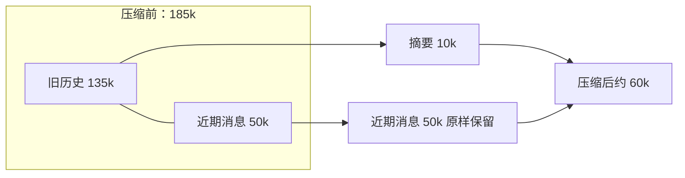
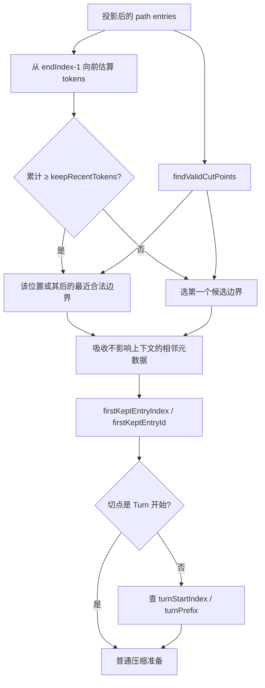
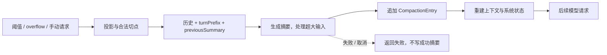

# 第9章：上下文压缩——当对话太长怎么办

[上一章](learning-ch08-context-engineering.md) · [学习目录](learning.md) · [下一章](learning-ch10-session.md)

结构对应 [参考教程第9章](https://dg-ai-notes.pages.dev/modules/ch09-compaction/)。Compaction 用摘要替代模型上下文里的旧前缀，保留原始会话记录；它是有损的上下文重建，不是无损压缩文件。

## 1. 问题：对话越来越长，窗口装不下了

编码任务不断积累文件、命令、失败尝试和解释。全部重发会增加用量，也可能触发 Provider 的窗口错误。直接保留最后 N 条消息又容易丢失目标、约束和工具调用的前半部分。

压缩更像把会议记录整理成纪要：原始记录都还在档案里，但下次开会先看纪要——目标是什么、已经做了什么、卡在哪、下一步做什么。纪要会丢细节，所以原始记录不能删。

图 9-1 用示例预算说明压缩的作用，数字不是实际基准测试，也不代表摘要总能达到相同比例。



窗口假设为 200k，此时压缩后还有约 140k 空间。模型保留的是摘要里的事实与当前保留区，丢失的细节仍可能需要通过历史导航或读文件重新取得。


### 1.1 一个关键时序：压缩发生在请求边界

当前 PiG 不仅在一次 Agent 运行结束后检查压缩。`Session.prepareNextTurn` 在同一次运行的后续 assistant 请求之前也可执行预防性压缩；响应后的决策还处理超限恢复和其他阈值路径。应围绕“下一次要发什么上下文”理解时序，而不是固定为“等到 agent_end 才压缩”。

## 2. 什么时候压缩：预算与触发

### 2.1 触发条件

默认启用自动压缩，预留 `reserveTokens = 16384`，近期保留预算 `keepRecentTokens = 20000`。阈值判断是估计上下文 tokens 严格大于 `contextWindow - reserveTokens`。用户设置、模型窗口和扩展处理都可能影响实际决策。

两种预算不是同一个量：reserve 为提示和输出等后续需求留下余地；keepRecent 决定尽量保留多少近距离原文。

可运行的阈值实验：

```go
package main

import (
    "fmt"
    "github.com/MichaelKinsy/PiG/internal/codingagent/compaction"
)

func main() {
    settings := compaction.DefaultCompactionSettings
    for _, tokens := range []int{180000, 183616, 183617, 185000} {
        fmt.Printf("%d → %v\n", tokens, compaction.ShouldCompact(tokens, 200000, settings))
    }
}
```

阈值是 `200000 - 16384 = 183616`；等于阈值时不触发，大于时触发。这份程序只调用纯函数，不产生摘要、文件或模型费用。

### 2.2 Token 估算：用已知用量校准

已有 assistant usage 可作为已处理上下文的锚点，后续未被 usage 覆盖的消息再估算；不是每次简单地将整个历史字符数除以四。图片、工具内容和系统状态都有自己的贡献。

```text
有效 assistant 的 usage：input + output + cacheRead + cacheWrite = 120000
该锚点之后：toolResult 估算 10000 + user 估算 1000
本次估算：120000 + 10000 + 1000 = 131000
```

这是人为给定数值的计算例。已经包含在 usage 中的前缀不能再逐条累加一次，否则重复计数。error/aborted assistant 不能当成可靠用量锚点；完全没有可用 usage 时，才更多依赖消息估算。

上下文编辑会影响估算依据。D136 记录不相关的后续编辑不应使已有用量锚点失效。阅读估算函数时要同时看“消息是否仍在投影中”和“这份 usage 覆盖到哪里”。

实际逐条估算并不等于 `bytes / 4`：源码计算 JavaScript UTF-16 字符长度，文本向上除以四，对图片按固定估值；不同消息角色的内容块也分别处理。ASCII 英文的估算可能还行，中文和代码中的特殊 token 可能偏差明显。

| 内容 | 算法示意 |
|---|---|
| 一般文本 | `ceil(UTF16Length / 4)` |
| 图片 | 使用每张图片的固定估算字符额度 |
| 已记录 assistant usage | 作为该前缀上下文的锚点 |
| 锚点之后的新消息 | 继续估算并累加 |

因此阈值检查是保守策略，不是 provider tokenizer 对完整请求的精确测量。Provider overflow error 是另一条检测信号，不应把两者混为一个计数器。

### 2.3 两种触发场景

预防性压缩发生在估算接近窗口上限时；溢出恢复发生在 Provider 已报告上下文过大时。恢复路径需要记录失败、调整当前投影并控制重试次数，避免把同一失败上下文无限发回去。

当前 Session 有压缩后重试和用 `context_edit` 排除失败尝试的处理。扩展在溢出恢复前注入信息的边界也有记录（D138）；RPC 中压缩与后续输入的规则见 D147、D148。它们是明确的差异或修复边界，不是参考教程旧流程的隐含保证。

## 3. 在哪里切：切割点算法

### 3.1 不是哪里都能切

不能把保留区开在孤立 tool result 上，否则模型看不到对应 assistant 调用。合法候选包括 user、assistant 和支持的 Bash/custom/摘要消息；system 状态需要重放，而不是作为普通对话切点；已有 compaction 节点也不是任意候选。

当前准备过程基于 Session 的规范投影，先应用已有压缩和上下文编辑，再选择需要处理的消息。直接对完整文件数组切片会重新引入已排除内容。

### 3.2 切点的语义：保留区的起点

`FirstKeptEntryID` 指向第一条需要保留的 Entry，而不是最后一条要删除的 Entry。`TurnStartIndex` 记录切点所属轮次的起点，`IsSplitTurn` 说明是否切开了一个长 Turn。

```text
旧历史                           最近消息
[需要总结的前缀] | [第一条保留 Entry ... 当前叶]
                 ↑ firstKeptEntryId
```

实际情况下左侧还可能拆成较早历史和 turnPrefix。这个 ID 的含义决定之后怎样重建上下文。

### 3.3 向后遍历：优先保留近期内容

`FindCutPoint` 从尾部反向累计消息 token 估计，达到保留预算后，优先选择该位置上或之后最近的合法切点。如果已经到了尾部 toolResult，之后没有合法候选，才退回最后一个候选，保留它前面的 assistant 调用。它还吸收相邻、对上下文无贡献的元数据记录。

因此“保留 20000 tokens”是预算目标，不是允许破坏协议的硬切字节数，也不保证最终每次请求正好等于这个值。

图 9-2 把算法分解成三个问题：消息何处允许切、需要保留多少、最终 Entry 的索引和 Turn 起点是什么。



下面用一组教学条带练习候选边界：

```text
索引： 0       1      2       3       4      5       6      7
类型： model   user   asst    result  user   asst    result asst
候选：         ✓      ✓               ✓      ✓               ✓
估算：  0      4k     2k      20k     5k     2k      18k    3k
```

如果向后累计达到 20k 预算时落在索引 6 的 result，索引 7 的 assistant 是其后最近的合法候选，保留区从 7 开始；索引 5 的调用和 6 的结果一起进入待总结区，不能声称算法总是往前移动。

如果同一条带没有最后的索引 7，累计位置仍落在索引 6，但之后已无候选，则退回最后的合法候选 5，把 assistant 和 result 一起保留。此时保留区可能超过预算。这两条分支共同保证不会让 toolResult 成为无来源的保留区起点。

```text
预算命中位置 i
  → 第一个 candidate >= i 存在？
      是：选该 candidate，前面的完整调用/结果进入摘要
      否：选最后一个 candidate，保留尾部调用/结果
```

候选列表为空时返回 startIndex；总量不足预算时从首个合法候选保留。之后才吸收相邻元数据并计算是否 split-turn。测试切点时至少覆盖这四种情况，不能只验证摘要后 tokens 变少。

## 4. 切掉的部分怎么处理：结构化摘要

### 4.1 摘要格式：以固定栏目组织

当前默认普通摘要模板要求 Goal、Constraints & Preferences、Progress、Key Decisions、Next Steps、Critical Context；Progress 再分 Done、In Progress、Blocked。目标是让后续模型能继续任务，而不是生成一篇对话回顾。

这是提示词要求，不是 JSON Schema 强制的输出结构。保留精确路径、符号和错误比把文字改写得流畅更重要。

**结构化摘要示例（虚构任务）：**

```text
## Goal
修复 auth.go 的盐值编码错误，并保持已有 API。

## Constraints & Preferences
- 不修改已发布的请求字段。
- 使用仓库现有测试方式。

## Progress
### Done
- [x] 阅读 auth.go 和 hash.go。
- [x] 定位编码不一致的位置。
### In Progress
- [ ] 验证修改后的边界输入。
### Blocked
- 外部身份服务当前不可用；本地测试不依赖它。

## Key Decisions
- 在公共编码入口修复，而不是在调用方补字符串转换。

## Next Steps
1. 执行边界测试并检查旧会话输入。
2. 记录外部验证缺口。

## Critical Context
- 当前修改位于 auth.go；尚未提交。
```

它保留“未完成”和“受阻”的状态，不把一段讨论变成已完成事实。文件列表由下面的显式跟踪补充，摘要模型不应自行猜测。

### 4.2 摘要生成：模型调用及大输入处理

准备阶段选出待总结消息，序列化为模型可理解的记录，然后调用摘要模型。序列化不会把 thinking 当成普通可总结正文。调用同样有认证、取消、输出限制和失败处理，不能假定摘要请求总会成功。

普通情况可以用一次摘要请求；D167 为过大历史引入分块摘要及相关恢复，因此当前实现不能笼统描述为“任何情况都只调用一次 LLM”。

压缩输入由投影的 Entry 变成可读消息文本，再加 system prompt；大段历史必要时先分块，最后合并摘要：

```text
PrepareCompaction
  ├─ MessagesToSummarize：旧的完整轮次 / 历史前缀
  ├─ TurnPrefixMessages：若切断一个 Turn，它的较早消息
  └─ PreviousSummary：上一次摘要（若有）
         │
         ├─ 序列化消息并按 context window 切 chunks
         ├─ 逐块 GenerateSummaryChunk（超大输入）
         ├─ 更新 PreviousSummary（已有摘要时）
         └─ 生成独立 Turn Prefix Summary（切断 Turn 时）
                    ↓
              汇总 usage 与文件操作
                    ↓
              CompactionResult
```

只有 split-turn 才需要独立前缀摘要；一般压缩不额外产生这一份。生成失败时 Compact 返回错误，不返回成功的空摘要给调用者持久化。

### 4.3 增量更新：把前一次摘要作为输入

再次压缩时，`PreviousSummary` 与新待总结内容共同生成更新摘要，而不是重复读取所有被压缩的原始历史。`PrepareCompaction` 通过当前投影找到前一次有效 compaction，并从其保留区之后继续选择。

如果分支尾部已经是 compaction，或本次没有需要总结的内容，准备函数可以返回空结果。调用方必须处理“无需压缩”，不能把它当成生成失败。

准备结果的核心字段可以概括如下：

```go
type CompactionPreparation struct {
    FirstKeptEntryID    string
    MessagesToSummarize []agent.AgentMessage
    TurnPrefixMessages  []agent.AgentMessage
    IsSplitTurn         bool
    TokensBefore       int
    PreviousSummary    string
    FileOps            FileOperations
    Settings           CompactionSettings
}
```

正式定义属于内部 `compactiontypes` 包；上面只是便于学习的形状。`FirstKeptEntryID` 标记压缩后保留区，`PreviousSummary` 驱动增量更新，而 `TokensBefore` 诊断压缩前状态。

### 4.4 文件跟踪：不仅是摘要文字

工具调用中提取读过和修改过的文件，再合并前一次默认摘要的 details。已经修改的文件不重复计入仅阅读列表。来自扩展自定义摘要的 details 不能未经判定就当成默认格式解析。

这些信息帮助后续任务知道哪些文件已检查、哪些发生修改；它们不是文件内容备份，也不能保证摘要之后磁盘没有外部变化。

```text
原始操作：read auth.go → read hash.go → edit auth.go → write auth_test.go
Read 集合：auth.go, hash.go
Modified 集合：auth.go, auth_test.go
最终 readFiles：hash.go
最终 modifiedFiles：auth.go, auth_test.go
```

摘要末尾可附：

```text
<read-files>
hash.go
</read-files>

<modified-files>
auth.go
auth_test.go
</modified-files>
```

重复出现的 auth.go 从仅阅读集合移除；下次压缩合并旧 details，再加入新操作。当前实现还可从工具结果的 nested calls 提取文件调用，不能只搜索普通 assistant 的直接 tool calls。

## 5. 极端情况：Turn 分割

### 5.1 为什么允许 assistant 切点

一个用户请求可能驱动很多轮工具交互；如果只允许在新的用户消息处切割，单个长任务就可能完全无法压缩。允许在安全的 assistant 位置切，能保留近期交互，同时总结同一任务较早的部分。

### 5.2 turnPrefix：被切开的 Turn 怎么处理

准备结果把较早完整历史与 `TurnPrefixMessages` 分开。Turn 前缀摘要使用 Original Request、Progress So Far、Context Needed to Continue 等栏目，解释被保留的后半段从哪里接续。

```text
[较早完整历史] [user 原始请求 → assistant → toolResult] | [assistant → toolResult ...]
                ↑ turnStartIndex                         ↑ firstKeptEntryIndex
MessagesToSummarize     TurnPrefixMessages                      保留区
```

当前 `PrepareCompaction` 的切片是 `[TurnStartIndex:FirstKeptEntryIndex]`，所以 **user 原始请求也在 turnPrefix 中**，不是只总结它之后的 assistant。较早完整历史另做普通摘要，两份摘要组合到一个 CompactionEntry。当前 Compact 代码先处理 history，再处理 prefix；不能沿用旧教程的“固定 Promise.all 并行生成”说法。

两份摘要合并后既保留长期目标，也交代当前长任务的局部进度。仅截掉前半段而不补充这层说明，会让模型收到失去原始请求的工具链。

## 6. 压缩结果如何生效

### 6.1 CompactionEntry：结果的物理形态

会话中追加 `compaction` Entry，保存摘要、`firstKeptEntryId`、`tokensBefore`、details 等字段以及树节点公共字段。原始 Entry 不因此被逐条删除，新的记录说明以后如何解释当前路径。

系统状态也需要在投影中恢复，不能只复制摘要文本而丢掉当前工具声明与提示词 sections。

### 6.2 上下文重建

`BuildSessionContext` 委托规范投影构造消息：应用当前分支、有效压缩、保留范围和 `context_edit`。结果包含摘要、保留的近期消息与其后新增消息，以及正确的系统状态。完整细节在第10章展开。

### 6.3 自动压缩的集成

Session 计算决策、协调扩展和取消，调用准备及生成过程，持久化结果，然后替换当前 Agent 上下文。压缩期间到达的输入必须按队列规则进入后续请求；不能绕过压缩直接追加到一个已经过时的上下文快照。

溢出恢复还需要检查失败轮次是否排除、是否已经尝试恢复、是否真的有可总结内容。摘要失败不能被保存成一份看似成功的 compaction。

### 6.4 两套事件

自动压缩的 start/end 等产品事件供 UI、JSON 或 SDK 观察；`session_before_compact` 等扩展事件允许在定义的边界取消或提供结果。观察者看见压缩开始，并不意味着它能够替换摘要；扩展回调返回结果，也不等于 UI 已收到全部后续状态。

## 7. 完整链路回顾

估计当前投影用量 → 判断预防或溢出路径 → 选择合法保留起点 → 区分历史与 turnPrefix → 生成或更新摘要 → 追加 CompactionEntry → 重建投影 → 准备下一次模型请求。

每个箭头都涉及失败或取消，不能只测试最终出现了一段摘要文字。

图 9-3：压缩结果通过持久化记录进入下一次请求，同一次 Send 内的后续 Turn 也可以走这条路径。



Entry 的教学实例：

```json
{
  "type":"compaction", "id":"c1", "parentId":"e9",
  "timestamp":"2026-10-27T00:00:00Z",
  "summary":"## Goal\n修复认证编码问题\n## Next Steps\n补充边界测试",
  "firstKeptEntryId":"e7", "tokensBefore":185000,
  "details":{"readFiles":["hash.go"],"modifiedFiles":["auth.go"]},
  "fromHook":false
}
```

`firstKeptEntryId` 可以指向 compaction 节点之前的记录。压缩投影顺序是摘要、保留区、压缩后新增消息，不是单纯从 compaction 所在文件行继续读取。

## 8. 设计精华

### 8.1 反向预算与合法切点相结合

用反向累计优先保留近期信息，用候选规则保护模型协议，再用 turnPrefix 补充长任务的断点语义。

### 8.2 结构摘要保留继续工作的依据

模板强调目标、约束、进度和下一步，而不是对话措辞；摘要仍然可能漏信息，因此需要保留原始记录供用户恢复。

### 8.3 文件跟踪积累领域信息

编码 Agent 的重要状态不仅是文字，还包括文件操作。把这些数据作为明确 details 维护，比期望每次摘要都完整重述所有路径更可靠。

## 9. 下一站

最后一章解释这些消息、摘要和状态怎样存入同一棵会话树，以及恢复时怎样选择当前路径。

**源码阅读与练习**

- [internal/codingagent/compaction/compaction.go](https://github.com/MichaelKinsy/PiG/blob/c64bebd820e20411599a8b1e8e52aa92b4a2ed82/internal/codingagent/compaction/compaction.go)：`FindCutPoint`、`PrepareCompaction`、摘要生成。
- [coding/session_transcript.go](https://github.com/MichaelKinsy/PiG/blob/c64bebd820e20411599a8b1e8e52aa92b4a2ed82/coding/session_transcript.go)、[coding/session.go](https://github.com/MichaelKinsy/PiG/blob/c64bebd820e20411599a8b1e8e52aa92b4a2ed82/coding/session.go)：请求前准备与响应后决策。
- [internal/codingagent/session_context.go](https://github.com/MichaelKinsy/PiG/blob/c64bebd820e20411599a8b1e8e52aa92b4a2ed82/internal/codingagent/session_context.go)：压缩记录到模型上下文。
- [internal/codingagent/compaction_docs_test.go](https://github.com/MichaelKinsy/PiG/blob/c64bebd820e20411599a8b1e8e52aa92b4a2ed82/internal/codingagent/compaction_docs_test.go)：对照已有文档约束，继续追踪同目录算法测试。
- 练习：构造末尾为“大 tool result”的历史，指出预算切到它时为什么必须向合法 assistant 边界调整。

[上一章](learning-ch08-context-engineering.md) · [学习目录](learning.md) · [下一章](learning-ch10-session.md)
