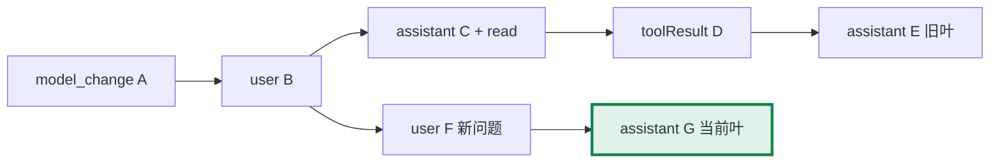
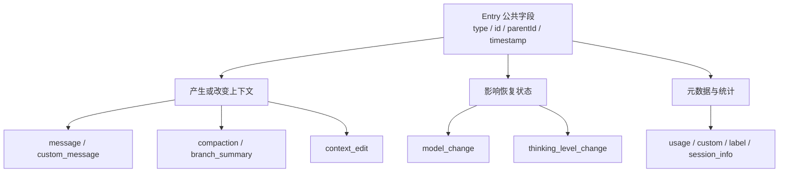

# 第10章：会话管理——对话的存储、恢复与分叉

[上一章](learning-ch09-compaction.md) · [学习目录](learning.md)

结构对应 [参考教程第10章](https://dg-ai-notes.pages.dev/modules/ch10-session/)。把会话理解为带父指针的记录树，再理解如何从树生成当前模型输入，就能把分支、摘要和压缩放在同一个模型中。

## 1. 问题：会话数据怎么存

### 1.1 子问题 A：存在哪里

默认磁盘会话位于 `~/.pig/agent/sessions/` 下按项目路径编码分组的目录，Agent 目录可以被配置覆盖。文件是 JSONL：每行一个 JSON 记录。内存模式则不需要磁盘文件。默认路径不是项目内的 `.pig/sessions`。

可以把它想成一本只往后写的账本：每条记录占一行，记下“我是谁、我的上一条是谁”。读的时候不需要从头重放所有分支，只要顺着当前最后一条往回走，就能还原这次对话。

### 1.2 子问题 B：长什么样

物理文件按追加顺序排列，逻辑记录通过 `id` 与 `parentId` 组成树。当前 leaf 指定活动分支。文件后写入的节点可以连接到更早的父节点，不要求父节点就是前一行。

存储介质与逻辑结构相互独立：同一棵树可以存入其他介质，但必须保留顺序、身份与恢复契约。当前内置实现是文件和内存，并不代表已经内置任意数据库后端。

## 2. 跟着一次会话看树怎么长出来

以下 ID 是教学用符号，不是实际生成格式；图只保留本节需要的记录，省略系统状态和其他元数据。

### 2.1 第一步：切换模型，第一个节点上树

追加 A：`model_change`，记录 Provider 和 model ID。真正文件在它之前还有 Session Header；Header 不是普通树节点。

```json
{"type":"model_change","id":"A","parentId":null,"timestamp":"2026-10-27T00:00:01Z","provider":"ollama","modelId":"qwen2.5-coder:7b"}
```

```text
A(model_change) ← leaf
```

下面每一步的 JSON 都是教学记录，ID 使用 A—G 便于对应图，不代表真实随机 ID 生成方式。

### 2.2 第二步：用户提问

追加 B：user message，`parentId=A`。问题是“解释 config.go”。活动 leaf 从 A 变成 B。

```json
{"type":"message","id":"B","parentId":"A","timestamp":"2026-10-27T00:00:02Z","message":{"role":"user","content":"Explain config.go"}}
```

```text
A(model_change)
└── B(user) ← leaf
```

### 2.3 第三步：Agent 调 read 工具

追加 C：assistant message，包含 `read` 的 tool call，`parentId=B`。工具调用是 assistant 内容的一部分，不必另造一个 tool_call Entry 类型。

```json
{
  "type":"message","id":"C","parentId":"B","timestamp":"2026-10-27T00:00:03Z",
  "message":{
    "role":"assistant",
    "content":[
      {"type":"text","text":"I will inspect config.go."},
      {"type":"toolCall","id":"read-1","name":"read","arguments":{"path":"config.go"}}
    ],
    "api":"openai-completions","provider":"ollama","model":"qwen2.5-coder:7b",
    "stopReason":"toolUse","timestamp":1793059203000
  }
}
```

```text
A → B → C(assistant + toolCall) ← leaf
```

工具调用 ID `read-1` 是消息内容字段；树节点 ID 是 C。父子关系和请求—响应关系并非同一组 ID。

### 2.4 第四步：read 返回结果

追加 D：toolResult message，`parentId=C`，通过 `toolCallId` 关联 C 内的调用。父指针解释会话路径，调用 ID 解释协议关联，两者职责不同。

```json
{"type":"message","id":"D","parentId":"C","timestamp":"2026-10-27T00:00:04Z","message":{"role":"toolResult","toolCallId":"read-1","toolName":"read","content":[{"type":"text","text":"package config\n\nfunc Load(...) ..."}],"isError":false,"timestamp":1793059204000}}
```

```text
A → B → C(assistant + toolCall) → D(toolResult) ← leaf
```

### 2.5 第五步：Agent 给出分析

追加 E：assistant message，`parentId=D`。当前路径是 A → B → C → D → E。

```json
{"type":"message","id":"E","parentId":"D","timestamp":"2026-10-27T00:00:05Z","message":{"role":"assistant","content":[{"type":"text","text":"Load reads and validates the project configuration."}],"stopReason":"stop","model":"qwen2.5-coder:7b","provider":"ollama"}}
```

```text
A → B → C → D → E(assistant) ← leaf
```

到目前为止，树退化为一条链；因此仅看普通聊天，很容易误认为 Session 永远只是 messages 数组。

### 2.6 第六步：回退，这是关键转折

选择 B 为当前 leaf。A—E 仍然存在，变化的是当前分支位置。回退会话不会撤销工具已经写入的文件或运行过的命令，恢复文件需要另有版本控制或外部机制。

```go
if err := session.Branch("B"); err != nil { return err }
```

`Branch` 检查 ID 存在后调用 `SetLeafID`。分支前的状态：

```text
A → B → C → D → E      leaf=E
```

分支后的状态：

```text
A → B → C → D → E      仍在文件和索引里
    ↑ leaf=B
```

回退没有扫出并删除“B 后面的记录”；之后 append 的新节点自然以 B 为 parent。

### 2.7 第七步：换思路重新问

追加 F：新的 user message，`parentId=B`。新分支自然形成，无需复制原路径或改写 C 的父指针。

```json
{"type":"message","id":"F","parentId":"B","timestamp":"2026-10-27T00:00:06Z","message":{"role":"user","content":"先说明配置校验失败时的行为。"}}
```

```text
A → B → C → D → E
    └── F(user) ← leaf
```

F 和 C 的共同父节点都是 B。追加 F 既没有更改 C，也没有在 B 的记录上新增 children 字段。

### 2.8 第八步：新分支继续长

追加 G：新的 assistant message，`parentId=F`。

```json
{"type":"message","id":"G","parentId":"F","timestamp":"2026-10-27T00:00:07Z","message":{"role":"assistant","content":[{"type":"text","text":"Validation errors are reported to the caller; they are not treated as successful output."}],"stopReason":"stop"}}
```

```text
A → B → C → D → E
    └── F → G ← leaf
```

文件仍可依次保存 A、B、C、D、E、F、G；当前模型上下文选择 A、B、F、G 的贡献，而不是“文件最后四行”。

图 10-1：物理记录保持追加，逻辑活动路径由 parent 指针决定。



以上记录省略 usage 等非本节字段，不是可直接导入的完整会话 fixture。下一节会区分公共 Entry 字段与完整消息。

## 3. 树上节点的解剖

### 3.1 一个 MessageEntry 包含什么

公共字段是 `type`、`id`、`parentId`、`timestamp`，message Entry 再带消息对象。外层 `type=message` 与内层 `role=user/assistant/toolResult/system` 是两个层次。时间戳与 ID 有各自真实格式，教学图中的 A、B 仅用于解释关联。

Session 类型定义建议直接查看 `internal/sessionentry/entry.go` 与 `union.go`。以下是 Entry 联合里几个关键成员的教学摘录；Header 不进入 `SessionEntry` 联合。

```go
type SessionEntryBase struct {
    Type      string  `json:"type"`
    ID        string  `json:"id"`
    ParentID  *string `json:"parentId"`
    Timestamp string  `json:"timestamp"`
}

type MessageEntry struct {
    SessionEntryBase
    Message agent.AgentMessage `json:"message"`
}

type ModelChangeEntry struct {
    SessionEntryBase
    Provider string `json:"provider"`
    ModelID  string `json:"modelId"`
}
```

`SessionHeader.Version` 是上游拥有的 session schema 版本 3。PiG 沿用它，不应将这个值说成 PiG 自己的一套兼容版本协商机制。

### 3.2 Entry 类型：按职责分组，而非固定旧版九种

| 职责 | 当前主要类型 | 是否直接成为对话文本 |
|---|---|---|
| 对话和产品消息 | `message`、`custom_message`、`branch_summary` | 按消息及投影规则转换 |
| 上下文重建 | `compaction`、`context_edit` | 控制摘要、保留和替换，不逐条直发 |
| 模型和用量状态 | `model_change`、`thinking_level_change`、`usage` | 主要用于恢复与统计 |
| 扩展和导航元数据 | `custom`、`label`、`session_info` | 通常不作为普通对话发送 |

`internal/sessionentry/union.go` 是精确联合的阅读入口，另有 `RawEntry` 保留无法按已知变体描述的已读记录。存在一条可保留的未知记录，不等于它会被模型转换器接受。

图 10-2：沿用参考教程按职责分类的方法，把当前新增记录放入正确类别，而不是继续标成固定九种。



以 `context_edit` 为例，replacement 为 null 表示从后续模型上下文省略目标，不删除目标记录：

```json
{"type":"context_edit","id":"omit1","parentId":"G","timestamp":"2026-10-27T00:00:08Z","targetId":"E","replacement":null}
```

这只是形状示例；只有目标在当前投影中的贡献才可能被改变，不能把任意跨分支 ID 的编辑当成跨全文件删除。`custom` 用于扩展数据，`custom_message` 才是明确的产品消息，两种类型不要混淆。

### 3.3 为什么父指针适合追加式存储

新节点只需记录已有父 ID，旧节点无需更新子列表，分支也就无需重写旧节点。子索引可以在内存中建立，用于导航。所谓 append-only 描述常规历史记录方式，不是承诺任何维护操作都绝不重写文件。

“认父不认子”可以这样理解：每个节点只记得自己的父亲，不维护孩子名单。要问“我是从哪来的”，一路往上走就行；要问“从某个点能去哪”，才需要在内存里建一张反查表。好处是追加一条记录永远只写一行，不需要回去修改任何人；分支也就成了自然结果，而不是一次复制操作。

## 4. 三个核心操作加分支摘要

### 4.1 操作一：追加

为新消息分配 ID，父节点取当前 leaf，更新索引和 leaf，再按持久化策略保存。这里说的是 `AppendMessage` 等高层追加操作；底层 `AppendEntry` 接收调用方已经准备好的 Entry，不会替你推断 parent 或补全 ID。树连接本身是局部操作；完整 JSON 编码、首次 flush 和文件 I/O 的开销不能都笼统标成 O(1)。

```go
id, err := session.AppendMessage(agent.AgentMessage{User: &agent.UserMessage{
    Role: agent.RoleUser,
    Content: ai.UserText("解释配置加载顺序"),
}})
if err != nil { return err }
entry, found := session.GetEntry(id)
if !found { return fmt.Errorf("new entry was not indexed") }
fmt.Println(entry.Base().ID, entry.Base().ParentID)
```

这是使用已有 `*coding.SessionManager` 的函数内片段。`AppendMessage` 先处理不同消息的存储形态，再在普通 message 路径中读取 leaf、构造公共字段并交给日志；custom、Bash 的专门路由不能仅靠给 role 改名代替。

### 4.2 操作二：回退

`Branch` 检查目标节点存在，然后更新 leaf。它不删除旧分支，也不立即恢复外部文件系统。无效目标必须报错，不能悄悄退回任意位置。

### 4.3 操作三：分支

回退后执行普通追加，父指针就是新选择的 leaf，分支自然形成。“导航到旧点”和“复制成另一份会话文件”是不同操作，不应把 tree navigation 与 fork 混为一谈。

### 4.4 分支摘要：BranchSummaryEntry

`BranchWithSummary` 接收已经生成的 summary，移动到指定 parent 并追加摘要节点，记录离开的来源 ID 等信息。它不是负责调用模型生成摘要的函数。

```text
B → C → D → E    旧分支
└── S → F → G    S 是保存到目标位置的摘要
```

摘要 S 成为 leaf，后续 F 必须是 S 的孩子。若把 S 和 F 都画成 B 的孩子，F 的活动路径就读不到摘要，这会错误解释实际行为。

下面用真实内存 SessionManager 运行“追加 → 回退 → 摘要 → 新消息”。模型回复由本地数据构造，不发起 API 请求；程序验证 parent 和旧分支是否保留。

```go
package main

import (
    "fmt"
    "github.com/MichaelKinsy/PiG/agent"
    "github.com/MichaelKinsy/PiG/ai"
    "github.com/MichaelKinsy/PiG/coding"
)

func mustID(id string, err error) string {
    if err != nil { panic(err) }
    return id
}
func user(text string) agent.AgentMessage {
    return agent.AgentMessage{User:&agent.UserMessage{Role:agent.RoleUser, Content:ai.UserText(text)}}
}
func main() {
    session, err := coding.NewInMemorySessionManager(".")
    if err != nil { panic(err) }
    first := mustID(session.AppendMessage(user("Explain config.go")))
    old := mustID(session.AppendMessage(agent.AgentMessage{Assistant:&agent.AssistantMessage{
        Role:agent.RoleAssistant, StopReason:ai.StopReasonStop,
        Content:[]ai.AssistantContentBlock{ai.TextContent{Text:"First analysis"}},
    }}))
    summary := mustID(session.BranchWithSummary(&first, "Earlier exploration found a validation question.", nil, false, nil))
    fresh := mustID(session.AppendMessage(user("Now inspect validation.")))
    entry, ok := session.GetEntry(fresh)
    if !ok || entry.Base().ParentID == nil || *entry.Base().ParentID != summary {
        panic("new message must be a child of the summary")
    }
    if _, ok := session.GetEntry(old); !ok { panic("old branch was lost") }
    fmt.Println("old branch retained; new message follows summary")
    for _, e := range session.GetBranch() { fmt.Println(e.Base().Type) }
    for _, m := range session.BuildSessionContext().Messages { fmt.Println(m.Role()) }
}
```

预期当前路径的 Entry 类型为 message、branch_summary、message；上下文的角色为 user、branchSummary、user。旧 assistant 还存在于全部记录中，却不在当前分支。这也是一个可以运行验证图是否画对的办法。

## 5. 从树到模型上下文：BuildSessionContext

### 5.1 为什么这一步必须存在

JSONL 包含所有分支、产品元数据和上下文编辑，模型只应看到当前路径的有效贡献。`BuildSessionContext` 委托规范的 `BuildSessionProjection`，而不是简单读取每条 `message`。

### 5.2 第一步：沿 leaf 回溯到 root

按父指针收集当前路径，再恢复根到叶顺序。这里要区分明确的空 leaf 与“使用最后节点”的默认值；`LastLeaf()` 的约定不能被任意空字符串或 nil 替代。

对第2节的当前 G 节点，逐步展开如下：

```text
当前 ID   读到 parent   暂存（从叶往根）
G         F            [G]
F         B            [G,F]
B         A            [G,F,B]
A         null         [G,F,B,A]

reverse → [A,B,F,G]
```

C、D、E 不在 parent 链上，因此不进入当前上下文；它们仍能通过按 ID 查询和树导航读到。高层读取可以使用 `session.GetBranch()`，不必重新扫描整份 JSONL 自己建立路径。

### 5.3 第二步：按类型和投影规则处理

普通消息进入对应转换；custom message 和摘要有专门表示；label、session_info 等只影响产品状态；`context_edit` 改变目标 Entry 在模型上下文中的贡献。原记录仍保留，修改的是投影，不是原始历史文本。

| 当前路径上的 Entry | 对模型消息的贡献 | 其他影响 |
|---|---|---|
| message | 其 AgentMessage；system 进入顺序状态处理 | 普通对话与工具关联 |
| custom_message | custom AgentMessage | display、customType 供产品使用 |
| branch_summary | branchSummary | 保留探索来源 |
| compaction | 摘要与选择后的保留区 | 重设有效上下文前缀 |
| context_edit | 省略或替换目标的贡献 | 原 Entry 保留 |
| model_change / thinking_level_change | 不作为普通聊天文本发送 | 恢复模型或推理设置 |
| usage / custom / label / session_info | 不直接变成聊天正文 | 用量、扩展数据、导航和名称 |

它比一个 switch 更复杂：compaction 与 context_edit 会改变其他记录的贡献，不能在遍历到它们时简单地 `continue`。最后得到的仍是 AgentMessage 列表，进入模型前还要执行第6章的转换。

### 5.4 状态变量：沿路径恢复最新状态

模型和 thinking 变化沿活动路径覆盖。模型恢复不仅能读取 `model_change`，也可使用 assistant 保存的 Provider/model 元数据。只扫描模型切换 Entry 会遗漏实际恢复路径中的信息。

```text
model_change：Provider A / model-a       → 当前 A/model-a
thinking_level_change：high             → 当前 high
assistant：Provider B / model-b         → 当前 B/model-b
user：继续                              → 模型状态不变
```

这说明状态记录和消息内容可以共同决定恢复结果。若回退到那条 assistant 之前，当前路径又只恢复 A/model-a；不能读取所有分支中时间最晚的模型记录覆盖当前选择。

系统提示词与工具声明同样是顺序状态，需要按消息位置重放，不能永远取文件开头的一份配置。

### 5.5 CompactionEntry：选择性收集

有效 compaction 提供摘要和 `firstKeptEntryId`，投影据此选择保留范围，再接上后续消息。还要应用当前路径上的 context edits，避免把被省略的失败请求重新放回模型上下文。较旧的 compaction 可能还在路径上，但不因此把所有历史摘要重复发送。

```text
活动分支：
e1(user) → e2(assistant) → e3(user) → e4(assistant) → c1(compaction) → e5(user)
                                                         firstKept=e3

模型上下文：
compactionSummary(c1)
e3(user)
e4(assistant)
e5(user)
以及正确位置的系统状态
```

保留区 e3、e4 物理上在 c1 之前，因此“从 compaction 那行以后读文件”会漏掉它们。回退到 c1 之前的节点时，当前路径不包含该压缩记录，e1、e2 又可按当时路径参与投影。

核心步骤的算法示意如下，真实实现还维护系统状态、上下文编辑、缓存与模型恢复：

```text
1. 构造 leaf → parent → ... 的路径，然后逆转。
2. 找当前路径上有效的最近 compaction。
3. 生成其摘要贡献；按 firstKeptEntryId 恢复保留区。
4. 应用上下文编辑，恢复系统状态与模型 / thinking 状态。
5. 把有消息贡献的 Entry 转成 AgentMessage。
6. 模型请求时再 ConvertToLLM 和 NormalizeContext。
```

单独调用投影函数时，nil leaf 表示空分支，LastLeaf() 表示默认末节点，未知 leaf 也有回退约定；而 `Session.Branch` 对不存在的 ID 返回错误。两个入口的失败语义不同，不能把后者写成“找不到就默认最后一个”。

## 6. JSONL 持久化的具体细节

### 6.1 格式：先 Header，再逐条 Entry

一行一条记录，追加一个完整 JSON 与换行。读取时保留记录语义和必要的未知字段，重写时不能无故丢弃当前结构没有命名的成员。`SessionEntry` 的类型化视图与其原始 record 也有只读约定：改了已解码副本的字段，不一定改变它写出的原始记录。

### 6.2 延迟写入：等待真正的对话消息

当前 `persistRecord` 在未首次 flush 时检查是否已有 user 或 assistant 消息。只有模型切换等初始化元数据，不会立即创建文件；第一条满足条件的消息触发 Header 与已缓冲 Entry 的整批写入，之后追加单条。

这与旧教程的“必须等到 assistant 回复才落盘”不同。用户提问本身即可触发写入，因此有问无答的记录可能存在，不能把它当作写入机制的错误。

| 配置路径 | 已出现 user/assistant | 已 flushed | 当前写入 |
|---|---|---|---|
| 无 | 任意 | 任意 | 只存内存 |
| 有 | 否 | 否 | 缓冲初始化记录，不建文件 |
| 有 | 是 | 否 | 创建文件，写 Header 和全部缓冲记录 |
| 有 | 任意 | 是 | 追加当前记录 |

以下 JSONL 只演示 header、消息与分支的物理排列，省略模型回复，让每行都是完整 JSON。最后一行的 parent 指回 u1，而非上一行 u2：

```json
{"type":"session","version":3,"id":"learning-example","timestamp":"2026-10-27T00:00:00Z","cwd":"/workspace/demo"}
{"type":"message","id":"u1","parentId":null,"timestamp":"2026-10-27T00:00:01Z","message":{"role":"user","content":"Compare two approaches","timestamp":1793059201000}}
{"type":"message","id":"u2","parentId":"u1","timestamp":"2026-10-27T00:00:02Z","message":{"role":"user","content":"Try approach A","timestamp":1793059202000}}
{"type":"message","id":"u3","parentId":"u1","timestamp":"2026-10-27T00:00:03Z","message":{"role":"user","content":"Try approach B instead","timestamp":1793059203000}}
```

JSONL 不是一个外围带方括号的 JSON 数组。追加新行无需重新序列化之前全部消息；恢复时沿 parent 读取当前路径，连续 user 消息如何进入具体 API 则是后续 Provider 转换的责任。

### 6.3 偶尔的全文件重写

首次 flush 写完整缓冲内容；另一些创建副本或格式维护路径也可能重新写文件。常规追加与这些维护操作应分开分析。文件快照、偏移索引与分页还承担避免重复扫描大历史的工作，不能用“每次读完整 JSONL”概括当前恢复实现。

文件重写不等于树节点被修改。重写的是物理载体，可以保留原 ID、parent 和原始字段；新建 clone 则可能是另一份文件。未知 Entry 的原始 JSON 和成员顺序也尽量保留，避免“读入再写出”破坏扩展数据。

```text
正常 append：
open(O_APPEND) → 写一行 JSON + newline → 更新快照偏移

首次 flush：
创建新文件 → Header → 缓冲 entries → 标记 flushed

其他完整写入：
按具体复制或维护入口选择 records → 编码并写入目标文件
（是否使用临时文件、何时替换，以该入口实现为准）
```

当前 Session 还会为大历史建立快照和行偏移，使查询一个 Entry 不必每次从文件开头解码全部工具输出。分页与追加并发需要由拥有 Session 的运行时协调，不能自行同时写同一文件。

## 7. 两层实现：公开管理接口与内部存储

公开 `coding.SessionManager` 是内部 `internal/codingagent.Session` 的类型别名，指向同一份追加日志，而非复制的消息投影或独立存储接口。内部实现管理记录、分支和磁盘；`NewInMemorySessionManager` 创建没有持久化路径的日志。扩展暴露的只读 Session 视图又是另一种能力边界。

```text
coding.SessionManager     ──type alias──> internal/codingagent.Session
                                              ├─ entries / byID / leaf
                                              ├─ append + persistence
                                              └─ BuildSessionContext / projection

AgentSession              ──owns────────> coding.SessionManager
Provider                  <──Transcript── Session / Agent
Extension ReadonlySession ──limited view─> branch entries and IDs
```

存储别名不等于另有可替换的 SQL interface；扩展的 ReadonlySession 只承诺读取能力，也不能因内部实现有 Append 就推导扩展拥有修改历史的公开 API。

替换存储不是只实现 Save/Load 两个函数：还需要维护追加顺序、ID、parent、leaf、投影、分页、一致性与关闭生命周期。参考教程提出的“接口允许换数据库”可以作为设计思路，但不是本章宣称已有一个可直接插拔的 SQL 后端。

## 8. 总结

### 8.1 一条主线：存储的两个独立维度

JSONL 回答记录如何落盘，树回答历史如何关联。模型上下文是树上当前路径的投影，而不是二者中的任意一个原样副本。

### 8.2 Session Tree 的本质

父指针和追加记录使回退与分叉保留旧历史；摘要与上下文编辑改变后续解释，不必直接删除旧记录。保留会话历史仍不等于回滚外部副作用。

### 8.3 三个可迁移思路

分开物理存储和逻辑结构；显式构造当前状态的投影；用追加记录描述摘要和上下文编辑。再把这些规则落实到取消、失败、恢复与大历史测试，才成为可靠的会话管理。

## 9. 下一站

十章源码学习篇至此结束。下一步建议回到第1章的文件解释任务，完整追踪一次 Session.Send：从投影进入循环，从工具结果回到模型，再到记录追加与恢复。需要编写应用时继续阅读 [Go SDK](zh-sdk.md)、[扩展](zh-extensions.md) 和 [会话格式](zh-session-format.md)，而不是把本系列扩展成参考网站的另一套实战篇。

**源码阅读与练习**

- [internal/sessionentry/union.go](https://github.com/MichaelKinsy/PiG/blob/c64bebd820e20411599a8b1e8e52aa92b4a2ed82/internal/sessionentry/union.go)：Entry 联合、RawEntry 与原始记录。
- [internal/codingagent/session.go](https://github.com/MichaelKinsy/PiG/blob/c64bebd820e20411599a8b1e8e52aa92b4a2ed82/internal/codingagent/session.go)：`Branch`、`BranchWithSummary` 与 `persistRecord`。
- [internal/codingagent/session_context.go](https://github.com/MichaelKinsy/PiG/blob/c64bebd820e20411599a8b1e8e52aa92b4a2ed82/internal/codingagent/session_context.go)：公开重建入口和投影。
- [coding/session_manager.go](https://github.com/MichaelKinsy/PiG/blob/c64bebd820e20411599a8b1e8e52aa92b4a2ed82/coding/session_manager.go)：公开管理边界。
- 练习：在内存会话中追加一条路径，回退后追加摘要与新消息；分别列出完整 Entry 顺序、当前父路径和模型消息，检查三者为何不同。

[上一章](learning-ch09-compaction.md) · [学习目录](learning.md)
