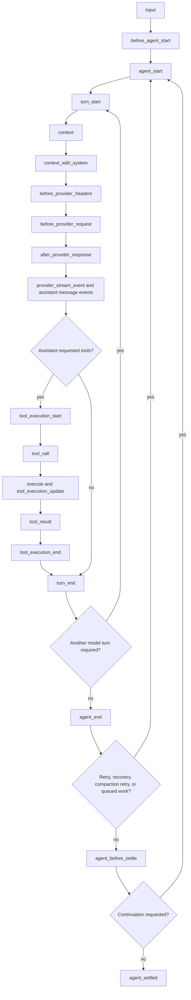
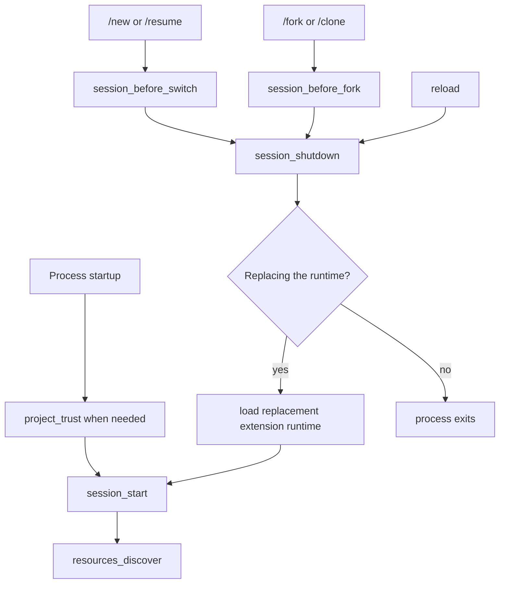

# 扩展

扩展给 PiG 增加可执行行为。它们可以注册工具、命令、事件处理器、Provider、渲染器和交互 UI。

PiG 保留 Pi 的扩展模型，同时使用面向进程的宿主，支持 Go、Rust、Python 和 Node。兼容的 Go 扩展还可以编译进 Piglet Binary。

> 本页是英文页 `extensions.md` 的中文译本，对应 PiG 提交 `c64bebd8`。英文页是规范来源；事件名、签名与差异编号以英文页和当前源码为准。

## 为什么采用这种设计

上游 Pi 在进程内加载 TypeScript 扩展。PiG 是 Go 原生实现，不嵌入 JavaScript 运行时，也不加载动态 Go 插件。

PiG 改用一个公开扩展契约，配合几种执行方式：

- 隔离子进程；
- 打包子进程单元；
- Piglet Binary 中的融合 Go 工厂。

这个设计有四个目标：

1. 保留 Pi 扩展的可观察行为。
2. 支持多种实现语言。
3. 在可行处隔离源码扩展的故障。
4. 让经过审查的 Go 扩展成为一个原生 Agent 可执行文件的一部分。

执行位置不得改变扩展行为。源码、打包和融合模式下，扩展使用相同的注册与宿主调用契约。

## 已知的跨进程差距

还有三处跨进程差异：Provider 对象表面与外部配置身份（D78）、部分消息观察（D82）、跨进程的事件总线调度边界（D83）。见 [Provider](zh-providers.md) 与 [RPC 模式](zh-rpc.md)。

每个 Node 扩展共用一个 `pi.events` 总线，包括显式隔离的扩展和精确独立形式。另一个进程里的监听器按引用收到发送者的原始载荷：同步修改、重入发送、保留的 `await` 前后别名和回调都按 Pi 的方式表现。D83 列出跨进程时的不同：不同进程里的独立任务按时间排序；只有监听器 `await` 之后的第一个续体与发送者的微任务有序；跨进程的引用环在进程退出时释放；`util.types.isMap` 这类品牌检查在外部对象上失败，而 `util.types.isProxy` 仍返回 true。带 `customInspect: false` 的 `util.inspect` 打印空占位对象而不是外部载荷；带 `showProxy: true` 时显示 Proxy 包装；Node 26.0.0 及以后，不可扩展的外部载荷会打印在 `Proxy(...)` 里，因为 V8 没有提供钩子。Node 25 及更早按 Pi 的方式打印该载荷。永不返回的监听器会阻塞发送者，与 Pi 一致。

同进程内的配置根、子对象、回调和接收者也必须与 Pi 完全一致。外部配置快照不是作者持有的活动对象（D78）。保留的远端部分消息不会随生产者前进（D82）。事件顺序、取消、最终结果、持久化和清理仍是必需项。严格的 RPC33 比较保留其原始失败。

## 扩展的职责

一个扩展拥有一个可执行能力，或一组内聚的能力。它可以提供：

- 模型可调用的工具；
- 斜杠命令；
- 生命周期处理器；
- Provider 与 OAuth 声明；
- 消息和条目渲染器；
- 状态、组件、页头、登录和聚焦 UI；
- 扩展拥有的命名空间状态。

扩展不能自己选择自己。设置、Package、显式 `-e` 路径或 Piglet 才会选择它。

## 支持的源码形式

PiG 接受一个常规工厂，或一个精确独立的源码。

| 语言 | 工厂 | 独立形式 |
|---|---|---|
| Go | `func Extension() *sdk.Extension` | 可执行的 `package main` 模块 |
| Rust | `src/lib.rs` 中的 `pub fn new_extension() -> Extension` | 带 `src/main.rs` 的 crate |
| Python | 一个模块中的 `def new_extension() -> Extension` | 带 shebang 的可执行 `main.py` |
| Node | 兼容 Pi 的默认导出 | 带 shebang 的可执行脚本 |
| 原生 | 不适用 | 确切的可执行文件 |

PiG 会拒绝混合语言、多个工厂、工厂与独立形式混用、非标准工厂符号、缺失入口和身份不匹配。

## 创建扩展

可能进入原生 Piglet Binary 的扩展优先用 Go：

```bash
pig extension init ./review --lang go
```

只有能力确实需要独立可执行边界时，才创建隔离的独立形式：

```bash
pig extension init ./review --lang go --isolated
```

脚手架不写扩展清单。运行时注册才是扩展身份和能力的来源。

## 理解运行时生命周期

工厂可以是同步或异步的。PiG 会等待异步工厂完成再继续启动，因此工厂可以获取配置，或注册启动期间需要的 Provider。

不要在工厂里启动进程、socket、监视器或定时器，因为有些调用只加载扩展而不启动会话。
长时间存在的资源请从 `session_start`、或从需要它的命令/工具里启动。
会话作用域资源请在幂等的 `session_shutdown` 处理器里关闭。

一次普通提示遵循这个钩子顺序：



生命周期包含这些事件组：

| 区域 | 事件 |
|---|---|
| 输入准备 | `input`、`before_agent_start` |
| Agent 运行 | `agent_start`、`agent_end` |
| 模型轮次 | `turn_start`、`context`、`context_with_system`、`turn_end` |
| Provider 调用 | `before_provider_headers`、`before_provider_request`、`after_provider_response`、`provider_stream_event` |
| 消息生命周期 | `message_start`、`message_update`、`message_end` |
| 工具执行 | `tool_execution_start`、`tool_call`、`tool_execution_update`、`tool_result`、`tool_execution_end` |
| 安定 | `agent_before_settle`、`agent_settled` |

运行一开始 PiG 就算忙碌，包括压缩检查和 `before_agent_start` 期间，所以此时发送的消息进入正在启动的运行。消息生命周期事件也覆盖 user 和 tool-result 消息；图中只把 assistant 流放在每个模型轮次里它实际出现的位置。

每个工具调用都会跑工具钩子；一次 assistant 响应可以返回工具调用而开启下一轮。Provider 钩子只在该传输暴露对应阶段时运行。精确的事件载荷与结果类型见 Pi 的 [`extensions/types.ts`](https://github.com/earendil-works/pi/blob/main/packages/coding-agent/src/core/extensions/types.ts) 导出声明；PiG 把同样的事件交付给子进程和融合扩展。

会话启动和替换遵循另一条生命周期：



`project_trust` 在受信任项目资源加载前运行，会话替换进入新工作目录时可能再次运行。重试、恢复、压缩和排队消息可以在 `agent_end` 之后再启动一次运行，所以 `agent_end` 不是最终空闲信号。重载和会话替换会让旧运行时失效。`await ctx.reload()` 之后的代码仍属于旧运行时，不得复用其会话绑定状态。

### 按意图选择事件

| 目标 | 事件 |
|---|---|
| 检查、转换或消费原始用户输入 | `input` |
| 在运行前修改提示 section、活动工具或补充上下文 | `before_agent_start` |
| 观察一次低层 Agent 运行 | `agent_start`、`agent_end` |
| 在一次模型响应及其工具调用之后动作 | `turn_end` |
| 为一次 Provider 请求过滤对话消息 | `context` |
| 转换完整记录，包括系统消息 | `context_with_system` |
| 修改请求头或序列化后的 Provider 载荷 | `before_provider_headers`、`before_provider_request` |
| 观察 Provider 响应元数据或解析后的流事件 | `after_provider_response`、`provider_stream_event` |
| 授权或修改工具调用 | `tool_call` |
| 脱敏、批注或替换工具结果 | `tool_result` |
| 追加最终条目，或请求最后一次继续 | `agent_before_settle` |
| 在自动处理停止后执行通知类工作 | `agent_settled` |
| 初始化或释放会话作用域资源 | `session_start`、`session_shutdown` |

<a id="agent_start--agent_end--agent_before_settle--agent_settled"></a>

扩展需要追加条目或请求最后一次继续时，用 `agent_before_settle`。只需要通知、且应在 Pi 没有剩余自动继续之后运行的工作，用 `agent_settled`。

<a id="extensionapi-methods"></a>

## 只校验不安装

```bash
pig install ./review --validate-only --json
```

校验会：

- 解析源码形式；
- 构建或启动扩展；
- 检查运行时注册；
- 验证身份；
- 检测重复能力；
- 报告执行位置；
- 不修改任何 Package 设置。

校验一组扩展，以便在 Piglet 里使用前发现冲突：

```bash
pig install --validate-only --set ./review,./policy --json
```

## 选择扩展

临时运行源码时用显式路径：

```bash
pig -e ./review
```

Agent 应用请用 Piglet：

```yaml
extensions:
  - name: review
    origins: [local:./extensions/review]
```

需要分发给其他应用时用 Package。安装 Package 不会激活 Piglet。

## MCP 服务器、虚拟模型与工具曝光

任何受支持语言的扩展都可以注册 MCP 服务器（`registerMcpServer`）、虚拟模型（`registerVirtualModel`），以及带 `exposure`、`namespace`、`annotations`、`outputSchema`、`defaultActive`、`prepareLoadout` 和 `reachesTools` 的工具；工具还可以通过 `ctx.executeTool()` 调用其他工具。`prepareLoadout` 会收到每个工具的提示守则（`getPromptGuidelines`）；默认系统提示把隐藏工具排除在工具列表和规则之外，读取器隐藏时技能提示也不点名任何工具。见 [MCP 服务器](mcp.md#extensions)、[虚拟模型](virtual-models.md) 和 [codemode](codemode.md)。

能触达其他工具的工具（如 `codemode` 或 `tool_search`）用 `reachesTools(input)` 声明一次调用可以触达哪些工具。它返回 `"all"`，或输入中可能点名工具的词。一个词指代名称包含它的每个工具或命名空间。`pi.getAllTools()` 会报告每个工具的 `reachesTools`。Pi 1.4.0 加入了 `reachesTools`。

`namespace: { name, aliases, description, instructions }` 把相关工具分组，方式与 MCP 服务器相同。Codemode 在一个标题下列出命名空间及其 `description`。`instructions` 保存较长的使用说明，例如 MCP 服务器说明；它不会被列出，codemode 脚本用 `describeNamespace(name)` 读取。`aliases` 是 `describeNamespace()` 和 `searchTools()` 的 `namespace` 选项也接受的其他名称，例如 `mcp__docs` 的服务器名 `docs`。Pi 1.4.0 加入了 `aliases`。传给 `registerMcpServer` 的服务器配置接受与 `mcp.json` 中 `mcpServers` 条目相同的 `description`。

## Markdown 转换器

用 Node 的 `pi.registerMarkdownTransformer`、Go 的 `MarkdownTransformer`，或 Rust/Python 的 `markdown_transformer` 注册只影响显示的 Markdown 转换器。转换器收到消息类型、流式状态和当前内容宽度。它们改变显示出来的 user、assistant 和可见 thinking 文本，不改变存储的消息或 Provider 输入。返回字符串会替换当前 Markdown，包括空字符串。Node 的 Promise 结果和其他非字符串结果会被忽略，与 Pi 一致。

Node 的 `pi.registerToolRenderer((toolName, next) => renderers)`、Go 的 `ToolRenderer`、Python/Rust 的 `tool_renderer`（Rust 在加载后 `Context::register_tool_renderer`）可以为任意工具调用选择渲染器，包括尚未注册的工具，例如恢复会话中服务器还没连上的 MCP 工具。`next()` 返回其余解析器（按扩展加载顺序）再是已注册工具会用的结果，所以 `next() ?? mine` 只是填空。PiG 对每个工具只问扩展的解析器一次，且不在交互循环上：答案到达之前，卡片用 `next()` 的渲染器绘制；`next()` 是解析器可以返回的标记，但其渲染函数不能被调用；给它一个调用或结果渲染器后，副本只用解析器设置的渲染器绘制（D89）。

PiG 通过多语言桥接在渲染循环之外运行完整链路（D19）。正常更新在组件之间保留渲染准入顺序。替换会丢弃过期输出，但不会提前结束已准入回调的等待。文本相同的内容更新会重跑有状态转换器。移除消息会移除其排队工作并阻止晚到发布。

渲染器不活动、断连和关闭仍保留子进程隔离边界（D56）。取消宿主请求不证明扩展回调体已经返回。同步转换器要保持短小，不要依赖被放弃回调的副作用。

## 最终工具结果内容

工具同时产生文本和图片时，返回有序的 `content` 数组。每个文本块用 `{ "type": "text", "text": "..." }`；每个图片块用 `{ "type": "image", "data": "...", "mimeType": "image/png" }`，其中 `data` 是 base64 编码的图片字节。

PiG 在最终工具事件、Provider 上下文、会话历史和自定义渲染器输入中保留这些块及其顺序。空文本块与 `content: []` 仍然不同。文本签名保留在对应文本块上。

`tool_result` 处理器运行后，PiG 在存储结果前规范化图片。转换或缩放说明紧跟在受影响的图片之后。关闭 `images.autoResize` 会阻止缩放，但仍允许把 BMP 等不支持的格式转换为 PNG。图片处理失败时，PiG 保留原始图片块，而不是丢掉工具输出。

## 子进程实现

源码扩展通常通过 PiG 的子进程宿主运行。

### 优点

- 支持 Go、Rust、Python、Node 和原生可执行文件。
- 把许多崩溃和退出与 PiG 进程隔离。
- 提供明确的心跳和取消处理。
- 支持源码开发与重载。
- 避免不安全的动态原生插件加载。

### 代价

- 增加进程启动和 IPC 开销。
- 进程边界需要序列化。
- 首次源码构建可能需要语言运行时或编译器。
- 需要明确的生命周期、超时和连接处理。
- 无法跨线传递活动的 Go 或 TypeScript 对象闭包。

## 打包子进程单元

同语言的兼容工厂可以共用一个生成的运行时进程。每个扩展保留自己的逻辑连接和注册。

打包减少进程数量，不创造共享扩展身份。从不同文件夹选择的副本保留原始注册名和分离的宿主身份。模块路径相同的 Go 副本在独立单元里构建，各自运行自己的源码（D20）。工具和标志冲突在加载后报告，与 Pi 一致。

冷启动原生构建只在带终端标准错误的交互模式下打印 `Building extensions...`（D19）。缓存构建、Node 加载、print、JSON 和 RPC 不打印该提示。

进程仍健康时，停滞的逻辑成员会与健康成员隔离。共享进程死亡时，PiG 隔离受影响的单元。下一次计划可以把失败成员与健康成员分开。

## 融合 Go 实现

Piglet Binary 可以把兼容的 Go 工厂编译进 PiG 可执行文件。

### 优点

- 产出一个目标平台原生可执行文件。
- 去掉目标端的 Go 构建要求。
- 免去扩展子进程启动。
- 把确切的扩展源码保留在 Binary 构建闭包中。

### 代价

- 每次改扩展都要重建 Binary。
- 与 PiG 共享进程故障边界。
- 需要针对目标平台构建。
- 只支持兼容的 Go 工厂。
- 需要更严格的 panic、死锁和资源生命期审查。

融合是分发优化。融合工厂与子进程工厂使用相同的注册和宿主调用语义。

## 会话压缩事件

注册 `session_before_compact` 来检查或替换压缩工作。事件包含准备结果、分支条目、自定义指令、原因、重试状态和取消上下文。返回 `cancel: true` 取消操作；返回 `compaction` 直接提供结果、不调用模型。

PiG 在发出 `session_compact` 之前先持久化成功结果。事件包含已持久化的压缩条目、原因、重试状态和 `fromExtension` 值。隔离、打包和融合扩展收到相同事件。

溢出恢复期间，`session_compact` 处理器调用 `sendMessage({ triggerTurn: false })` 时，消息会在被中断的轮次重试之前追加，因此重试能看到它。Pi 把消息推迟到运行结束、重试之后（D138，Pi #9051）。

压缩失败或中止后，PiG 在 `compaction_end` 监听器返回之后发出 `session_compact_failed`。事件包含原因、`errorMessage`（压缩中止时缺失）、`aborted`、重试状态和 `fromExtension` 值。

PiG Standard 要求每个被选扩展都融合：

```yaml
build:
  extensionRealization: fused
```

任何被选扩展会使用子进程时，Standard Binary 构建失败。

## 连接与存活模型

PiG 不能保证扩展连接永不失败。扩展进程可能崩溃、被杀、死锁、耗尽资源或丢失传输。

PiG 提供的是有界的失败契约：

1. 检测传输或心跳失败。
2. 取消失败连接拥有的待处理调用。
3. 关闭该连接拥有的 UI 和渲染器状态。
4. 隔离或隔离处理受影响的成员或单元。
5. 尽量保留无关的健康扩展。
6. 替换未通过校验时保留上一组可用的扩展。
7. 安全时允许显式重载或受监督的重启。

心跳证明传输派发器还活着，不证明某个扩展处理器在推进。

工具、命令、事件和快捷键可以执行长操作，直到完成或被取消。渲染器使用按代际的不活动检测，新一代停滞时保留最后一帧有效画面。

扩展工具运行期间运行中止时，PiG 取消该工具的请求，其中止信号触发（Node 的 `AbortSignal`、Go 的 `ctx.Done()`、Rust/Python 的 `is_cancelled`）。3 秒内安定的工具行为与 Pi 相同。届时仍未安定的工具以 `Operation aborted` 失败，会话重新空闲，工具的晚到答案被丢弃。Pi 会无限等待这样的工具（D111）。

扩展的标准错误进入其诊断日志。日志保留输出的前 1 MiB 和后 64 KiB，并说明丢弃了多少字节。共享 Go、Rust 或 Python 进程里的扩展崩溃时，每个停止的扩展会被告知用 `/reload` 重启它。

## 自定义消息

`pi.sendMessage(message, options)` 在 print、JSON、RPC 以及交互模式下都使用当前会话。空闲时带 `triggerTurn: false` 的消息会被持久化，但不启动模型轮次。RPC 在确认发送它的命令之前发出 `message_start` 和 `message_end`。`deliverAs: "nextTurn"` 把投递推迟到后续提示。运行活动期间，要把“省略 `triggerTurn`”与显式 false 分开保留。被触发的工作和关闭由 Session 拥有；桥接不创建另一个运行所有者。

空闲时由 `sendMessage({ triggerTurn: true })` 启动的运行会检查压缩、发出 `before_agent_start`、应用其结果，并在开始前投递待处理的 `nextTurn` 消息。事件的 `messageType` 是 `"custom"`，带 `message` 而没有 `prompt`；用户提示的 `messageType` 是 `"user"`。只想对用户提示动作的处理器必须检查 `event.messageType === "user"`。Pi 1.4.0 行为相同；更早的版本对这类运行跳过了这些步骤（[Pi #5581](https://github.com/earendil-works/pi/issues/5581)）。

运行一开始 Session 就算忙碌，包括 `before_agent_start` 处理器运行期间。此时 `ctx.isIdle()` 返回 false，`pi.sendMessage()` 排入正在启动的运行，`pi.sendUserMessage()` 需要 `deliverAs`，中止会在运行开始后中止它。这遵循 Pi 1.4.0。更早的版本里，第二次 `sendMessage` 可能启动另一个运行，并以“Agent is already processing”失败（[Pi #10739](https://github.com/earendil-works/pi/pull/10739)）。

清空队列（RPC 的 `clear_queue`、SDK，或交互式恢复编辑器的按键）只移除排队的用户消息。扩展用 `deliverAs: "followUp"` 或 `"steer"` 排队的自定义消息仍留在队列里。Pi 会静默丢弃它们（D135，Pi #9886）。

运行中调用的 `waitForIdle()` 会一直挂起，直到 `agent_settled` 处理器及其推迟的每个提示都完成。安定期间中止会丢弃被推迟的提示。Pi 更早唤醒等待者，并在中止后仍启动推迟的提示（D142，Pi #10704、#10705）。

## 会话上下文

只有当扩展读取会话历史时，PiG 才为它加载。持久会话从其本地 JSONL 文件读取，并与宿主游标核对。文件不可用时，宿主发送有序分页，每页最多 4 MB。之后的追加走同一条有界路径。

## 为什么不重放被中断的操作

工具调用或命令期间连接失败，该操作就失败。PiG 不会自动重放。

重放可能重复：

- 文件修改；
- shell 命令；
- 网络请求；
- 用户消息；
- 外部事务。

PiG 无法推断这些副作用是幂等的。调用方必须判断重试是否安全。

扩展必须在重启后还需要某状态之前先持久化它。PiG 无法恢复只存在于失败进程内存里的状态。

## 重载行为

`/reload` 使用与启动相同的规范化扩展输入和首次出现顺序。

PiG 会：

1. 解析请求的扩展集合；
2. 计算内容身份并复用有效构建产物；
3. 规划运行时单元；
4. 为每个已配置、内嵌、融合和内置扩展构造新的工厂与运行时；
5. 启动并校验替换；
6. 验证注册；
7. 发布成功的集合；
8. 关闭旧集合。

失败的扩展会被移除并报告，其他扩展继续加载。

Node 工厂抛出或拒绝时，它捕获的 `pi` API 变为不活动。之后的注册、动作、getter 和事件总线调用会同步抛出 `Extension "<path>" failed to load and its API is no longer active.`，即使该方法通常返回 Promise。该工厂建立的事件总线订阅会被移除。健康扩展保留其 API。

Node 扩展把 Jiti 的编译源码缓存放在 `<config-root>/cache/jiti`（D20）。加载器每次加载都检查源码内容，并区分编译器与运行时版本，所以源码变化会重新编译。更换临时目录不会丢弃该缓存。缓存不在加载之间保留已求值的工厂。`JITI_FS_CACHE=false` 关闭它。转换缓存是一次性的，与 `pig extensions cache prune` 管理的已发布产物分开。

导入虚拟 SDK 库时，Node 还会在 `<config-root>/cache/node-compile` 保留原生字节码（D20）。Node 在复用前校验源码字节和 VM 兼容性。该缓存包含编译代码，不包含已求值工厂或扩展状态。`NODE_DISABLE_COMPILE_CACHE=1` 独立于 Jiti 关闭它。现有 Node 缓存配置仍然有效。与 Jiti 缓存一样，它是一次性的，不由 `pig extensions cache prune` 管理。

## 会话替换

`/new`、`/resume`、`/fork`、`/clone`、`ctx.newSession()`、`ctx.fork()`、`ctx.switchSession()` 以及 RPC 的 `new_session`、`switch_session`、`fork`、`clone` 都从零构建替换会话的扩展：新 runner、新扩展进程和新 `session_start`。Pi 在同一个 Node 进程里再次调用扩展工厂，PiG 则启动新进程，所以模块级状态和 `process.env` 这类进程级状态不会带到下一个会话（D70）。请求替换的扩展保留其进程，直到命令处理器返回。扩展在替换或重载之前捕获的 `ctx`，其 `cwd`、`mode`、`hasUI` 和 `model` 会抛出 Pi 的过期消息，与 Pi 一样：Go 和 Rust 以该消息 panic，Python 抛出 `RuntimeError`。处理器的错误携带该消息。通过这类 `ctx` 或 `pi` 的宿主调用会以同样消息被拒绝，但不在调用点抛出：按语言不同，SDK 返回错误、抛出异常或写入标准错误（D30）。

## 取消

处理器通过其语言 SDK 收到请求取消。

Go 中使用 `sdk.Context.Done()`，并从自己拥有的工作返回取消错误。除非上游操作是有意不等待且有另一个生命期拥有它，否则不要把 goroutine 从处理器上脱离。

被等待的处理器必须在其工作完成后才返回。提前返回会改变完成顺序并丢错误。

Python 自定义 Provider 回调和 SDK 的事件转发共用请求 Context 的取消信号。做 Provider 工作时检查 `ctx.is_cancelled()`。转发前、迭代中或迭代器结束后取消，会产生中止操作错误，而不是继续转发事件。

交互式关闭在停止渲染器或恢复终端之前取消并汇合输入读取器和解码器。临时对话框让共享输入所有者保持存活。外部编辑器交接暂停终端读取器而不关闭 stdin，下一个所有者可以收到未读输入。

## 保留的回调上下文

回调可以在其来源命令或事件处理器正常结束后保留扩展 Context。之后的宿主调用使用同一个活动扩展连接，而不是已完成的请求。这适用于读取当前编辑器文本和工具展开状态的保留终端输入回调，包括空/重置值。编辑器文本包含紧凑粘贴的完整内容，而不是 `[paste #…]` 标记。Node 回调收到与宿主查询 SDK 相同的、由所有者发布的展开文本。

请把取消和连接退役与正常完成分开。被取消的来源请求不会变成新的运行时拥有请求。通过已关闭或已替换连接的调用会失败，不会转移到最新处理器或替换连接。重载或会话替换后获取新 Context。属于当前处理器的工作请等待它，而不是脱离并依赖保留 Context 保活。

这些生命期规则属于多语言桥接（D19）。它们不重放被中断的操作，也不改变渲染器不活动策略（D56）。

## 终端字符串

终端监听器收到 JavaScript UTF-16 字符串。BMP 之外的可打印字符可能分成高、低代理项两个块到达，中间会看到未配对单元。返回判断之前不要拼接块。线协议对未配对单元使用合法的 JSON `\u` 转义。

PiG 的交互驱动拥有终端输入。它按 Pi 的顺序先运行宿主的颜色与单元尺寸回复、覆盖层修正和宿主监听链，扩展的终端输入监听器随后异步运行，PiG 保持每个块在输入顺序中的位置。Pi 中监听器在 `TUI.start()` 的输入处理器里同步运行（D105）。

Go SDK 字符串对未配对单元使用原生编辑器的 WTF-8 约定。自行序列化回调文本时，用 `github.com/MichaelKinsy/PiG/extensions/sdk/json` 而不是 `encoding/json`。Node 和 Python 字符串自然保留这些单元。Rust 的终端和聚焦组件输入回调收到 `&JsString`，判断 `data` 是 `Option<JsString>`，`get_editor_text` 返回 `JsString`。用 `as_units()` 无损访问，用 `from_units(...)` 构造，只有显示时才用 `to_string_lossy()`。Rust 编辑器 setter 接受普通字符串或 `JsString`。

## 注册输入

每个工具都必须提供对象参数 schema，包括没有参数的工具。用空对象 schema，而不是省略 schema 或传 null。无效 schema 在注册改动之前失败；后来有效的声明不会掩盖先前的无效声明。

标志值保留 false 和空字符串。清除覆盖会恢复注册的默认值，而不是在 SDK 快照里留下过期值。

Provider 配置在替换现有注册表条目之前被校验。提供 `streamSimple` 回调时同时提供 `api`，并为每个新模型在 Provider 或模型层提供 API。失败的注册不会移除之前的 Provider。绑定和移除行为见 [Provider 扩展](zh-providers.md)。

## 聚焦 UI

子进程扩展可以打开聚焦自定义 UI。扩展渲染本地的行快照。PiG 拥有聚焦外壳，并把有序输入送回组件。

一个终端同时只给一个扩展对话框或覆盖层聚焦。其他交互调用在 TUI 循环之外等待。取消会在等待中的调用获得焦点之前移除它。

作为覆盖层打开的组件按覆盖层宽度渲染，与 Pi 一致：80 列或可用宽度，取较小者，除非 `overlayOptions` 设置了 `width`、`minWidth` 或 `margin`。内联组件和旧式带标题模态（没有 `overlayOptions` 的 `title`、`widthFraction` 或 `heightFraction`）按终端宽度渲染。

Go、Rust、Python 和 Node 都支持定时器驱动的渲染请求。PiG 合并重复请求，限制在 16 ms 的 TUI 帧间隔内，并只发送变化的快照。输入驱动的帧仍然即时。

用 `ctx.ui.custom` 打开的组件在全屏模式下接收鼠标事件，与 Pi 一致：点击、按下、拖动、滚轮和悬停，坐标相对组件本地。Node 实现 Pi 的 `handleMouse`，Go 实现 `sdk.MouseHandler`，Rust 和 Python 实现 `handle_mouse`。component-kit 视图里的选择和设置列表响应点击与滚轮。

宿主拒绝过期宽度、乱序和晚代际的帧。SDK 在释放组件前解除定时器失效。完成、取消、重载、断连和关闭都会停止组件工作。不返回的回调会产生有界清理错误，而不是并发释放。

PiG Standard 把 PiG Runner 作为普通 Go 扩展包含进来。`/runner` 和 `/pig-runner` 使用与其他扩展相同的公开自定义组件契约。Standard Binary 融合该扩展，无需私有的 Stock PiG 启动器。

## 用户 bash 操作

`user_bash` 处理器在所有 SDK 中都可以返回 Pi 的 `{ operations }` 结果，例如通过 SSH 运行 `!` 命令。`BashOperations` 对象留在扩展侧。宿主通过其 `exec` 运行用户命令，带 `onData`、`signal`、`timeout` 和 `env`。Node 原样返回 Pi 的对象，Go 返回 `map[string]any{"operations": sdk.BashOperations{Exec: ...}}`，Python 返回带 `exec` 方法的对象，Rust 返回 `ctx.bash_operations(...)`。

## 工具渲染上下文

工具渲染器收到 `outputPad`（Node 的 `context.outputPad`、Go 的 `OutputPad`、Rust/Python 的 `output_pad`）和 `durationMs`，即工具 `execute` 的毫秒数。声明 `renderShell: "self"` 的渲染器自行应用 `outputPad`。`ctx.ui.theme.sourcePath` 报告活动主题自己的源文件。

## 扩展拥有的状态

产品状态或扩展状态存放在命名空间路径下：

```text
~/.pig/state/<extension-id>/
```

不要给 Stock PiG 设置增加产品状态字段。

PiG Standard 的登录扩展按此规则保存精灵选择。

## 产品边界

把产品行为留在 Stock PiG 之外。产品扩展可以通过公开扩展和 Piglet 契约提供品牌、引导、认证、Marketplace 访问或工作流命令。

不要给 `cmd/pig` 加产品专用的启动器、启动分支或隐藏注册。

## 安全模型

除非有操作系统边界限制，扩展以 PiG 进程的权限运行。进程分离改善故障隔离，但不是安全沙箱。

安装扩展之前：

- 审查源码和依赖；
- 核实来源和摘要；
- 弄清它需要哪些文件、命令、网络访问和密钥；
- 需要安全边界时使用容器或虚拟机。

## 升级为旧 SDK 编写的 Go 扩展

PiG 用运行它的那个 pig 的 SDK 编译 Go 扩展，所以 SDK 发布可能破坏为更早版本写的扩展（D109）。Pi 没有对应问题：它在进程内加载扩展源码。因 SDK 符号变化而构建失败时，pig 报告 `go build: written for an older SDK`，并列出每个变化的 API 及其新旧形状，而不是只打印编译器日志：

```text
Extension "ask" was written for an older SDK:
  Context.GetSessionID: func() string -> func() (string, error) (SDK 0.3.0)
  SendMessageOptions.TriggerTurn: bool -> *bool (SDK 0.2.0)
Run: pig extension upgrade /home/me/.pig/agent/extensions/ask
```

如果同一次构建还因非 SDK 变化出错（在扩展本身或同一打包单元的其他扩展里），则保留普通构建消息。

`pig extension upgrade [<name|path>...] [--all] [--dry-run] [--summary]` 用 `extensions/sdk/upgrade` 里的规则改写扩展。规则解析并类型检查 Go 源码，只改它认识的 SDK 用法，再用 `go/format` 格式化。命令先把原文件复制到 `<config root>/state/extension-upgrade/<time>-<name>/`（目录已存在时用 `<time>-<name>-2/` 等），打印统一 diff，重建扩展，并为每个扩展报告一种状态：`upgraded`、`up to date`、`needs manual changes`、`failed` 或 `skipped`。`--dry-run` 只打印 diff，不改任何东西。`--summary` 每个扩展打印一行。不带参数时，命令升级设置、包、Agent 目录和受信任项目目录加载的每个 Go 扩展。

改写前（为 SDK 0.2.0 编写）：

```go
ext.OnSessionStart(func(ctx sdk.Context, _ map[string]any) (any, error) {
	id := ctx.GetSessionID()
	return nil, ctx.SendMessage("note", id, true, sdk.SendMessageOptions{TriggerTurn: true})
})
```

`pig extension upgrade` 之后：

```go
ext.OnSessionStart(func(ctx sdk.Context, _ map[string]any) (any, error) {
	id, err := ctx.GetSessionID()
	if err != nil {
		return nil, err
	}
	return nil, ctx.SendMessage("note", id, true, sdk.SendMessageOptions{TriggerTurn: sdk.Bool(true)})
})
```

规则会改写宿主支持的 getter、可选布尔字段，以及 `ContextUsage.Tokens` 和 `Percent`。getter 调用会移出其语句（包括 `if` 或 `switch` 的初始化语句），连同它之前的 `Cwd`、`Mode`、`HasUI`、`Width`、`Height` 或 `ToolCallID` 调用一起移动，以保持调用顺序。作为可变参数调用唯一实参的 `ConfigHome` 调用（如 `fmt.Println(ctx.ConfigHome())`）仍能编译，因为值和错误都成为实参，所以错误会被打印或继续传递，而不是被处理。扩展的 `go.mod` 要求的 SDK 早于 0.5.0 时，规则会找到该调用并同样改写，列出而不是丢弃其错误。错误参数类型为 `error` 的调用（如 `check(home string, errs ...error)`）已经接收错误，保持不动。返回错误的函数会返回 getter 的错误。不返回错误的函数里，宿主 getter 的错误会被丢弃并加注释，从而在失败时保留旧 SDK 的空值；而 `ConfigHome` 调用会改为列给你：旧的 `ConfigHome` 不会失败，空配置根会让它的路径相对于工作目录。无法在不改变求值顺序的情况下移动的用法（例如 `select` 分支里的），以及把 getter 的方法值传到处需要旧签名的地方，会连同原因列出。没有安全写法的变更，例如带类型的 `SetEditorComponent` 工厂、`ToolConstrainedSampling` 联合、`AutocompleteProviderFactory` 类型或 Provider 对象的 `*sdk.Credential`，会报告补救方式，文件保持原样。升级是全有或全无：写文件或重建升级后的扩展失败时，pig 恢复它改过的每个文件，并在报告中说明。

交互式启动会列出发生漂移的扩展，并在退出前询问 `Run pig extension upgrade <path>... now? [y/N]`。回答 yes 会升级并重建它们，然后在同一进程里重新加载扩展并继续启动，所以 `--fork`、`--session-id` 或 `--name` 只生效一次。回答 no 则像 Pi 遇到扩展加载错误那样退出。Print、JSON 和 RPC 模式把命令打印到标准错误并以 1 退出，标准输出不写任何东西。

在全局设置文件里把 `extensionsAutoUpgrade` 设为 `true`，启动时和 `pig update` 之后会自动运行规则，不再询问。每个被升级的扩展会得到备份和标准错误上的一行说明。该设置默认关闭，项目设置文件无法打开它，且只运行规则；没有 Agent 去改扩展。

两个已加载扩展注册同名工具、且其中一个目录是另一个的副本时，pig 会点名两个目录并建议删除较旧的副本。Pi 的工具冲突错误保持原样。

## 0.5.0 的 SDK 变更

这些 SDK 变更会破坏为 0.4.x 编写的扩展。`pig extension upgrade` 改写每个有安全写法的 Go 变更，并报告其余变更及补救方式（见上文“升级为旧 SDK 编写的 Go 扩展”一节）。

- Go SDK 的 `Context.SetEditorComponent` 接受 `sdk.EditorFactory` 而不是 `any`。旧的 `any` 形式只接受 nil。
- 配置根 getter 可能失败。Go 的 `Context.ConfigHome` 返回 `(string, error)`，Python 的 `config_home` 抛出 `RuntimeError`，Rust 的 `Context::config_home` 返回 `io::Result<String>`，都在需要主目录且不可用时发生。Rust SDK 不再读取 `GOPI_HOME`；请设置 `PIG_HOME`。
- Provider 对象的 `OAuthAuth.Login` 把应用的登录选项作为第二参数，Go Provider 的凭据是 `*sdk.Credential` 而不是 `map[string]any`。见[自定义 Provider](/docs/latest/custom-provider)。
- `ProviderStreamOptions` 增加 `OnProviderStreamEvent`（`on_provider_stream_event`），并在 Go、Python、Rust 中移除 `TransformHeaders`（`transform_headers`）。
- Rust 的 `on_event`、`on_event_result` 和 Python 的 `on_event` 去掉 `can_block` 参数。Pi 没有这个概念，宿主也从未读取它。
- 子进程线协议类型 `CommandDecl` 没有 `Args` 字段。Pi 的 `registerCommand` 没有该选项。

注册期间失败的扩展在加载消息里显示自己的错误，进程刚退出时也是如此。Rust panic 会连同消息报告。

## 0.3.0 的 Go SDK 变更

Pi 1.4.0 把未知上下文用量表示为 null，而不是零。所以 Go 把 `ContextUsage.Tokens` 保持为 `*int`，`Percent` 为 `*float64`。没有可用模型窗口时 `GetContextUsage()` 返回 nil，宿主失败在所有 SDK 中都作为错误返回（Go `error`、Rust `io::Result`、Python `HostCallError`）。压缩后，非 nil 的用量可能包含 nil 计数。Rust 用 `Option`；Python 对相同状态用 `None`。

之前：

```go
if usage != nil && usage.Tokens > 0 {
    fmt.Printf("%d tokens (%.1f%%)", usage.Tokens, usage.Percent)
}
sdk.SendMessageOptions{TriggerTurn: true}
```

之后：

```go
if usage != nil && usage.Tokens != nil && usage.Percent != nil {
    fmt.Printf("%d tokens (%.1f%%)", *usage.Tokens, *usage.Percent)
}
sdk.SendMessageOptions{TriggerTurn: sdk.Bool(true)}
```

只有调用方有意为未知用量选零时，才用 `usage.TokensOr(0)` 或 `usage.PercentOr(0)`。先用 `usage != nil` 判断。这些辅助函数不改变可空字段。`sdk.Bool(false)` 显式选择 false；nil 表示选项未设置。对 `TriggerTurn`，未设置表示在活动轮次中 steer，false 表示推迟自定义消息。不要把省略的选项自动替换成 false。这些辅助函数是共享 SDK 契约上的 Go 便利（D19）。

### 宿主支持的 getter 报告失败与 Pi 的 undefined

Pi 的 getter 在宿主调用失败时抛出，对缺失状态返回 `undefined`。现在每个 SDK 都这样：失败是错误，绝不是空值、假定默认值或缓存名称。Pi 的 `undefined` 在 Go 里是 nil 指针，Rust 里是 `Option::None`，Python 里是 `None`。

Go `Context` 方法（每个最后返回错误）：

| 方法 | 之前 | 之后 |
|---|---|---|
| `GetEditorText` | `string` | `(string, error)` |
| `GetSessionName` | `string` | `(*string, error)`，未命名时 nil |
| `GetSessionID` | `string` | `(string, error)` |
| `GetSessionFile` | `string` | `(*string, error)`，内存会话为 nil |
| `GetLeafID` | `string` | `(*string, error)`，空会话为 nil |
| `GetFlag` | `any` | `(any, error)`；失败不再返回注册默认值 |
| `GetThinkingLevel`、`GetSystemPrompt`、`GetToolsExpanded` | 值 | `(值, error)` |
| `GetActiveTools`、`GetAllTools`、`GetCommands`、`GetAllThemes` | 切片 | `(切片, error)` |
| `GetSystemPromptOptions` | `SystemPromptOptions` | `(SystemPromptOptions, error)`；集合始终存在 |
| `GetContextUsage`、`GetModelInfo` | 指针 | `(指针, error)`，缺失时 nil |
| `GetModelAuth` | `json.RawMessage` | `(json.RawMessage, error)` |
| `IsIdle`、`HasPendingMessages`、`IsProjectTrusted` | `bool` | `(bool, error)`；不假定空闲或受信任 |
| `GetBranch`、`GetEntries` | 切片 | `(切片, error)`；会话日志订阅失败会在每次读取时返回 |

Rust `Context` 方法返回 `io::Result<T>`（`get_session_name`、`get_session_file`、`get_leaf_id`、`get_flag`、`get_context_usage`、`get_model_info` 返回 `io::Result<Option<T>>`）；`get_branch` 和 `get_entries` 返回 `io::Result<Vec<_>>`。Python 方法抛出 `HostCallError`；`get_session_name`、`get_session_file` 和 `get_leaf_id` 缺失时返回 `None`，`get_branch` 和 `get_entries` 抛出订阅失败。

### 超时是 JavaScript 数字

Pi 的 exec 和对话框 `timeout` 是数字，所以小数和很大的值都有意义。Go 的 `ExecOptions.Timeout` 和 `DialogOptions.Timeout` 从 `int` 改为 `float64`（`int` 变量不再能编译，需要转换）。Rust 的 `ExecOptions.timeout` 和 `DialogOptions.timeout` 从 `Option<u64>` 改为 `Option<f64>`，两个类型都失去 `Eq`。Python 接受 float。exec 超时和交互对话框倒计时只对正值启动，与 Pi 一致。RPC 模式下对话框对任何非零值（包括负数）都会启动 Node 定时器（rpc-mode.ts），超时的对话框像被取消一样返回：select 和 input 返回 `undefined`，confirm 返回 `false`。

### 系统提示选项

`getSystemPromptOptions` 返回 Pi 的集合完整形状：`selectedTools`、`toolSnippets`、`toolGuidelines`、`promptGuidelines`、`appendSystemPrompt`、`sections`、`contextFiles` 和 `skills` 始终存在，未设置时为空。Go 的 `SystemPromptOptions` 增加 `ToolGuidelines`。

旧路径 `github.com/mainstai/pig/extensions/sdk` 的 import 在工厂和精确独立形式里仍可构建。PiG 为当前 SDK 创建私有别名，包括其子包和自引用，不改作者文件（D19）。新扩展或融合扩展请使用当前路径 `github.com/MichaelKinsy/PiG/extensions/sdk`。

## 替换编辑器

扩展用 `setEditorComponent` 替换输入编辑器，用 `getEditorComponent` 读回自己的替换，与 Pi 一致。每个运行时都有这两个调用，行为相同：

| 运行时 | 安装 | 读回 |
|---|---|---|
| Node | `ctx.ui.setEditorComponent(factory)` | `ctx.ui.getEditorComponent()` |
| Go | `Context.SetEditorComponent(factory sdk.EditorFactory) error` | `Context.GetEditorComponent() any`（非 nil 结果是 `sdk.EditorFactory`） |
| Rust | `Context::set_editor_component(factory)` | `Context::get_editor_component() -> Option<EditorFactory>` |
| Python | `Context.set_editor_component(factory)` | `Context.get_editor_component()` |

工厂收到宿主的默认编辑器，组件把它作为 `super` 嵌入。nil 或 `undefined` 工厂，或 SDK 的清除调用，会恢复宿主编辑器。getter 返回该扩展最后安装的工厂。安装之前、清除之后、没有 UI 时，以及安装无效的 RPC 模式下，它什么都不返回，与 Pi 一致。它永不返回其他扩展的工厂。

## SDK

PiG 提供这些子进程 SDK 桥接：

- Go：`extensions/sdk`；
- Rust：`extensions/sdk-rs`；
- Python：`extensions/sdk-py`。

Node 扩展通过 Node 运行时桥接使用兼容 Pi 的导出。`extensions/sdk-ts` 包重新导出固定 Pi 类型并声明 PiG 专有调用，不含运行时实现。

各语言的可运行示例在 `examples/extensions/`：`go-factory`、`rust-factory`、`python-factory` 和 `node-factory`。

所有运行时桥接都针对同一个当前扩展行为。新能力在所有受支持运行时暴露等价行为、且一致性套件能检测出损坏实现之前，都算未完成。

## 相关文档

- [Piglets](/docs/latest/piglets)
- [Piglet Binaries](/docs/latest/piglet-binaries)
- [Packages](zh-packages.md)
- [派生 harness](/docs/latest/derivative-harnesses)
- [上游 Pi 扩展](https://pi.dev/docs/latest/extensions)

### 一次升级运行会做什么

一次运行会改写它能安全处理的每个变化 API，覆盖语句和表达式位置（包括作为 `len`、`cap` 或 `panic` 唯一实参的 getter）。没有错误返回值的函数里的 `Context.ConfigHome` 会被改写成 `ctx.Notify(...)` 报告错误并返回。无法移到语句之前的 getter（`&&` 操作数、`else if`、循环条件）会调用 `pig_upgrade_getters.go` 里的辅助函数，失败时返回旧零值。没有安全形式的用法保持原样，并列出文件、行号和应写的形式；此时扩展状态为 `partly upgraded`，命令以 1 退出。`--dry-run` 在临时目录编译改写后的扩展，只有能构建时才报告 `would upgrade`；改完列出的用法后能构建时报告 `would partly upgrade`。启动时会为升级会触及的每个 Go 扩展提供机会，一次 yes 全部覆盖。
